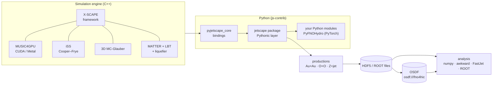

# js-contrib

**GPU-accelerated X-SCAPE heavy-ion simulations, driven from Python, with the data out in the open.**

js-contrib is the contrib package of the [JETSCAPE](https://github.com/JETSCAPE/JETSCAPE) / [X-SCAPE](https://github.com/JETSCAPE/X-SCAPE) event generator, much like [fastjet-contrib](https://fastjet.hepforge.org/contrib/) is for FastJet. It takes the full multistage simulation (3+1D viscous hydrodynamics, MATTER + LBT jets with the medium response, Cooper–Frye particlization and hadronization) and makes it fast enough, scriptable enough and portable enough to produce large event samples. Those samples are used for physics analyses and as training data for machine-learned surrogates.

*A Pb+Pb Z+jet event at 5.02 TeV, 3 fm/c after the collision: the medium without the jet's deposit, with it, and the difference, the jet's wake. The Z (white arrow, its muons in green) recoils against the parton shower. Drawn by `wake_pyvista.py` from the [example on the OSDF](https://jhputschke.github.io/js-contrib/python/visualization/#example-data-a-pbpb-zjet-event-on-the-osdf).*

- **GPU acceleration**

  ______________________________________________________________________

  MUSIC hydro runs on the GPU: CUDA on NVIDIA cards, Metal on Apple Silicon. Several jobs share one GPU, so a single workstation produces thousands of Au+Au events with jets per hour.

  [GPU acceleration](https://jhputschke.github.io/js-contrib/about/gpu/index.md)

- **Python and PyTorch**

  ______________________________________________________________________

  The whole framework is available in Python. You can run events, read results as numpy or awkward arrays, write your own modules in Python, and put a live PyTorch FNO in place of the hydro.

  [Python and ML](https://jhputschke.github.io/js-contrib/about/python-ml/index.md)

- **Runs anywhere**

  ______________________________________________________________________

  Choose a production container (Docker or Apptainer, NVIDIA GPUs), a native Mac wheel (Metal), a lightweight analysis environment, or a full source build in conda.

  [Choose your setup](https://jhputschke.github.io/js-contrib/install/index.md)

- **Open data on the OSDF**

  ______________________________________________________________________

  Productions are shared on the Open Science Data Federation and can be read without an account, either by downloading them or by opening them in place over `osdf://`.

  [Data on the OSDF](https://jhputschke.github.io/js-contrib/run/osdf/index.md)

## From zero to an analysed event

**Linux + NVIDIA GPU (container):**

```bash
docker pull jhputschke/xscape-prod:cu126
mkdir -p work
docker run --rm --gpus all --user "$(id -u):$(id -g)" -v "$PWD/work:/work" -w /work \
  jhputschke/xscape-prod:cu126 bash -c \
  'xscape-examples /work/examples && cd /work/examples/pythonic &&
   python oo_workflow.py --events 1 --outdir /work/out_oo'
```

One O+O event goes through the whole chain, and its hadron files are written to `./work/out_oo/`. Other CUDA versions, Apptainer and Jupyter are covered in [Production container](https://jhputschke.github.io/js-contrib/install/container/index.md).

**Mac, Apple Silicon (wheel):**

```bash
curl -LsSf https://raw.githubusercontent.com/jhputschke/xscape-macos/main/install.sh | sh
source ~/.venvs/xscape-0.2.0/bin/activate              # the line the script printed
xscape-examples ~/xscape/examples
cd ~/xscape/examples/pythonic && python oo_workflow.py --events 1 --outdir ~/xscape/out_oo
```

The script installs uv, the environment of the latest release, and the LBT tables, then runs the self-test. The same event then runs on the Mac's GPU in under a minute. See [Mac (xscape wheel)](https://jhputschke.github.io/js-contrib/install/mac/index.md).

The same by hand

```bash
curl -LsSf https://astral.sh/uv/install.sh | sh        # once; then open a new Terminal
VER=0.2.0                                              # latest: github.com/jhputschke/xscape-macos/releases
mkdir -p ~/xscape && cd ~/xscape
curl -LO https://github.com/jhputschke/xscape-macos/releases/download/v$VER/xscape-$VER-cp313.lock.txt
uv venv --managed-python ~/.venvs/xscape-$VER --python 3.13
source ~/.venvs/xscape-$VER/bin/activate
uv pip sync xscape-$VER-cp313.lock.txt
xscape-fetch-data lbt                                  # the LBT tables (240 MB download)
xscape-selftest                                        # checks the environment
xscape-examples ~/xscape/examples
cd ~/xscape/examples/pythonic && python oo_workflow.py --events 1 --outdir ~/xscape/out_oo
```

**Any computer (analysis only):**

```bash
git clone https://github.com/jhputschke/js-contrib.git && cd js-contrib
./utils/analysis_env/setup_analysis_env.sh             # venv in ~/.venvs/js_analysis
source ~/.venvs/js_analysis/bin/activate
python utils/analysis_env/check_env.py /path/to/out    # opens every file of a production
```

This gives you no GPU and no X-SCAPE build, only what you need to read and analyse the files, including files on the OSDF. See [Analysis environment](https://jhputschke.github.io/js-contrib/install/analysis-env/index.md).

From there, the site follows the order you work in:

1. **[Install](https://jhputschke.github.io/js-contrib/install/index.md):** choose one of the four setups.
1. **[Run](https://jhputschke.github.io/js-contrib/run/index.md):** start with [your first event](https://jhputschke.github.io/js-contrib/run/first-event/index.md), then run the productions: [Au+Au with jets](https://jhputschke.github.io/js-contrib/run/auau-jet/index.md), [O+O with initial-state radiation](https://jhputschke.github.io/js-contrib/run/oo-isr/index.md), [Z+jet in Pb+Pb](https://jhputschke.github.io/js-contrib/run/zjet-other/index.md), and [at scale on clusters](https://jhputschke.github.io/js-contrib/run/clusters/index.md).
1. **[Analyse](https://jhputschke.github.io/js-contrib/analysis/index.md):** [hadrons](https://jhputschke.github.io/js-contrib/analysis/hadrons/index.md), [jets with FastJet](https://jhputschke.github.io/js-contrib/analysis/jets/index.md), [hydro and hadrons together](https://jhputschke.github.io/js-contrib/analysis/hydro-hadrons/index.md) (the jet wake), [O+O](https://jhputschke.github.io/js-contrib/analysis/oo/index.md), and [ROOT](https://jhputschke.github.io/js-contrib/analysis/root/index.md). The physics analysis scripts are work in progress and need further vetting: examples of how to use the outputs, not validated results.
1. **[Extend in Python](https://jhputschke.github.io/js-contrib/python/index.md):** the [Pythonic interface](https://jhputschke.github.io/js-contrib/python/pythonic/index.md), [your own modules](https://jhputschke.github.io/js-contrib/python/modules/index.md), and the [live PyTorch FNO hydro](https://jhputschke.github.io/js-contrib/python/fno/index.md).

## What is in the box



The physics behind each box is explained in [The physics](https://jhputschke.github.io/js-contrib/about/physics/index.md). If you use these simulations in a publication, cite the papers listed in [Publications and citing](https://jhputschke.github.io/js-contrib/about/references/index.md).

Status

js-contrib follows the X-SCAPE `contrib` branch and MUSIC4GPU `XSCAPE`. The Mac wheel's current release is **v0.2.0** (the extra hard scatterings, pelicanfs, the tool commands, `xscape-run` for any XML). The production container images are tagged by CUDA version (`cu126`, `cu130`, `cu124`). See [Contribs and repositories](https://jhputschke.github.io/js-contrib/reference/contribs/index.md) for the full list of components.
