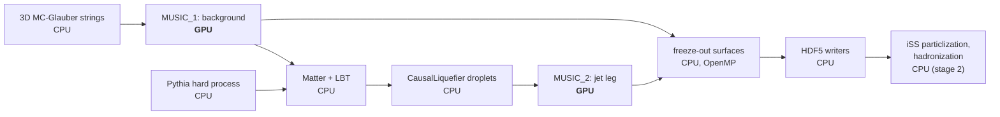

# GPU acceleration

The viscous hydrodynamics is the most expensive part of an X-SCAPE heavy-ion event, and
js-contrib runs it on the GPU with **MUSIC4GPU**, a port of MUSIC to CUDA (NVIDIA) and Metal
(Apple Silicon). This page explains what runs on the GPU and what does not, how closely the GPU
results agree with CPU MUSIC, what throughput to expect on the machines it was measured on, and
the launch settings that give that throughput. Read it before you plan a campaign or pick
hardware. To launch jobs, see [Clusters, GPUs and monitoring](../run/clusters.md).

## What runs on the GPU

MUSIC4GPU is a **direct port of MUSIC 3.1**: the same equations and the same numerical scheme
(KT flux, Newton reconstruction, second-order Israel–Stewart viscous evolution). It adds no
new physics. Two back ends share the same compute kernels and host code, and are chosen when
MUSIC is built:

| back end | hardware | used by |
|---|---|---|
| **CUDA** | NVIDIA GPUs, discrete (V100 … H100, RTX) and Grace-Blackwell (GB10) | the [production container](../install/container.md), source builds on Linux |
| **Metal** | Apple Silicon (M1 or later) | the [Mac wheel](../install/mac.md), source builds on macOS |

When a configuration is supported, the **whole per-cell hydro time step runs on the GPU**:
ideal evolution and reconstruction, shear stress and bulk pressure, velocity gradients,
temperature-dependent η/s and ζ/s, the regulator, and the integration of the hydro source
terms. The X-SCAPE productions (zero net baryon density, 3+1D grid) fall entirely inside it.
Configurations outside it fall back to the CPU path, correct but slower: baryon diffusion,
vorticity terms, a finite-μ<sub>B</sub> EOS or μ<sub>B</sub>-dependent shear.

Everything else in the event runs on the CPU:



- **On the CPU:** the initial state, Pythia, the jet energy loss (Matter, LBT), the liquefier's
  droplets (the source is evaluated on the CPU and integrated on the GPU), the freeze-out
  surface search (Cornelius), the HDF5 output, and the whole second stage: iSS particlization
  and hadronization. Stage 2 needs no GPU at all, so it runs on CPU nodes.
- **One GPU per MUSIC.** MUSIC uses the first GPU it sees, so a machine with several GPUs runs
  one campaign per GPU (each with its own `CUDA_VISIBLE_DEVICES`).
- **The CPU path is still there.** `MUSIC_FORCE_CPU=1` runs the double-precision CPU path of
  the same binary, for validation.

!!! note "The GPU is no longer the bottleneck"
    After the speed-ups, an Au+Au jet event on an RTX 3090 needs about **2 GPU-seconds but
    about 35 host core-seconds** (24 core-seconds for a job alone); the GPU computes for about
    2 s of a 15 s event ([where the time goes](#where-an-events-time-goes)). On a discrete GPU
    the host cores, not the GPU, set the rate.
    That is why the launch settings below are mostly about cores and threads, and why several
    jobs share one GPU.

### Precision choices

- **Single precision on the GPU.** The kernels compute in FP32 (CUDA builds with
  `--use_fast_math`); the CPU path computes in double precision. Apple GPUs have no FP64, so
  Metal stays FP32. An FP64 build option has been assessed but not built.
- **Vacuum cells at rest.** In FP32, dilute vacuum cells could reach large u⁰ and stall an
  evolution. MUSIC4GPU puts vacuum cells (e < 10⁻⁵ fm⁻⁴, u⁰ > 10) at rest and zeroes
  non-finite viscous fields with a warning; `MUSIC_ABORT_ON_NONFINITE=1` stops the run instead.
- **The reconstruction solvers stop at float resolution.** No switch; the change is at the
  level of float rounding.
- **A larger time step late in the evolution** (on by default in the production XMLs):
  Δτ = 0.02 → 0.05 fm/c from τ = 3 fm/c, with the stored frames and freeze-out checks kept every
  0.1 fm/c, so the output format does not change. It roughly halves the MUSIC steps and changes
  the medium at the 10⁻³ level, below the GPU-vs-CPU difference. The wake field differs cell by
  cell by ~5 %, almost all at scales below ~1 fm; at hadron level no change is seen within
  ±2 %. Keep **one setting per campaign**; `--late-dtau 0` gives a constant step.

## How close is the GPU to CPU MUSIC?

**Method.** The same Au+Au 0–10 % jet job (6 jet events on 3 backgrounds, PythiaGun
p̂<sub>T</sub> 50–70 GeV, Matter + LBT + liquefier) was run twice with identical options, once
on the GPU and once with `MUSIC_FORCE_CPU=1`. Only MUSIC's arithmetic differs. The comparison
goes cell by cell through the hydro fields, then the freeze-out surfaces, then hadrons: iSS was
run on both paths' surfaces with the same seeds and correlated sampling, so the hadrons are
identical wherever the surfaces agree and the difference is measured with little noise. It was
done with CUDA on a GB10 and repeated with Metal on an M3 Max.

**Result.** The two paths agree to about 0.2–0.3 %, with identical freeze-out times. The small
remaining difference is systematic, and the same with CUDA and Metal:

| quantity | GPU vs CPU |
|---|---|
| freeze-out times (all 9 MUSIC runs) | identical |
| energy density above freeze-out, energy-weighted \|Δe\|/e | 2×10⁻³ |
| temperature \|ΔT\|/T, velocity \|Δv\| above freeze-out | 3×10⁻⁴, 1.6×10⁻⁴ |
| energy above freeze-out / in the dilute fluid below it | −0.3 % / +0.4 % |
| freeze-out volume | −0.19 % |
| charged hadrons | **−0.20 ± 0.02 %** |
| ⟨p<sub>T</sub>⟩, v₂, v₃, momentum anisotropy | equal within errors |
| jet wake (events with the same showers) | fields 0.1–1 %, integrals ~1 % |

**What it means.**

- **Within one campaign the difference is negligible**: far below model and tuning
  uncertainties.
- **Between paths it is a normalization offset** that does not average out (it has the same
  sign in every event). Keep a campaign, and an FNO training set, on one path; don't mix in
  CPU-fallback jobs; and name the path when you compare with CPU or published MUSIC results.
- **Single events can differ in their jets.** A 3×10⁻⁴ change in the temperature is enough to
  send Matter and LBT down another random sequence, so the same seed may give a different
  shower. Compare the two paths statistically.
- **Limits:** 6 events, one centrality, one p̂<sub>T</sub> window. A large campaign compared with
  the CPU build has not been done.

Full details: [MUSIC_CPU_vs_GPU.md](https://github.com/jhputschke/js-contrib/blob/main/docs/MUSIC_CPU_vs_GPU.md).
The physics of the productions themselves is on [The physics](physics.md).

## Headline numbers

!!! warning "Measured on specific machines"
    These numbers come from a handful of machines and code states, and they change as the
    code does. Each one is given with its hardware and settings. Re-measure on your own
    hardware before you size a campaign.

The productions:

- **Au+Au jets, campaign setting:** `prod_AuAu_0_10_jet` (two stages: MUSIC_1 background,
  then MUSIC_2 with jet deposition) with `--pthat-bins 10-20,20-30,30-40 --jets-per-bin 5
  --parton-ymax 0.6 --write-particlize both`: one background per 15 jet events, pair file and
  particlize file written. An "event" is a jet event.
- **O+O, hadron files only:** `prod_OO_isr --bulk-hadrons 10 --no-particlize --no-hydro-file`
  (bulk hadrons made in the job, nothing else kept).

The rates are events per hour for the whole machine, from the campaign's makespan.

### Throughput per machine

| machine | production | launch | events/h | per event |
|---|---|---|---|---|
| **2 × RTX 3090**, Threadripper 3960X (24 cores), 125 GB; Docker, current image | Au+Au, campaign setting, 15-event jobs | per GPU: 10 jobs, `OMP_NUM_THREADS=3`, MPS, blocking sync, LBT cache, stagger 12 s | **2,160** (1,080 per GPU); ~2,400–2,500 expected with 45-event jobs | ~25 s in a loaded job; 2.1 GPU-s, 35 core-s; 0.243 GB on disk |
| | O+O, hadron files only, ±10.5 fm grid, 60-event jobs | per GPU: 8 jobs, `OMP_NUM_THREADS=3`, MPS, blocking sync | **13,728** (6,860 per GPU) | 4.0 s in a loaded job; 0.34 GPU-s, 6.1 core-s; 0.13 MB on disk |
| **NVIDIA GB10**, 20 cores, 121 GB unified memory; native build | Au+Au, campaign setting, older code¹ | 4 jobs, MPS, `OMP_NUM_THREADS=5`, passive, blocking sync | **381** (~750–800 expected with the current code, not measured) | 34–37 s in a job of 4 |
| | O+O, hadron files only, older code¹ and ±15 fm grid | 8 jobs, MPS, `OMP_NUM_THREADS=2` | **1,620** (~3,500–4,500 expected, not measured) | 17 s in a job of 8; GPU 92 % busy |
| | Pb+Pb 5.02 TeV Z+jet vs Au+Au jets, hadrons only, 2 jobs | `OMP_NUM_THREADS=6`, blocking sync | Pb+Pb **323**, Au+Au 693 in the same setup | Pb+Pb 2.1× the time and memory (14–16 GB per job) |
| **Apple M3 Max**, 16 cores, 64 GB; Metal | Au+Au, older code¹, **not** the campaign setting: a new background every event, p̂<sub>T</sub> 50–70 GeV, no particlize file | 3 jobs, `OMP_NUM_THREADS=5`, passive, LBT cache | **263** (284 from the per-event times) | ~38 s in a job of 3 |
| | O+O | not measured as a campaign | – | – |

¹ These campaigns predate the latest GPU changes (the solver stop and the late
time step) and, on the M3 Max, the host-CPU fixes; both machines are GPU-bound, so these should
help them most. The expected rates are estimates.

**One job alone** (no other job on the machine):

| machine | job | time |
|---|---|---|
| 2 × RTX 3090, current image | Au+Au campaign setting, 15-event job | 11.3 s per event with 48 threads, 15.0 s with 3; a jet event on a reused background 10.7 s ([breakdown](#where-an-events-time-goes)) |
| M3 Max, current code | Au+Au two-stage, 4 events, `--reuse 2 --write-particlize both` | 54.7 s in all; a jet event on a reused background 6.5–7.2 s |
| | O+O, 4 events | 9.2 s |
| | one O+O event through the whole chain (to hadrons) with the Mac wheel | 27 s |
| GB10, older code | Au+Au two-stage, 4 events, `--reuse 2 --write-particlize both` | 92.9 s; a jet event on a reused background 12.3–14.6 s |
| | O+O | ~5 s per event |

### GPU vs CPU MUSIC

How much faster a production runs on the GPU than on MUSIC's CPU path (`MUSIC_FORCE_CPU=1`,
same binary, same events) on the **same machine**. These are speed-ups over each machine's own
CPU, not a comparison between GPUs. Two numbers answer different questions:

- **Single event:** one job alone on the machine, GPU against CPU path. This is what a user
  running a few events sees.
- **Whole machine:** each path with as many jobs at once as pays, best events/h against best
  events/h. This is what a campaign sees.

<figure class="sp-figure">
<div class="sp-legend" aria-hidden="true"><span><i class="sp-sw sp-s1"></i>Single event: one job alone, GPU vs CPU path</span><span><i class="sp-sw sp-s2"></i>Whole machine: best events/h, GPU vs CPU path</span><span><i class="sp-sw sp-rng"></i>Range</span></div>
<svg class="sp-chart" viewBox="0 0 720 286" role="img" aria-labelledby="sp-title">
<title id="sp-title">Speed-up of the GPU over MUSIC's CPU path per machine. 2 × RTX 3090: single event 5.4×, whole machine 46× (35× counting startup). GB10: single event 7.2×, whole machine 11–13×. M3 Max: single event 10.8×, whole machine 15–17×.</title>
<line class="sp-axis" x1="128.0" x2="128.0" y1="6" y2="258"/>
<text class="sp-tick" x="128.0" y="278" text-anchor="middle">0×</text>
<line class="sp-grid" x1="224.0" x2="224.0" y1="6" y2="258"/>
<text class="sp-tick" x="224.0" y="278" text-anchor="middle">10×</text>
<line class="sp-grid" x1="320.0" x2="320.0" y1="6" y2="258"/>
<text class="sp-tick" x="320.0" y="278" text-anchor="middle">20×</text>
<line class="sp-grid" x1="416.0" x2="416.0" y1="6" y2="258"/>
<text class="sp-tick" x="416.0" y="278" text-anchor="middle">30×</text>
<line class="sp-grid" x1="512.0" x2="512.0" y1="6" y2="258"/>
<text class="sp-tick" x="512.0" y="278" text-anchor="middle">40×</text>
<line class="sp-grid" x1="608.0" x2="608.0" y1="6" y2="258"/>
<text class="sp-tick" x="608.0" y="278" text-anchor="middle">50×</text>
<text class="sp-lab" x="116" y="46" text-anchor="end">2 × RTX 3090</text>
<text class="sp-sub" x="116" y="64" text-anchor="end">current image</text>
<g class="sp-bar"><title>2 × RTX 3090, single event: 5.4×. One job alone: GPU 11.3 s/event, CPU path 60.9 s/event.</title><rect class="sp-hit" x="128" y="19" width="592" height="26"/><path class="sp-s1" d="M128.0,20H175.8Q179.8,20 179.8,24V40Q179.8,44 175.8,44H128.0Z"/><text class="sp-val" x="187.8" y="37.0">5.4×</text></g>
<g class="sp-bar"><title>2 × RTX 3090, whole machine: 46× (35–46). GPU, 20 jobs: 2,846 events/h (2,160 counting startup and ramp-up). CPU path, 4 jobs: 62 events/h.</title><rect class="sp-hit" x="128" y="45" width="592" height="26"/><path class="sp-s2" d="M128.0,46H565.6Q569.6,46 569.6,50V66Q569.6,70 565.6,70H128.0Z"/><path class="sp-whisk" d="M464.0,52.0V64.0M464.0,58.0H569.6M569.6,52.0V64.0"/><text class="sp-val" x="577.6" y="63.0">46× (35–46)</text></g>
<text class="sp-lab" x="116" y="130" text-anchor="end">GB10</text>
<text class="sp-sub" x="116" y="148" text-anchor="end">older code</text>
<g class="sp-bar"><title>GB10, single event: 7.2×. One job alone: GPU 32 s/event, CPU path 230 s/event (2026-10-08).</title><rect class="sp-hit" x="128" y="103" width="592" height="26"/><path class="sp-s1" d="M128.0,104H193.1Q197.1,104 197.1,108V124Q197.1,128 193.1,128H128.0Z"/><text class="sp-val" x="205.1" y="121.0">7.2×</text></g>
<g class="sp-bar"><title>GB10, whole machine: ~12× (11–13). GPU, 6 jobs with MPS: 205 events/h, 1.74× one job. CPU job-count gain assumed 1.0–1.1×.</title><rect class="sp-hit" x="128" y="129" width="592" height="26"/><path class="sp-s2" d="M128.0,130H239.2Q243.2,130 243.2,134V150Q243.2,154 239.2,154H128.0Z"/><path class="sp-whisk" d="M233.6,136.0V148.0M233.6,142.0H252.8M252.8,136.0V148.0"/><text class="sp-val" x="260.8" y="147.0">~12× (11–13)</text></g>
<text class="sp-lab" x="116" y="214" text-anchor="end">M3 Max</text>
<text class="sp-sub" x="116" y="232" text-anchor="end">older code</text>
<g class="sp-bar"><title>M3 Max, single event: 10.8×. One job alone: GPU 28 s/event, CPU path 302 s/event (2026-10-08).</title><rect class="sp-hit" x="128" y="187" width="592" height="26"/><path class="sp-s1" d="M128.0,188H227.7Q231.7,188 231.7,192V208Q231.7,212 227.7,212H128.0Z"/><text class="sp-val" x="239.7" y="205.0">10.8×</text></g>
<g class="sp-bar"><title>M3 Max, whole machine: ~16× (15–17). GPU, 3 jobs: 284 events/h, 1.69× one job. CPU job-count gain assumed 1.05–1.25×.</title><rect class="sp-hit" x="128" y="213" width="592" height="26"/><path class="sp-s2" d="M128.0,214H277.6Q281.6,214 281.6,218V234Q281.6,238 277.6,238H128.0Z"/><path class="sp-whisk" d="M272.0,220.0V232.0M272.0,226.0H291.2M291.2,220.0V232.0"/><text class="sp-val" x="299.2" y="231.0">~16× (15–17)</text></g>
</svg>
<figcaption>Speed-up of the GPU over MUSIC's CPU path on the same machine. Hover a bar for the measured times and rates; the numbers are in the table below.</figcaption>
</figure>

| | 2 × RTX 3090, Threadripper 3960X (24 cores) | GB10 (20 Arm cores, one integrated GPU) | M3 Max (12 performance + 4 efficiency cores, Metal) |
|---|---|---|---|
| code and setting | current `cu124` image, Au+Au campaign setting (2026-10-23) | code of 2026-10-03 to 10-08 | code of 2026-09 to 10-10 |
| one job alone, CPU path | 60.9 s/event (59 events/h) | 230 s/event | 302 s/event |
| one job alone, GPU | 11.3 s/event (319 events/h) | 32 s/event | 28 s/event |
| **single-event speed-up** | **5.4×** | **7.2×** | **10.8×** (12.8× in a September test) |
| CPU path, machine full | 4 jobs × 12 threads: 62 events/h (1.05× one job) | not measured; 1.0–1.1× assumed | not measured; 1.05–1.25× assumed |
| GPU, machine full | 10 jobs per GPU, MPS: 2,846 events/h (8.9× one job) | 6 jobs, MPS: 205 events/h (1.74× one job) | 3 jobs: 284 events/h (1.69× one job) |
| **whole-machine speed-up** | **~46×** (35× counting job startup and ramp-up) | **~11–13×** | **~15–17×** |

The whole-machine speed-up is the single-event speed-up times what concurrent jobs add on the
GPU, divided by what they add on the CPU path. The two differ this much because:

- **One GPU job leaves the machine mostly idle.** On the 3090 box a job alone keeps the GPU 18 %
  busy and 4.4 of 48 threads. More jobs fill the spare GPU and cores: 20 jobs (10 per GPU) give
  8.9× the rate of one.
- **One CPU-path job already fills the machine.** MUSIC's OpenMP loops keep 42 of 48 threads
  busy, so 4 jobs × 12 threads gain only 5 %.
- **The 3090 box gains most** because it has two GPUs and 24 fast cores, so 20 jobs fit. Its rate
  is now limited by the CPUs (22 of 24 cores busy, GPUs 62 % busy). The GB10 and the M3 Max each
  have one integrated GPU, which is ~85 % busy at 3–6 jobs; more jobs add nothing.

!!! note "The GB10 and M3 Max numbers are older"
    Their CPU/GPU pairs come from the 2026-10-08 comparison (6 events, two per background,
    MUSIC's own grid); their concurrent-job gains from a setting with a new background every
    event and p̂<sub>T</sub> 50–70 GeV. Both predate the GPU-side speed-ups of 2026-10-11/12 (on
    the M3 Max a job alone got 43 % faster), while the CPU path gained only the late time step,
    so their speed-ups today are probably higher. One CPU-path and one GPU job with the current
    code (~15 minutes per machine) would settle them.

- **The CPU path is a fair reference.** It takes the late time step, but MUSIC_2 starts from
  τ<sub>0</sub> instead of restarting from MUSIC_1's state, which is how a CPU production would
  run. Both paths gave the same p̂<sub>T</sub> values and droplet counts.
- **MUSIC alone** gains more than the whole event. Per time step: 9.1× on the 3090 (vs 48
  threads), ~5.2–5.5× on the GB10 (vs 20 threads), 5.0× on the M3 Max (vs 12 threads). One
  O+O event (wall time, indicative): ~3.5×, ~5.5× and ~8×.

### Where an event's time goes

The stages of one Au+Au event at the campaign setting, for **one job alone on the 3090 box**,
same image on both paths (measured 2026-10-23 and 10-25). Stage 1 is the GPU job; stage 2 is iSS
on the saved freeze-out surfaces, run later on CPU cores. Times are per event in a 15-event job,
so the background's hydro counts one fifteenth.

| per event, one job alone | GPU, 3 threads (campaign) | GPU, 48 threads | CPU path, 48 threads |
|---|---|---|---|
| jet-leg hydro (MUSIC_2) | 8.24 s | 5.14 s | 51.52 s |
| &emsp;GPU kernels | 2.07 s (GPU 25 % busy) | 1.80 s (GPU 35 % busy) | – |
| &emsp;CPU work around them | 6.17 s (1.8 cores) | 3.34 s (7.6 threads) | 51.52 s (45.5 threads) |
| background hydro (MUSIC_1 + copy), ⅟₁₅ | 1.00 s | 0.36 s | 3.78 s |
| Pythia + Matter + LBT + liquefier | 0.13 s | 0.14 s | 0.13 s |
| pair file writer | 4.34 s | 4.36 s | 4.18 s |
| particlize file writer | 1.32 s | 1.27 s | 1.27 s |
| **stage 1** | **15.0 s** (hydro 61 %) | **11.3 s** (hydro 49 %) | **60.9 s** (hydro 91 %) |
| stage 2, one core: iSS (400 oversamples) | 6.45 s | 6.45 s | 6.45 s |
| stage 2, one core: jet fragmentation + files | 0.86 s | 0.86 s | 0.86 s |
| **both stages** | **22.3 s** | **18.6 s** | **68.2 s** |

Inside the jet leg's hydro (`MUSIC_PROFILE=1`, 3 threads): the RK steps, where the host waits
for the kernels, take 1.96 s; putting the string and droplet source terms on the grid (CPU,
OpenMP) 2.93 s; the freeze-out surface 2.64 s (Cornelius 1.93 s, on the CPU after a copy from the
GPU); packing and copying the frames 0.35 s; init and other 0.36 s.

- **The GPU computes for about 2 s of a 15 s event.** The rest of the hydro is CPU work around
  the kernels, which runs in parallel: 48 threads cut it from 6.2 to 3.3 s, while the GPU part
  stays at ~2 s.
- **Matter + LBT take 0.13 s per event, under 1 %,** including Pythia and the liquefier, the same
  on both paths.
- **The writers take 5.6 s on one core,** as long as the GPU-path hydro with 48 threads; the pair
  file alone 4.3 s (reading the frames, resampling, HDF5). `--particlize-only` skips it.
- **Counting stage 2 lowers the single-event speed-up from 5.4× to 3.7×** (18.6 s against
  68.2 s), since iSS costs the same on both paths. Stage 2 usually runs on a CPU cluster
  (`slurm_hadronize.sh`), where 4–5 cores keep up with 2,160 events/h; on the 3090 box itself it
  would cost ~17 % of stage 1's rate (~38× instead of 46× over the CPU path, an estimate).

!!! tip "iSS in stage 1?"
    Today the hydro (GPU and CPU parts) is about half of a stage-1 event. iSS at 400 oversamples
    adds ~7.3 s on one core, about as long as the hydro, so moving it into stage 1 drops the
    hydro to 30–40 % of the event if the job still writes its files (22.3 s and 18.6 s per event
    above). It stays near half only without the writers (`--hadrons-only`, ~16.6 s and ~13.0 s)
    or with few oversamples (1–10 oversamples cost mostly a fixed ~2.6 s per surface). But
    `--hadrons-only` writes no pair file, so there is no hydro history for FNO training and no
    surfaces to sample again. On a full 3090 box, already CPU-limited, iSS in stage 1 costs
    ~17 % of the rate either way. These rows add measured stage times; they were not run as
    jobs.

### Other speed-ups that matter

A pair event once took ~184 s on the GB10. Much of the way to today's rates came from the CPU
side, with bit-identical output:

- **MUSIC's host work:** the string source fill skips empty steps and bins strings by
  transverse reach (15.3 → 5.9 s per event); the jet source is prepared once per step and the
  liquefier evaluates only droplets that can deposit (pair event 184 → 60 s).
- **Parallel freeze-out surface:** the surface search runs η-slices in parallel with OpenMP,
  deterministic across thread counts (9.6 → 1.2 s per event).
- **MUSIC_2 restarts from MUSIC_1's state** at the step before the first droplet, instead of
  re-running the early evolution (two-stage job −19 % wall time, on by default).
- **iSS:** the per-surface fixed cost fell from ~16.5 s to ~4 s, and the sampling loop was
  repacked; `hadronize.py` on both legs at 500 oversamples now takes ~10.6 s on one core
  (8.8 s with `--correlated`), against ~58 s before.
- **HDF5 writers and memory:** Blosc-zstd compression and a background stored once for all
  its jet events take the pair file from 400 to 170 MB per event (15 jets per background);
  reading the legs one frame at a time and a slim copy of the hydro history for the jets took a
  job's memory from ~20 GB to ~6–7 GB.
- **Shared LBT tables** (`LBT_TABLE_CACHE`): one read-only copy of LBT's 0.66 GB of tables for
  all jobs on a machine.

The complete list, with what is and is not bit-identical:
[OPTIMIZATION_CHANGES.md](https://github.com/jhputschke/js-contrib/blob/main/docs/OPTIMIZATION_CHANGES.md).

## Recommended launch settings

None of these settings changes the output; they only change how fast a campaign runs. They are
**not built into the scripts**, because the best values depend on the machine's balance of
cores, GPU and memory. These are the measured best values:

| setting | 2 × RTX 3090 (per GPU, Docker) | GB10 | M3 Max (Metal) | SLURM cluster (`slurm_prod_array.sh`) |
|---|---|---|---|---|
| jobs at once (`run_jobs.sh -j`) | Au+Au 10, O+O 8 | Au+Au 4, O+O 8 | Au+Au 3 | `P=10` (default; see the per-GPU table) |
| `OMP_NUM_THREADS` | 3 | Au+Au 5, O+O 2 | 5 | `cpus-per-task / P`, at least 2 (set by the script) |
| `OMP_WAIT_POLICY` | `passive` | `passive` (no measurable effect here) | `passive`, with `KMP_BLOCKTIME=0` | `passive` (set by the script) |
| `MUSIC_CUDA_SYNC` | `block` | `block` | – (CUDA only) | `block` (default) |
| CUDA MPS (`--mps`) | yes, one daemon per container | yes, natively (not in a container) | – (CUDA only) | off (`USE_MPS=0`), never tried on a cluster |
| `LBT_TABLE_CACHE` | yes (Au+Au) | optional (−0.6 GB per job) | yes | yes (Au+Au, default path) |
| `--stagger` | 12 s (Au+Au) | – | no gain | 12 s (Au+Au, default) |

**What each setting does:**

- **Jobs per GPU.** One job alone leaves the GPU idle much of the time, so several jobs share
  it. Size the number by the cores (~2–3 per job) and host memory (plan ~7 GB per Au+Au job,
  5 GB with `--particlize-only`; ~1.5–2 GB per O+O job). If a node gives fewer cores per GPU,
  lower `-j`, not the threads per job.
- **`OMP_NUM_THREADS` ≈ cores / jobs.** By default every job starts one OpenMP thread per
  core, and several jobs then oversubscribe the cores. On the M3 Max, `-j 3` with default
  threads gave only 1.1× one job; with the cores split, 1.6×. **For one job alone, leave it
  unset**: on the GB10, fewer threads made a single job 24 % slower.
- **`OMP_WAIT_POLICY=passive`:** idle OpenMP threads sleep instead of spinning and stealing
  cores from the other jobs.
- **`MUSIC_CUDA_SYNC=block`:** the host thread sleeps while it waits for the GPU instead of
  spinning, ~30 % less CPU per event at the same throughput. The job log says
  `[MUSIC-GPU] host sync: block`.
- **CUDA MPS** lets the kernels of several jobs run side by side instead of taking turns:
  +5–7 % on the 3090s, +12.5 % on the GB10 at 4 jobs. Try without it first; if the GPU is
  under ~60 % busy it won't help. The MPS daemon does not start inside a container on the
  GB10, and two daemons in one container hang the second GPU's jobs: use one container per GPU.
- **`LBT_TABLE_CACHE=FILE`:** all jobs map one read-only copy of LBT's tables: −0.6 GB and
  6–11 s of start-up per Au+Au job (on the M3 Max, start-up 14.5 → 3.0 s). Put the file on
  local disk, one file per LBT-tables version, not in the container's `/dev/shm`. O+O runs no
  LBT.
- **`run_jobs.sh --stagger S`:** the first jobs start S seconds apart so that their memory peaks
  don't coincide (−11 GB at 20 jobs on the 3090 box).
- **`OPENBLAS_NUM_THREADS=1`** is set by the drivers; more threads don't help.

=== "NVIDIA GPU, ~12 cores per GPU"

    One RTX 3090-class GPU, Au+Au campaign setting (one `run_jobs.sh` per GPU):

    ```bash
    mkdir -p /scratch/lbt_cache
    OMP_NUM_THREADS=3 MUSIC_CUDA_SYNC=block LBT_TABLE_CACHE=/scratch/lbt_cache/lbt_tables_v1.bin \
      ./run_jobs.sh -j 10 --mps --stagger 12 60 45 0 out_c --pthat-bins 10-20,20-30,30-40 \
      --jets-per-bin 5 --parton-ymax 0.6 --write-particlize both
    ```

    With Docker on two GPUs, `utils/launch_2gpu.sh` (Au+Au) and `utils/launch_2gpu_oo.sh`
    (O+O) start one container and one MPS daemon per GPU, with the settings above as their
    defaults (Au+Au: 10 jobs and 3 threads per GPU, the LBT cache, `--stagger 12`).

=== "GB10"

    ```bash
    OMP_NUM_THREADS=5 OMP_WAIT_POLICY=passive MUSIC_CUDA_SYNC=block \
      ./run_jobs.sh -j 4 --mps 20 25 0
    ```

    For O+O: `OMP_NUM_THREADS=2` and `-j 8 --mps`.

=== "Mac (Metal)"

    ```bash
    export LBT_TABLE_CACHE=/path/on/local/disk/lbt_tables_v1.bin
    OMP_NUM_THREADS=5 OMP_WAIT_POLICY=passive KMP_BLOCKTIME=0 \
      ./run_jobs.sh -j 3 --campaign test 20 25 0 ~/xscape/prod/out
    ```

    `-j 4` with 4 threads was not better than `-j 3`. `--mps` and `MUSIC_CUDA_SYNC` don't
    apply. Keep the Mac awake for long campaigns (`caffeinate -i ./run_jobs.sh ...`).

!!! tip "Let the wizard write the command"
    [`utils/prodwizard.py`](https://github.com/jhputschke/js-contrib/blob/main/utils/prodwizard.py)
    takes a production preset and a machine (`2x3090`, `gb10`, `m3max`, or a SLURM cluster with
    V100, A40, A100 or L40S) and writes the launch command with these settings, with estimates
    of events/h, duration, disk and memory. It never starts jobs.

!!! warning "Disk can become the limit"
    At 2,160 Au+Au events/h with the pair file, the 3090 box writes ~525 GB/h, more than the
    ~290 GB/h an upload to the OSDF takes. If you don't need the hydro history, use
    `--particlize-only` (0.097 instead of 0.243 GB per event) or a large local disk.

**On another machine,** measure: one job alone first (is the GPU mostly idle?), then a short
sweep of `-j` with and without MPS, with `OMP_NUM_THREADS ≈ cores / jobs`. Use the same seeds
in every run and compare events/h by makespan. If the GPU stays below ~75 % busy while the
cores are full, the machine is host-limited: more cores per GPU pay, more jobs don't. How to
launch and monitor: [Clusters, GPUs and monitoring](../run/clusters.md).

## Cost on HPC

None of the cluster GPUs has been run yet. Scaling the measured 3090 and GB10 numbers by GPU
speed and cores per GPU gives these **estimates** for the Au+Au campaign setting, per GPU:

| GPU | jobs per GPU | cores per GPU | host memory per GPU | expected Au+Au events/h | limit |
|---|---|---|---|---|---|
| V100 (16/32 GB) | 8 | 12–16 | 64 GB | 700–950 | GPU |
| A40 (48 GB) | 10–12 | 16–24 | 90–100 GB | 1,100–1,400 | cores at 16, GPU at 24 |
| A100 (40/80 GB) | 10–12 | 16–24 | 90–100 GB | 1,000–1,500 | GPU or cores |
| L40S (48 GB) | 18–22 | 24–32 | 135–165 GB | 2,000–2,900 | cores |

For NSF ACCESS resources, on well-sized nodes every option gives about **15–25 Au+Au events per
ACCESS credit**: faster GPUs cost proportionally more per hour. An H100 pays off only with at
least ~24 cores per GPU; with 16 it runs at an A100's rate. About **50,000–55,000 credits** of
GPU time make a million Au+Au events. Storage (100–240 TB for those files) is the larger
request. The first choice is NCSA DeltaAI (GH200, 72 Grace cores per H100, about 19–22 events
per credit), the second NCSA Delta A40. Details, including Slurm settings per resource:
[REPORT_CLUSTER_ACCESS.md](https://github.com/jhputschke/js-contrib/blob/main/docs/REPORT_CLUSTER_ACCESS.md).

### Speed-up per GPU against the CPU path

A cluster hands out a GPU together with a share of a node's cores and memory, so the useful
number is events/h per GPU against the CPU path on that same share. The 3090 column is measured;
the NCSA Delta columns are **estimates** (nothing has run on Delta), and Delta's smaller memory
share gives lower rates than the table above.

| per GPU | 2 × RTX 3090 box (measured) | Delta A40 or A100 40 GB, 4-GPU node (estimate) |
|---|---|---|
| share of the node | 12 Zen 2 cores (24 threads), ~62 GB | 16 Milan cores, 62.5 GB (one GPU's charge on a 64-core, 256 GB node) |
| jobs per GPU | 10, `OMP_NUM_THREADS=3` | 8 with the pair file, 10 with `--particlize-only`; OMP 2; memory sets this |
| GPU path, events/h | 1,423 (1,080 by makespan), pair + particlize | 800–1,100 with the pair file, 1,000–1,400 with `--particlize-only`; limited by memory, then cores, so the A100 adds nothing |
| CPU path on the same cores, events/h | 31 (half of the 62 measured on 24 cores) | 47–62 (16 cores × 2.6 events/h per Zen 2 core × 1.15–1.5 for Milan) |
| **speed-up per GPU** | **46×** (35× by makespan) | **13–23×** with the pair file, **16–30×** with `--particlize-only` |
| one GPU replaces | ~550 Zen 2 cores (~420 by makespan) | ~200–470 Milan cores |
| events per ACCESS credit | – | 12–16 (pair), 15–21 (`--particlize-only`) at the A100 rate; about twice that on A40s if they cost half |
| **cost per event against Delta CPU nodes** (3.0–3.9 events per credit) | – | **3–5× cheaper** (pair, A100 rate); up to 8–14× (`--particlize-only`, A40 at half rate) |

- **Delta's per-GPU speed-up is lower than the 3090 box's** (13–30× against 35–46×): its
  62.5 GB share holds only 8–10 jobs, too few to keep the GPU busy, and the CPU path does better
  on 16 newer cores than on 12.
- **The speed-up per credit is the per-GPU speed-up divided by ~4.2,** because Delta charges a
  GPU-hour (66.7 credits, cores included) about 4.2× the 16 core-hours of the same cores. The
  A40 is charged below the A100 rate, but Delta does not publish the factor.
- **Stage 2 changes little:** 7.3 core-s per event, about 0.002 credits on Delta CPU, against
  ~0.05–0.08 credits per event of GPU time.
- **Assumptions:** ~5 GB per job with `--particlize-only` and ~7 GB with the pair file; 25–35 s
  per event in a loaded job; 45-event jobs; a Milan core 1.15–1.5× a Zen 2 core for both paths;
  the A40's GPU time per event 1.0–1.2× the 3090's, the A100's 0.9–1.4×. The CPU path's rate
  per Milan core is not measured; its hydro is bandwidth-heavy and could scale less well.
- **Delta's 8-GPU A100 nodes** (more memory per GPU; check before planning) would lift the
  memory limit: ~1,100–1,700 events/h per GPU, about 18–36× the CPU path.
- **One short benchmark settles it:** one A40 at `-j 8` and `-j 10`, plus one CPU-path job on
  16 cores (REPORT_CLUSTER_ACCESS.md §7).

## Full details

- [MUSIC_CPU_vs_GPU.md](https://github.com/jhputschke/js-contrib/blob/main/docs/MUSIC_CPU_vs_GPU.md):
  GPU vs CPU MUSIC, method and every number; FP32 vs FP64.
- [REPORT_SUMMARY_CLUSTER.md](https://github.com/jhputschke/js-contrib/blob/main/docs/REPORT_SUMMARY_CLUSTER.md):
  throughput summary of all machines and the cluster sizing model.
- [BENCHMARK_2x3090.md](https://github.com/jhputschke/js-contrib/blob/main/docs/BENCHMARK_2x3090.md),
  [BENCHMARK_GB10.md](https://github.com/jhputschke/js-contrib/blob/main/docs/BENCHMARK_GB10.md),
  [BENCHMARK_M3MAX.md](https://github.com/jhputschke/js-contrib/blob/main/docs/BENCHMARK_M3MAX.md),
  [BENCHMARK_PbPb_vs_AuAu.md](https://github.com/jhputschke/js-contrib/blob/main/docs/BENCHMARK_PbPb_vs_AuAu.md):
  the measurements per machine.
- [REPORT_FINAL_OPTIM.md](https://github.com/jhputschke/js-contrib/blob/main/docs/REPORT_FINAL_OPTIM.md):
  the throughput of the current image and the physics check of the late time step.
- MUSIC4GPU: [README](https://github.com/jhputschke/MUSIC4GPU/blob/XSCAPE/README.md),
  [CUDA](https://github.com/jhputschke/MUSIC4GPU/blob/XSCAPE/README_CUDA.md) and
  [Metal](https://github.com/jhputschke/MUSIC4GPU/blob/XSCAPE/README_Metal.md) back ends,
  [the vacuum-cell fix](https://github.com/jhputschke/MUSIC4GPU/blob/XSCAPE/docs/VacReset_BUG.md).

## Next steps

- [Install the production container](../install/container.md) (CUDA) or
  [the Mac wheel](../install/mac.md) (Metal).
- [Launch campaigns on clusters and multi-GPU machines](../run/clusters.md).
- [Why js-contrib](why.md) and [the physics of the productions](physics.md).
