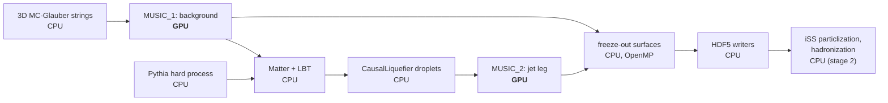

# GPU acceleration

The viscous hydrodynamics is the most expensive part of an X-SCAPE heavy-ion event, and
js-contrib runs it on the GPU with **MUSIC4GPU**, a port of MUSIC to CUDA (NVIDIA) and Metal
(Apple Silicon). This page explains what runs on the GPU and what does not, how closely the GPU
results agree with CPU MUSIC, what throughput to expect on the machines it was measured on, and
the launch settings that give that throughput. Read it before you plan a campaign or pick
hardware. To launch jobs, see [Clusters, GPUs and monitoring](../run/clusters.md).

## What runs on the GPU

MUSIC4GPU is a **direct port of MUSIC 3.1**: the same equations and the same numerical scheme
(KT flux, Newton reconstruction, second-order Israel–Stewart viscous evolution). It adds no
new physics. Two back ends share the same compute kernels and host code, and are chosen when
MUSIC is built:

| back end | hardware | used by |
|---|---|---|
| **CUDA** | NVIDIA GPUs, discrete (V100 … H100, RTX) and Grace-Blackwell (GB10) | the [production container](../install/container.md), source builds on Linux |
| **Metal** | Apple Silicon (M1 or later) | the [Mac wheel](../install/mac.md), source builds on macOS |

When a configuration is supported, the **whole per-cell hydro time step runs on the GPU**:
ideal evolution and reconstruction, shear stress and bulk pressure, velocity gradients,
temperature-dependent η/s and ζ/s, the regulator, and the integration of the hydro source
terms. The X-SCAPE productions (zero net baryon density, 3+1D grid) fall entirely inside it.
Configurations outside it fall back to the CPU path, correct but slower: baryon diffusion,
vorticity terms, a finite-μ<sub>B</sub> EOS or μ<sub>B</sub>-dependent shear.

Everything else in the event runs on the CPU:



- **On the CPU:** the initial state, Pythia, the jet energy loss (Matter, LBT), the liquefier's
  droplets (the source is evaluated on the CPU and integrated on the GPU), the freeze-out
  surface search (Cornelius), the HDF5 output, and the whole second stage: iSS particlization
  and hadronization. Stage 2 needs no GPU at all, so it runs on CPU nodes.
- **One GPU per MUSIC.** MUSIC uses the first GPU it sees, so a machine with several GPUs runs
  one campaign per GPU (each with its own `CUDA_VISIBLE_DEVICES`).
- **The CPU path is still there.** `MUSIC_FORCE_CPU=1` runs the double-precision CPU path of
  the same binary, for validation.

!!! note "The GPU is no longer the bottleneck"
    After the speed-ups, an Au+Au jet event on an RTX 3090 needs about **2 GPU-seconds but
    about 35 host core-seconds**. On a discrete GPU the host cores, not the GPU, set the rate.
    That is why the launch settings below are mostly about cores and threads, and why several
    jobs share one GPU.

### Precision choices

- **Single precision on the GPU.** The kernels compute in FP32 (CUDA builds with
  `--use_fast_math`); the CPU path computes in double precision. Apple GPUs have no FP64, so
  Metal stays FP32. An FP64 build option has been assessed but not built.
- **Vacuum cells at rest.** In FP32, dilute vacuum cells could reach large u⁰ and stall an
  evolution. MUSIC4GPU puts vacuum cells (e < 10⁻⁵ fm⁻⁴, u⁰ > 10) at rest and zeroes
  non-finite viscous fields with a warning; `MUSIC_ABORT_ON_NONFINITE=1` stops the run instead.
- **The reconstruction solvers stop at float resolution.** No switch; the change is at the
  level of float rounding.
- **A larger time step late in the evolution** (on by default in the production XMLs):
  Δτ = 0.02 → 0.05 fm/c from τ = 3 fm/c, with the stored frames and freeze-out checks kept every
  0.1 fm/c, so the output format does not change. It roughly halves the MUSIC steps and changes
  the medium at the 10⁻³ level, below the GPU-vs-CPU difference. The wake field differs cell by
  cell by ~5 %, almost all at scales below ~1 fm; at hadron level no change is seen within
  ±2 %. Keep **one setting per campaign**; `--late-dtau 0` gives a constant step.

## How close is the GPU to CPU MUSIC?

**Method.** The same Au+Au 0–10 % jet job (6 jet events on 3 backgrounds, PythiaGun
p̂<sub>T</sub> 50–70 GeV, Matter + LBT + liquefier) was run twice with identical options, once
on the GPU and once with `MUSIC_FORCE_CPU=1`. Only MUSIC's arithmetic differs. The comparison
goes cell by cell through the hydro fields, then the freeze-out surfaces, then hadrons: iSS was
run on both paths' surfaces with the same seeds and correlated sampling, so the hadrons are
identical wherever the surfaces agree and the difference is measured with little noise. It was
done with CUDA on a GB10 and repeated with Metal on an M3 Max.

**Result.** The two paths agree to about 0.2–0.3 %, with identical freeze-out times. The small
remaining difference is systematic, and the same with CUDA and Metal:

| quantity | GPU vs CPU |
|---|---|
| freeze-out times (all 9 MUSIC runs) | identical |
| energy density above freeze-out, energy-weighted \|Δe\|/e | 2×10⁻³ |
| temperature \|ΔT\|/T, velocity \|Δv\| above freeze-out | 3×10⁻⁴, 1.6×10⁻⁴ |
| energy above freeze-out / in the dilute fluid below it | −0.3 % / +0.4 % |
| freeze-out volume | −0.19 % |
| charged hadrons | **−0.20 ± 0.02 %** |
| ⟨p<sub>T</sub>⟩, v₂, v₃, momentum anisotropy | equal within errors |
| jet wake (events with the same showers) | fields 0.1–1 %, integrals ~1 % |

**What it means.**

- **Within one campaign the difference is negligible**: far below model and tuning
  uncertainties.
- **Between paths it is a normalization offset** that does not average out (it has the same
  sign in every event). Keep a campaign, and an FNO training set, on one path; don't mix in
  CPU-fallback jobs; and name the path when you compare with CPU or published MUSIC results.
- **Single events can differ in their jets.** A 3×10⁻⁴ change in the temperature is enough to
  send Matter and LBT down another random sequence, so the same seed may give a different
  shower. Compare the two paths statistically.
- **Limits:** 6 events, one centrality, one p̂<sub>T</sub> window. A large campaign compared with
  the CPU build has not been done.

Full details: [MUSIC_CPU_vs_GPU.md](https://github.com/jhputschke/js-contrib/blob/main/docs/MUSIC_CPU_vs_GPU.md).
The physics of the productions themselves is on [The physics](physics.md).

## Headline numbers

!!! warning "Measured on specific machines"
    These numbers come from a handful of machines and code states, and they change as the
    code does. Each one is given with its hardware and settings. Re-measure on your own
    hardware before you size a campaign.

The productions:

- **Au+Au jets, campaign setting:** `prod_AuAu_0_10_jet` (two stages: MUSIC_1 background,
  then MUSIC_2 with jet deposition) with `--pthat-bins 10-20,20-30,30-40 --jets-per-bin 5
  --parton-ymax 0.6 --write-particlize both`: one background per 15 jet events, pair file and
  particlize file written. An "event" is a jet event.
- **O+O, hadron files only:** `prod_OO_isr --bulk-hadrons 10 --no-particlize --no-hydro-file`
  (bulk hadrons made in the job, nothing else kept).

The rates are events per hour for the whole machine, from the campaign's makespan.

### Throughput per machine

| machine | production | launch | events/h | per event |
|---|---|---|---|---|
| **2 × RTX 3090**, Threadripper 3960X (24 cores), 125 GB; Docker, current image | Au+Au, campaign setting, 15-event jobs | per GPU: 10 jobs, `OMP_NUM_THREADS=3`, MPS, blocking sync, LBT cache, stagger 12 s | **2,160** (1,080 per GPU); ~2,400–2,500 expected with 45-event jobs | ~25 s in a loaded job; 2.1 GPU-s, 35 core-s; 0.243 GB on disk |
| | O+O, hadron files only, ±10.5 fm grid, 60-event jobs | per GPU: 8 jobs, `OMP_NUM_THREADS=3`, MPS, blocking sync | **13,728** (6,860 per GPU) | 4.0 s in a loaded job; 0.34 GPU-s, 6.1 core-s; 0.13 MB on disk |
| **NVIDIA GB10**, 20 cores, 121 GB unified memory; native build | Au+Au, campaign setting, older code¹ | 4 jobs, MPS, `OMP_NUM_THREADS=5`, passive, blocking sync | **381** (~750–800 expected with the current code, not measured) | 34–37 s in a job of 4 |
| | O+O, hadron files only, older code¹ and ±15 fm grid | 8 jobs, MPS, `OMP_NUM_THREADS=2` | **1,620** (~3,500–4,500 expected, not measured) | 17 s in a job of 8; GPU 92 % busy |
| | Pb+Pb 5.02 TeV Z+jet vs Au+Au jets, hadrons only, 2 jobs | `OMP_NUM_THREADS=6`, blocking sync | Pb+Pb **323**, Au+Au 693 in the same setup | Pb+Pb 2.1× the time and memory (14–16 GB per job) |
| **Apple M3 Max**, 16 cores, 64 GB; Metal | Au+Au, older code¹, **not** the campaign setting: a new background every event, p̂<sub>T</sub> 50–70 GeV, no particlize file | 3 jobs, `OMP_NUM_THREADS=5`, passive, LBT cache | **263** (284 from the per-event times) | ~38 s in a job of 3 |
| | O+O | not measured as a campaign | – | – |

¹ These campaigns predate the latest GPU changes (the solver stop and the late
time step) and, on the M3 Max, the host-CPU fixes; both machines are GPU-bound, so these should
help them most. The expected rates are estimates.

**One job alone** (no other job on the machine):

| machine | job | time |
|---|---|---|
| 2 × RTX 3090 | Au+Au jet event | ~8–15 s |
| M3 Max, current code | Au+Au two-stage, 4 events, `--reuse 2 --write-particlize both` | 54.7 s in all; a jet event on a reused background 6.5–7.2 s |
| | O+O, 4 events | 9.2 s |
| | one O+O event through the whole chain (to hadrons) with the Mac wheel | 27 s |
| GB10, older code | Au+Au two-stage, 4 events, `--reuse 2 --write-particlize both` | 92.9 s; a jet event on a reused background 12.3–14.6 s |
| | O+O | ~5 s per event |

### GPU vs CPU MUSIC

How much faster MUSIC is on the GPU than on the CPU of the same machine. These are speed-ups
over each machine's own CPU, not a comparison between GPUs.

| comparison | GB10 (vs 20 threads) | RTX 3090 (vs 48 threads) | M3 Max |
|---|---|---|---|
| one MUSIC time step | ~5.2–5.5× | 9.1× | 5.0× (vs 12 threads) |
| one O+O event, wall time (indicative) | ~5.5× | ~3.5× | ~8× (vs 16 threads) |
| a whole Au+Au jet job (6 events, `MUSIC_FORCE_CPU=1` for the CPU) | 3.2 vs 23 min (~7×) | – | 2.8 vs 30.2 min (~11×) |

The whole-job numbers include the parts that stay on the CPU in both runs.

### Other speed-ups that matter

A pair event once took ~184 s on the GB10. Much of the way to today's rates came from the CPU
side, with bit-identical output:

- **MUSIC's host work:** the string source fill skips empty steps and bins strings by
  transverse reach (15.3 → 5.9 s per event); the jet source is prepared once per step and the
  liquefier evaluates only droplets that can deposit (pair event 184 → 60 s).
- **Parallel freeze-out surface:** the surface search runs η-slices in parallel with OpenMP,
  deterministic across thread counts (9.6 → 1.2 s per event).
- **MUSIC_2 restarts from MUSIC_1's state** at the step before the first droplet, instead of
  re-running the early evolution (two-stage job −19 % wall time, on by default).
- **iSS:** the per-surface fixed cost fell from ~16.5 s to ~4 s, and the sampling loop was
  repacked; `hadronize.py` on both legs at 500 oversamples now takes ~10.6 s on one core
  (8.8 s with `--correlated`), against ~58 s before.
- **HDF5 writers and memory:** Blosc-zstd compression and a background stored once for all
  its jet events take the pair file from 400 to 170 MB per event (15 jets per background);
  reading the legs one frame at a time and a slim copy of the hydro history for the jets took a
  job's memory from ~20 GB to ~6–7 GB.
- **Shared LBT tables** (`LBT_TABLE_CACHE`): one read-only copy of LBT's 0.66 GB of tables for
  all jobs on a machine.

The complete list, with what is and is not bit-identical:
[OPTIMIZATION_CHANGES.md](https://github.com/jhputschke/js-contrib/blob/main/docs/OPTIMIZATION_CHANGES.md).

## Recommended launch settings

None of these settings changes the output; they only change how fast a campaign runs. They are
**not built into the scripts**, because the best values depend on the machine's balance of
cores, GPU and memory. These are the measured best values:

| setting | 2 × RTX 3090 (per GPU, Docker) | GB10 | M3 Max (Metal) | SLURM cluster (`slurm_prod_array.sh`) |
|---|---|---|---|---|
| jobs at once (`run_jobs.sh -j`) | Au+Au 10, O+O 8 | Au+Au 4, O+O 8 | Au+Au 3 | `P=10` (default; see the per-GPU table) |
| `OMP_NUM_THREADS` | 3 | Au+Au 5, O+O 2 | 5 | `cpus-per-task / P`, at least 2 (set by the script) |
| `OMP_WAIT_POLICY` | `passive` | `passive` (no measurable effect here) | `passive`, with `KMP_BLOCKTIME=0` | `passive` (set by the script) |
| `MUSIC_CUDA_SYNC` | `block` | `block` | – (CUDA only) | `block` (default) |
| CUDA MPS (`--mps`) | yes, one daemon per container | yes, natively (not in a container) | – (CUDA only) | off (`USE_MPS=0`), never tried on a cluster |
| `LBT_TABLE_CACHE` | yes (Au+Au) | optional (−0.6 GB per job) | yes | yes (Au+Au, default path) |
| `--stagger` | 12 s (Au+Au) | – | no gain | 12 s (Au+Au, default) |

**What each setting does:**

- **Jobs per GPU.** One job alone leaves the GPU idle much of the time, so several jobs share
  it. Size the number by the cores (~2–3 per job) and host memory (plan ~7 GB per Au+Au job,
  5 GB with `--particlize-only`; ~1.5–2 GB per O+O job). If a node gives fewer cores per GPU,
  lower `-j`, not the threads per job.
- **`OMP_NUM_THREADS` ≈ cores / jobs.** By default every job starts one OpenMP thread per
  core, and several jobs then oversubscribe the cores. On the M3 Max, `-j 3` with default
  threads gave only 1.1× one job; with the cores split, 1.6×. **For one job alone, leave it
  unset**: on the GB10, fewer threads made a single job 24 % slower.
- **`OMP_WAIT_POLICY=passive`:** idle OpenMP threads sleep instead of spinning and stealing
  cores from the other jobs.
- **`MUSIC_CUDA_SYNC=block`:** the host thread sleeps while it waits for the GPU instead of
  spinning, ~30 % less CPU per event at the same throughput. The job log says
  `[MUSIC-GPU] host sync: block`.
- **CUDA MPS** lets the kernels of several jobs run side by side instead of taking turns:
  +5–7 % on the 3090s, +12.5 % on the GB10 at 4 jobs. Try without it first; if the GPU is
  under ~60 % busy it won't help. The MPS daemon does not start inside a container on the
  GB10, and two daemons in one container hang the second GPU's jobs: use one container per GPU.
- **`LBT_TABLE_CACHE=FILE`:** all jobs map one read-only copy of LBT's tables: −0.6 GB and
  6–11 s of start-up per Au+Au job (on the M3 Max, start-up 14.5 → 3.0 s). Put the file on
  local disk, one file per LBT-tables version, not in the container's `/dev/shm`. O+O runs no
  LBT.
- **`run_jobs.sh --stagger S`:** the first jobs start S seconds apart so that their memory peaks
  don't coincide (−11 GB at 20 jobs on the 3090 box).
- **`OPENBLAS_NUM_THREADS=1`** is set by the drivers; more threads don't help.

=== "NVIDIA GPU, ~12 cores per GPU"

    One RTX 3090-class GPU, Au+Au campaign setting (one `run_jobs.sh` per GPU):

    ```bash
    mkdir -p /scratch/lbt_cache
    OMP_NUM_THREADS=3 MUSIC_CUDA_SYNC=block LBT_TABLE_CACHE=/scratch/lbt_cache/lbt_tables_v1.bin \
      ./run_jobs.sh -j 10 --mps --stagger 12 60 45 0 out_c --pthat-bins 10-20,20-30,30-40 \
      --jets-per-bin 5 --parton-ymax 0.6 --write-particlize both
    ```

    With Docker on two GPUs, `utils/launch_2gpu.sh` (Au+Au) and `utils/launch_2gpu_oo.sh`
    (O+O) start one container and one MPS daemon per GPU, with the settings above as their
    defaults (Au+Au: 10 jobs and 3 threads per GPU, the LBT cache, `--stagger 12`).

=== "GB10"

    ```bash
    OMP_NUM_THREADS=5 OMP_WAIT_POLICY=passive MUSIC_CUDA_SYNC=block \
      ./run_jobs.sh -j 4 --mps 20 25 0
    ```

    For O+O: `OMP_NUM_THREADS=2` and `-j 8 --mps`.

=== "Mac (Metal)"

    ```bash
    export LBT_TABLE_CACHE=/path/on/local/disk/lbt_tables_v1.bin
    OMP_NUM_THREADS=5 OMP_WAIT_POLICY=passive KMP_BLOCKTIME=0 \
      ./run_jobs.sh -j 3 --campaign test 20 25 0 ~/xscape/prod/out
    ```

    `-j 4` with 4 threads was not better than `-j 3`. `--mps` and `MUSIC_CUDA_SYNC` don't
    apply. Keep the Mac awake for long campaigns (`caffeinate -i ./run_jobs.sh ...`).

!!! tip "Let the wizard write the command"
    [`utils/prodwizard.py`](https://github.com/jhputschke/js-contrib/blob/main/utils/prodwizard.py)
    takes a production preset and a machine (`2x3090`, `gb10`, `m3max`, or a SLURM cluster with
    V100, A40, A100 or L40S) and writes the launch command with these settings, with estimates
    of events/h, duration, disk and memory. It never starts jobs.

!!! warning "Disk can become the limit"
    At 2,160 Au+Au events/h with the pair file, the 3090 box writes ~525 GB/h, more than the
    ~290 GB/h an upload to the OSDF takes. If you don't need the hydro history, use
    `--particlize-only` (0.097 instead of 0.243 GB per event) or a large local disk.

**On another machine,** measure: one job alone first (is the GPU mostly idle?), then a short
sweep of `-j` with and without MPS, with `OMP_NUM_THREADS ≈ cores / jobs`. Use the same seeds
in every run and compare events/h by makespan. If the GPU stays below ~75 % busy while the
cores are full, the machine is host-limited: more cores per GPU pay, more jobs don't. How to
launch and monitor: [Clusters, GPUs and monitoring](../run/clusters.md).

## Cost on HPC

None of the cluster GPUs has been run yet. Scaling the measured 3090 and GB10 numbers by GPU
speed and cores per GPU gives these **estimates** for the Au+Au campaign setting, per GPU:

| GPU | jobs per GPU | cores per GPU | host memory per GPU | expected Au+Au events/h | limit |
|---|---|---|---|---|---|
| V100 (16/32 GB) | 8 | 12–16 | 64 GB | 700–950 | GPU |
| A40 (48 GB) | 10–12 | 16–24 | 90–100 GB | 1,100–1,400 | cores at 16, GPU at 24 |
| A100 (40/80 GB) | 10–12 | 16–24 | 90–100 GB | 1,000–1,500 | GPU or cores |
| L40S (48 GB) | 18–22 | 24–32 | 135–165 GB | 2,000–2,900 | cores |

For NSF ACCESS resources, on well-sized nodes every option gives about **15–25 Au+Au events per
ACCESS credit**: faster GPUs cost proportionally more per hour. An H100 pays off only with at
least ~24 cores per GPU; with 16 it runs at an A100's rate. About **50,000–55,000 credits** of
GPU time make a million Au+Au events. Storage (100–240 TB for those files) is the larger
request. The first choice is NCSA DeltaAI (GH200, 72 Grace cores per H100, about 19–22 events
per credit), the second NCSA Delta A40. Details, including Slurm settings per resource:
[REPORT_CLUSTER_ACCESS.md](https://github.com/jhputschke/js-contrib/blob/main/docs/REPORT_CLUSTER_ACCESS.md).

## Full details

- [MUSIC_CPU_vs_GPU.md](https://github.com/jhputschke/js-contrib/blob/main/docs/MUSIC_CPU_vs_GPU.md):
  GPU vs CPU MUSIC, method and every number; FP32 vs FP64.
- [REPORT_SUMMARY_CLUSTER.md](https://github.com/jhputschke/js-contrib/blob/main/docs/REPORT_SUMMARY_CLUSTER.md):
  throughput summary of all machines and the cluster sizing model.
- [BENCHMARK_2x3090.md](https://github.com/jhputschke/js-contrib/blob/main/docs/BENCHMARK_2x3090.md),
  [BENCHMARK_GB10.md](https://github.com/jhputschke/js-contrib/blob/main/docs/BENCHMARK_GB10.md),
  [BENCHMARK_M3MAX.md](https://github.com/jhputschke/js-contrib/blob/main/docs/BENCHMARK_M3MAX.md),
  [BENCHMARK_PbPb_vs_AuAu.md](https://github.com/jhputschke/js-contrib/blob/main/docs/BENCHMARK_PbPb_vs_AuAu.md):
  the measurements per machine.
- [REPORT_FINAL_OPTIM.md](https://github.com/jhputschke/js-contrib/blob/main/docs/REPORT_FINAL_OPTIM.md):
  the throughput of the current image and the physics check of the late time step.
- MUSIC4GPU: [README](https://github.com/jhputschke/MUSIC4GPU/blob/XSCAPE/README.md),
  [CUDA](https://github.com/jhputschke/MUSIC4GPU/blob/XSCAPE/README_CUDA.md) and
  [Metal](https://github.com/jhputschke/MUSIC4GPU/blob/XSCAPE/README_Metal.md) back ends,
  [the vacuum-cell fix](https://github.com/jhputschke/MUSIC4GPU/blob/XSCAPE/docs/VacReset_BUG.md).

## Next steps

- [Install the production container](../install/container.md) (CUDA) or
  [the Mac wheel](../install/mac.md) (Metal).
- [Launch campaigns on clusters and multi-GPU machines](../run/clusters.md).
- [Why js-contrib](why.md) and [the physics of the productions](physics.md).
