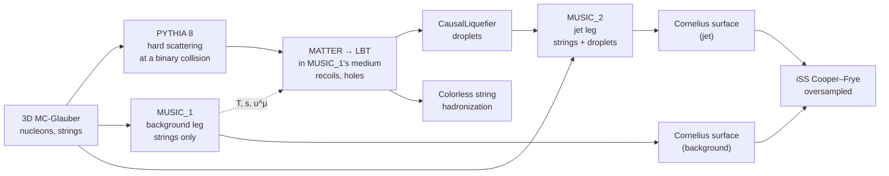

# The physics

This page describes what the js-contrib productions simulate, stage by stage, as their XML
files and drivers configure it. It is meant for a reader who knows heavy-ion physics and wants
to know which models, which parameters and which approximations are behind the files before
analysing them. Every module is an X-SCAPE module or an X-SCAPE external package; js-contrib
chooses the settings, chains the modules, runs them on the GPU and writes the results. The
values below are taken from the production inputs in
[`contribs/PyJetscape/example/config/`](https://github.com/jhputschke/js-contrib/tree/main/contribs/PyJetscape/example/config).
Every job also stores the XML it ran (`prod_user_xml`), so a file always records its own
settings. Publications are linked where each model appears and collected in
[Publications and citing](references.md).

## The setups at a glance

| setup | system | centrality | hard process | hydro | hadrons |
|---|---|---|---|---|---|
| Au+Au with a jet | Au+Au, \(\sqrt{s_{NN}}\) = 200 GeV | 0–10 % (\(b < 4.7\) fm) | PYTHIA 8 dijet, \(\hat p_T\) 50–70 GeV by default | background/jet pair of MUSIC runs | iSS + Colorless, afterwards on CPUs (or in the job) |
| Au+Au hydro only | Au+Au, 200 GeV | 0–10 % | none | one MUSIC run | none (FNO training data) |
| O+O with ISR | O+O, 200 GeV | \(b < 3\) fm (about 0–24 %) | PYTHIA 8 + iMATTER initial-state radiation, \(\hat p_T\) 20–40 GeV by default | one MUSIC run | iColored in the job; iSS in the job or afterwards |
| Pb+Pb with a jet | Pb+Pb, 5.02 TeV | 0–10 % (\(b < 4.95\) fm) | PYTHIA 8 dijet | background/jet pair | iSS + Colorless |
| Pb+Pb Z+jet | Pb+Pb, 5.02 TeV | 0–30 % (\(b < 8.57\) fm) | PYTHIA 8 Z + parton, Z → ee, μμ | background/jet pair | iSS + Colorless |

The Au+Au jet chain, which the other setups vary:



## 1. Initial state: 3D MC-Glauber with strings

The initial state is the dynamical 3D Monte Carlo Glauber model of Shen and Schenke
([arXiv:1710.00881](https://arxiv.org/abs/1710.00881); its rapidity-loss and string
deceleration model: [arXiv:2203.04685](https://arxiv.org/abs/2203.04685)):

- **Nucleons and quarks.** Nucleon positions are sampled for Au and Pb (minimum distance
  0.9 fm). For O+O they are read from O-16 configuration files with \(\alpha\) clustering
  (PGCM). The participants are valence quarks (`useQuarks` 1) whose momentum fractions come
  from parton distributions at \(Q^2 = 1\) GeV\(^2\).
- **Strings.** Every binary collision can produce a QCD string (the number per NN collision
  fluctuates). The string ends decelerate with a parametrized rapidity loss
  (`rapidity_loss_method` 4; `ylossParam4At2…At10` = 1.610, 1.685, 1.685, 2.95, variance
  0.682) and the nucleon remnants lose a fraction 0.536 of the string's rapidity loss. The
  strings form at \(\tau_{\rm form}\) with mean 0.424 fm/c (Au+Au, Pb+Pb) or 0.5 fm/c (O+O).
  No baryon junctions; baryon number is not evolved in the hydro.
- **Centrality is selected on \(b\) only.** Inside X-SCAPE the generator samples \(b\) with
  \(P(b) \propto b\) between `b_min` and `b_max` and requires two or more participants; the
  `cenMin`/`cenMax` tags act only in the standalone 3dMCGlauber program. The `b_max` values
  are geometric: \(\pi b_{\max}^2\) = 10 % of the Au+Au cross section (4.7 fm), and 10 % and
  30 % of 7.7 b for Pb+Pb (4.95 fm, 8.57 fm). For O+O at 200 GeV this model's \(\sigma_{\rm inel}\)
  is 1.55 b, so \(b < 3\) fm is about 0–24 %.
- **Where the hard scattering happens.** The hard process is placed at one of the event's
  binary-collision points, in \(x, y\), at \(z = t = 0\). Each event has exactly one hard
  scattering, while in nature the rate grows with \(N_{\rm coll}\): `n_coll` (or
  `glauber_ncoll`) is recorded per event so the analysis can weight with it.

The initial-state grid is \(|x|, |y| \le 15\) fm with 0.3 fm cells and \(|\eta_s| \le 6\) with
0.2 for Au+Au; \(\pm 20\) fm and \(\pm 8\) for Pb+Pb; \(\pm 10.5\) fm for O+O. MUSIC uses the
same grid.

## 2. From strings to fluid: no separate pre-equilibrium stage

There is no pre-equilibrium model: the task list contains `NullPreDynamics`. Instead MUSIC
starts on an empty grid just before the first string deposits anything, and the strings act
as **dynamical sources** while they decelerate (MUSIC `InitialProfile` 131: all strings start
at \(\tau = 0\), \(\eta_s = 0\)). The strings hand their energy and momentum to the fluid as
they decelerate, each deposit smeared with a Gaussian of width \(\sigma_x\) = 0.207 fm and
\(\sigma_{\eta}\) = 0.458, without an initial flow (`stringPreEqFlowFactor` 0). The hydro equations of the background are

\[
\partial_\mu T^{\mu\nu} = J^\nu_{\rm strings}.
\]

The hydro start time therefore varies per event; it is recorded as `tau0_music`. Jet energy
loss starts interacting with the medium at this time, at each point's own proper time; before
it, partons propagate as in vacuum.

## 3. The hard process: PYTHIA 8

The hard scattering comes from PYTHIA 8 ([arXiv:1410.3012](https://arxiv.org/abs/1410.3012),
[arXiv:2203.11601](https://arxiv.org/abs/2203.11601)) through X-SCAPE's `PythiaGun`:

- **Processes:** `HardQCD:all = on` (dijets) in a \(\hat p_T\) window, 50–70 GeV by default for
  Au+Au and 20–40 GeV for O+O. Pythia's initial-state radiation and multiparton interactions
  stay on; its final-state shower is off (`FSR_on` 0), because MATTER does the final-state
  shower; Pythia's hadronization is off.
- **Hand-over:** the final partons above `softMomentumCutoff` = 2 GeV are handed to the
  energy-loss modules at the binary-collision vertex.
- **Several \(\hat p_T\) windows:** a job can run several windows with one background each
  (`--pthat-bins`); each window's generated cross section and its error are stored, and the
  events carry weights.
- **Parton rapidity cut (optional):** `--parton-ymax` keeps only events whose hardest
  partons pass \(|y| < Y\). Rejected events are regenerated before any shower or hydro, and the
  stored cross sections are corrected by the kept/tried fraction.
- **A pp reference:** `run_prod_vacuum.py` runs the same PythiaGun and MATTER in vacuum, with
  no medium.

For O+O the hard process is `PythiaIsrGun` (section [12](#12-oo-with-initial-state-radiation)),
for Z+jet a Z + parton process (section [13](#13-zjet-in-pbpb)).

## 4. Jet energy loss: MATTER and LBT

The partons are showered in the medium by the JETSCAPE multistage approach
([arXiv:1705.00050](https://arxiv.org/abs/1705.00050),
[arXiv:2204.01163](https://arxiv.org/abs/2204.01163)): MATTER at high virtuality, LBT at
low virtuality.

- **MATTER** ([arXiv:1301.5323](https://arxiv.org/abs/1301.5323),
  [arXiv:1712.10055](https://arxiv.org/abs/1712.10055)) is a virtuality-ordered shower with
  medium-modified splitting. It runs while a parton's virtuality is above \(Q_0\) = 2 GeV.
- **LBT** ([arXiv:1503.03313](https://arxiv.org/abs/1503.03313),
  [arXiv:1803.06785](https://arxiv.org/abs/1803.06785)) is a linear Boltzmann transport of
  on-shell partons with elastic scatterings and medium-induced radiation. It takes over below
  \(Q_0\). The switch between the two is arbitrated by `<mutex>ON</mutex>`; MATTER comes first in
  the XML because it sets the virtuality LBT takes over at.
- **Couplings and \(\hat q\).** Both use \(\alpha_s\) = 0.25; LBT runs its coupling
  (`run_alphas` 1). MATTER's \(\hat q\) has the HTL form with one running and one fixed coupling
  and no virtuality dependence (`QhatParametrizationType` 1):

    \[
    \hat q = C_A\,\frac{42\,\zeta(3)}{\pi}\;\alpha_s^{\rm run}(2ET)\,\alpha_s^{\rm fix}\,T^3
    \ln\frac{2ET}{m_D^2},\qquad m_D^2 = \frac{4\pi\alpha_s^{\rm fix}\,T^2\,(6+N_f)}{6},\; N_f = 3.
    \]

- **Where the medium acts.** Both modules interact only where \(T \ge\) 160 MeV (`hydro_Tc`),
  and only from the hydro start time on. The time step is 0.1 fm/c, up to 20 fm/c (Au+Au,
  Pb+Pb) or 50 fm/c (O+O).
- **Recoils and holes.** MATTER runs with `recoil_on` 1 and LBT always produces them: a
  scattering kicks a medium parton out (the recoil) and leaves a hole, a negative-energy parton
  that carries the momentum missing from the medium. In the jet productions the soft part of
  this medium response goes into the fluid (next section); in O+O the holes close colour lines
  in the hadronization (section [10](#10-jet-hadronization)).
- **Which medium.** In the two-leg productions, MATTER and LBT see the background leg's medium
  (temperature, entropy density and flow velocity per cell).

## 5. Energy–momentum deposition: the CausalLiquefier

The energy the jet loses to the medium is put back into the fluid by X-SCAPE's
`CausalLiquefier` (Tachibana, Shen and Majumder,
[arXiv:2001.08321](https://arxiv.org/abs/2001.08321)).

**Droplets.** After every energy-loss step the liquefier compares the four-momentum that came
in with the four-momentum of the partons that are still tracked. A parton is no longer tracked
when its energy in the local fluid rest frame is below `e_threshold` = 2 GeV, and holes are
never tracked further. The difference \(\Delta p^\mu\) becomes a **droplet** at the step's
space-time point: soft partons enter with a positive sign, holes with a negative one. Heavy
quarks, photons and leptons are never liquefied. Each event's droplets are stored in the pair
file (`source/droplets`: \(\tau, x, y, \eta_s, E, p_x, p_y, p_z\)).

**Causal spreading.** A droplet is not dropped into one cell. Its energy and momentum spread
from its position by relativistic (causal) diffusion,

\[
\partial_t \rho + \nabla\cdot\vec j = 0,\qquad
\tau_{\rm relax}\,\partial_t \vec j + \vec j = -D\,\nabla\rho ,
\]

with \(\tau_{\rm relax}\) = 0.1 fm/c and \(D\) = 0.08 fm, so the signal speed is
\(\sqrt{D/\tau_{\rm relax}} \approx 0.89\,c\). The droplet is deposited in the hydro step that
contains \(\tau_{\rm drop} + \tau_{\rm delay}\), with \(\tau_{\rm delay}\) = 1 fm/c, using the
diffusion kernel \(G\) at that time (smoothed with `width_delta` = 0.1 fm). The jet leg's hydro
equations are then

\[
\partial_\mu T^{\mu\nu} = J^\nu_{\rm strings} + J^\nu_{\rm jet},\qquad
J^\nu_{\rm jet}(x) = \sum_{i\,\in\,\rm droplets} \Delta p_i^\nu\; G(x - x_i).
\]

Each droplet is normalized on MUSIC's grid, so it deposits exactly its four-momentum. The
liquefier's `dtau` must equal MUSIC's time step at the start (0.02 fm/c); when MUSIC
lengthens its step later (section [7](#7-hydrodynamics-music)) it passes the new step to the
liquefier.

## 6. The background/jet hydro pair

The jet productions run MUSIC twice per event, with X-SCAPE's two-stage hydro:

1. **MUSIC_1, the background leg:** the strings only. It provides the medium that MATTER, LBT
   and the liquefier read.
2. **MUSIC_2, the jet leg:** the **same** strings plus the droplets.

Both legs start from the identical initial condition and are bit-identical until the first
droplet deposits (not before \(\tau_{\rm delay}\) = 1 fm/c). The difference of the two
evolutions, jet leg minus background leg, is the jet's effect on the medium, without the
event-by-event fluctuations of the fireball that would remain if one subtracted an average
background. The same holds for the two freeze-out surfaces, and so for the hadrons: the
background's bulk hadrons can be subtracted event by event.

Things to know about the pair:

- **The jet does not feel its own wake.** Energy loss is computed in the background medium;
  the wake changes the fluid but not the jet.
- **Several jets per background.** The background can be reused for several jets
  (`--reuse`, `--pthat-bins`); MUSIC_1 then runs once per background and MUSIC_2 once per jet.
  MUSIC_2 also starts from MUSIC_1's saved state just before the first droplet can deposit
  instead of recomputing the identical early steps; the output is the same.
- **Late droplets are lost.** Droplets due after the jet leg has frozen out never reach the
  fluid; their energy is recorded (`E_droplets_late`).
- **A null test.** With the deposition switched off (`--no-deposit`) the two legs must be
  identical, which the productions check.

In the O+O production there is only one MUSIC run per event, so there the medium response is
part of the bulk and cannot be separated.

## 7. Hydrodynamics: MUSIC

The fluid is evolved by MUSIC, a 3+1D second-order viscous hydrodynamics code
([arXiv:1004.1408](https://arxiv.org/abs/1004.1408),
[arXiv:1009.3244](https://arxiv.org/abs/1009.3244),
[arXiv:1509.06738](https://arxiv.org/abs/1509.06738)), here through its GPU port MUSIC4GPU
(the same equations and numerical scheme; see [GPU acceleration](gpu.md)). The settings are
the tuned 3D-Glauber + MUSIC set of X-SCAPE, tuned at \(\sqrt{s_{NN}}\) = 200 GeV; the Pb+Pb
inputs use it unchanged.

| | setting |
|---|---|
| equation of state | EOS 91: lattice QCD (HotQCD, [arXiv:1407.6387](https://arxiv.org/abs/1407.6387)) matched to a hadron resonance gas with the SMASH hadron list. EOS 9 (the same with the UrQMD list) is available for reruns of older campaigns. |
| shear viscosity | \(\eta/s(T)\), piecewise linear with a kink (below) |
| bulk viscosity | \(\zeta/s(T)\), a skewed Cauchy peak (below) |
| second-order terms | on (`Include_second_order_terms` 1) |
| conserved charges | none (`Include_Rhob` 0, `Include_QS` 0) |
| numerics | Kurganov–Tadmor scheme in single precision (`beastMode` 1); \(\Delta\tau\) = 0.02 fm/c, 0.05 fm/c from \(\tau\) = 3 fm/c on |
| freeze-out | \(T_{\rm fo}\) = 150 MeV (0.243 GeV/fm\(^3\) with EOS 91) |
| stored evolution | every 0.1 fm/c: \(e, v_x, v_y, v_z\), resampled onto the output grid |

The transport coefficients use the functional forms of the JETSCAPE Bayesian analysis
([arXiv:2011.01430](https://arxiv.org/abs/2011.01430)) with these values:

\[
\frac{\eta}{s}(T) = \left(\frac{\eta}{s}\right)_{\rm kink} + a_{\rm low/high}\,(T - T_{\rm kink}),
\qquad T_{\rm kink} = 206~{\rm MeV},\;
\left(\frac{\eta}{s}\right)_{\rm kink} = 0.108,\;
a_{\rm low} = -1.999,\; a_{\rm high} = 1.999~{\rm GeV}^{-1}
\]

(with a floor of \(10^{-3}\)), and

\[
\frac{\zeta}{s}(T) = \frac{(\zeta/s)_{\max}}{1 + \left(\dfrac{T - T_{\rm peak}}
{w\,[1 + \lambda\,{\rm sign}(T - T_{\rm peak})]}\right)^2},
\qquad (\zeta/s)_{\max} = 0.092,\; T_{\rm peak} = 180~{\rm MeV},\; w = 67~{\rm MeV},\;
\lambda = -0.8 .
\]

The larger time step after 3 fm/c keeps the freeze-out checks and the stored frames at
0.1 fm/c. It changes the medium at the \(10^{-3}\) level, so the files of one campaign are made
with one setting, which every job XML records.

**The output grid.** The productions do not store MUSIC's native grid. They resample the
evolution onto a grid set in a YAML file, the one the FNO models are trained on: for Au+Au
64 × 64 × 32 cells at 0.3875 fm × 0.3875 fm × 0.3125 in \(\eta_s\) (\(|x|, |y| \le\) 12.2 fm,
\(|\eta_s| \le\) 4.84), \(\tau\) from 0.5 fm/c in steps of 0.1 fm/c; for O+O 0.3125 fm in
\(x, y\). The freeze-out surface and the hadrons are made from MUSIC's own grid, not from this
resampled copy.

## 8. Freeze-out surface: Cornelius

MUSIC finds the \(T = T_{\rm fo}\) hypersurface with Cornelius
([arXiv:1206.3371](https://arxiv.org/abs/1206.3371)), checking every 0.1 fm/c. Each surface
element carries its position \(x^\mu\), normal \(d\sigma_\mu\), flow \(u^\mu\), \(e\), \(T\),
\(P\) and the viscous fields \(\pi^{\mu\nu}\) and \(\Pi\): exactly what iSS reads. The
productions store these elements losslessly in the particlize file, one surface per jet leg and
one per background, so hadronization can be repeated later with any settings.

## 9. Particlization: Cooper–Frye with iSS

The fluid is converted into hadrons with the Cooper–Frye formula
([Cooper and Frye, Phys. Rev. D 10, 186 (1974)](https://doi.org/10.1103/PhysRevD.10.186)),
sampled by iSS ([arXiv:1409.8164](https://arxiv.org/abs/1409.8164)):

\[
E\,\frac{dN_i}{d^3p} = \frac{g_i}{(2\pi)^3}\int_\Sigma p^\mu\, d\sigma_\mu
\left[f_{\rm eq}\!\left(\frac{u\cdot p}{T}\right) + \delta f_{\rm shear} + \delta f_{\rm bulk}\right].
\]

- **Viscous corrections:** shear and bulk \(\delta f\), Grad's 22-moment form
  (`deltaf_type` 20).
- **Hadron list:** the SMASH list for EOS 91 (the UrQMD list for EOS 9), taken from the job's
  own MUSIC input so that EoS and hadron list always match.
- **Resonance decays:** iSS decays the resonances itself. Channels that are closed at the pole
  masses (215 of them, such as \(\omega \to \pi\rho\), \(\eta' \to \eta\sigma\),
  \(f_2 \to \rho\rho\)) get Breit–Wigner masses for their unstable daughters. \(\eta\) and
  \(\Sigma^0\) stay stable, as in SMASH, so they are among the final hadrons.
- **Oversampling:** one fluid is sampled many times (`--oversample`, 100 by default in the
  offline hadronization). The oversamples are independent Cooper–Frye samplings of one collision, not
  independent collisions, and the analysis tools treat their errors accordingly.
- **Correlated jet/background sampling** (`--correlated`): iSS's random numbers are addressed
  by the surface cell, and the jet leg's samples use their background's seeds. Jet and
  background then give the same hadrons where their surfaces agree, and jet − background is
  about 8 times less noisy at \(|\eta| < 1\), with the same physics in each leg.

## 10. Jet hadronization

**Au+Au, Pb+Pb and Z+jet: Colorless.** The final partons are hadronized by Lund string
fragmentation in PYTHIA 8, without their colour flow (the JETSCAPE choice for MATTER + LBT in
A+A). LBT's recoils are included (`take_recoil` 1); partons the liquefier took into the fluid
are not. A string that cannot be closed gets a beam remnant with 1/6 of
`eCMforHadronization`, which is always set to the collision's \(\sqrt{s_{NN}}\). Hadron decays
are done by Pythia. The productions store the final partons (in double precision), so the jets
are hadronized afterwards on CPUs, as often as wanted (`--n-frag` fragmentations per event).

**O+O: iColored.** With initial-state radiation the jet hadrons are the whole hard nucleon
pair: the dijet showered by MATTER and LBT, the ISR emissions, Pythia's MPI partons and the
pair's beam remnants from 3dMCGlauber. `iColoredHadronization` fragments them along their
colour flow. MATTER's recoils and LBT's partons carry colour tags, and the colour lines that
end in the medium, at the holes, are closed by reconnection (`<colour_closure>reconnect`).
Holes are not hadronized. Because it needs the beam remnants of the live event, this runs in
the production job. The mechanism is described in X-SCAPE's
[`README_ColourFlow.md`](https://github.com/JETSCAPE/X-SCAPE/blob/contrib/README_ColourFlow.md).

## 11. Hadronic afterburner

The productions do **not** run a hadronic afterburner: there is no hadronic rescattering after
particlization. iSS decays the resonances of the SMASH list itself (section
[9](#9-particlization-cooperfrye-with-iss)), so the stored hadrons are final-state hadrons as
far as decays go. The outputs are prepared for SMASH
([arXiv:1606.06642](https://arxiv.org/abs/1606.06642)) to be added later: the hadron list is
SMASH's, and the undecayed ("primary") bulk hadrons with their positions can be kept in their
own files (`--keep-primaries`). Positions of the jet hadrons for a rescattering stage are not
yet available.

## 12. O+O with initial-state radiation

The O+O production uses X-SCAPE's small-system chain
([arXiv:2308.02650](https://arxiv.org/abs/2308.02650),
[arXiv:2407.17443](https://arxiv.org/abs/2407.17443)), built from the `<Hard><ISR>` block of
the XML:

```text
IS: 3dMCGlauber (O-16, positions only)
 -> Hard: PythiaIsrGun at one binary collision      the hard scattering
          -> iMATTER                                 ISR, backward in time
          -> MCGlauberGenString                      strings from what the hard pair left
 -> MUSIC                                            one hydro per event
 -> Eloss: MATTER + LBT in MUSIC's medium            the final-state shower
 -> JetHadronization: iColored                       jet hadrons
 -> SoftParticlization: iSS                          bulk hadrons
```

- **Two-step initial state.** 3dMCGlauber first makes only the nucleon positions and the
  collisions. PythiaIsrGun puts the hard scattering (\(\hat p_T\) 20–40 GeV by default) at a
  binary collision drawn uniformly; Pythia's own ISR is off, its MPI on.
- **ISR with iMATTER.** The initial-state partons are showered backward in time, from
  \(t = 0\) to \(-t_{\max}\) = −50 fm/c, and the final-state shower starts there.
- **Strings from what is left.** The strings are made after the ISR, and the hard partons'
  momentum is taken out of the colliding nucleons (`Subtract_hard_momentum` 1); the hard pair's
  remnants go to the jet hadronization instead of into strings. The energy bookkeeping closes
  exactly, per event:
  \(E_{\rm strings} + E_{\rm ISR,\,sub} + E_{\rm remnant,\,proj} + E_{\rm remnant,\,targ}
  = N_{\rm part}\sqrt{s_{NN}}/2\).
- **Tuned O+O set.** 3dMCGlauber and MUSIC use X-SCAPE's tuned O+O settings at 200 GeV
  (\(\tau_{\rm form}\) = 0.5 fm/c, EOS 91, the viscosities and freeze-out above).
- **One MUSIC run per event,** no background leg and no liquefier: the medium is made from
  what each event's hard scattering left, so a background cannot be reused.
- **Energy loss:** MATTER (with recoils) + LBT with the Au+Au settings; there is no medium,
  and no \(\hat q\), before \(t = 0\).
- **Hard-triggered events.** Every event has exactly one hard scattering; weight with
  \(N_{\rm coll}\) for the geometry of hard events. When the hard collision is the event's only
  one, no string forms and there is no medium (about 5 % of the events at \(b < 5.6\) fm).

What this means for an analysis is in [O+O analysis](../analysis/oo.md).

## 13. Z+jet in Pb+Pb

The Z+jet input (`PbPb_0_30_ZJet.xml`) is the Pb+Pb jet setup at 5.02 TeV, 0–30 %, with a Z
in place of the dijet. It is set up for comparisons with the CMS Z+jet
([arXiv:1702.01060](https://arxiv.org/abs/1702.01060)) and Z–hadron
([arXiv:2103.04377](https://arxiv.org/abs/2103.04377),
[arXiv:2507.09307](https://arxiv.org/abs/2507.09307)) and ATLAS Z-tagged hadron
([arXiv:2008.09811](https://arxiv.org/abs/2008.09811)) measurements.

- **Hard process:** \(q\bar q \to Z g\) and \(qg \to Z q\), a pure Z (no \(\gamma^*\)), decaying
  to \(e^+e^-\) or \(\mu^+\mu^-\); Pythia's ISR and MPI on, FSR off. One parton is required next
  to the Z, and an event is kept only with the Z's lepton pair (`<trigger>Z`).
- **Acceptance in the generator:** both leptons \(p_T > 20\) GeV and \(|\eta| < 2.5\)
  (`--lepton-ptmin`, `--lepton-etamax`); failing events are regenerated before any hydro.
  Further cuts (Z rapidity, mass window, \(p_T^Z\), jet \(\eta\)) are left to the analysis.
- **\(\hat p_T\) windows:** 20–30, 30–35, 35–45, 45–55, 55–70 and 70–200 GeV, with each window's
  cross section stored.
- **The leptons pass through** MATTER, LBT, the liquefier and the hadronization like photons,
  and end up with the jet hadrons.
- **Weights:** every event has one Z while Z production scales with \(N_{\rm coll}\), so the
  events are weighted with their recorded \(N_{\rm coll}\).
- **Everything else** (pair of MUSIC runs, liquefier, iSS, Colorless) is the Pb+Pb jet setup,
  which uses the Au+Au template's physics settings; they are not tuned at the LHC.

## 14. Hadrons from a stored hydro history

The pair files keep only \(e\) and \(\vec v\) on the output grid, without viscous fields: this
is what an FNO learns and predicts. Hadrons can then only come from a surface found in that
history, sampled without \(\delta f\). A dedicated study compares such hadrons with iSS on
MUSIC's own surface for 100 Au+Au events
([hydro_hist_vs_surface](https://github.com/jhputschke/js-contrib/blob/main/contribs/PyJetscape/example/hydro_hist_vs_surface/README.md)):

- The surfaces agree to 2 % in volume.
- \(dN_{\rm ch}/d\eta\) agrees (+0.2 %), but identified yields, \(\langle p_T\rangle\) and
  \(v_n\) are off by 5–30 %, almost entirely from the missing \(\delta f\): bulk \(\delta f\)
  sets the proton yield (−29 % without it) and \(\langle p_T\rangle\), shear \(\delta f\) the
  flow harmonics.
- The jet wake keeps its shape but comes out about 10 % low.

The fast finite-volume solver [FastHydro](../python/fasthydro.md) agrees with MUSIC to about
0.3 % (relative L2 of the energy density at freeze-out) on the same initial condition. It
samples hadrons with ideal Cooper–Frye only.

## Approximations and limits

!!! warning "Keep these in mind when interpreting the output"
    - **No feedback of the wake on the jet:** energy loss runs in the background medium.
    - **No hadronic rescattering:** iSS decays resonances, but nothing like SMASH runs after
      particlization.
    - **No pre-equilibrium dynamics** beyond the decelerating string sources.
    - **One hard scattering per event:** the event samples are hard-triggered; use the
      recorded \(N_{\rm coll}\) and the per-window cross sections as weights.
    - **Centrality from \(b\)**, not from an event-activity class.
    - **Pb+Pb and Z+jet use parameters tuned at 200 GeV.**
    - **Droplets after the jet leg's freeze-out are lost** (recorded per event).
    - **The stored hydro history has no viscous fields** and is resampled onto a coarser grid
      (section [14](#14-hadrons-from-a-stored-hydro-history)).

## Next steps

- Full details: the production READMEs for
  [Au+Au with a jet](https://github.com/jhputschke/js-contrib/blob/main/contribs/PyJetscape/example/prod_AuAu_0_10_jet/README.md)
  and [O+O with ISR](https://github.com/jhputschke/js-contrib/blob/main/contribs/PyJetscape/example/prod_OO_isr/README.md),
  and the [Z+jet campaigns](https://github.com/jhputschke/js-contrib/blob/main/utils/zjet/README.md).
- Run them: [Au+Au jets](../run/auau-jet.md), [O+O with ISR](../run/oo-isr.md),
  [Z+jet and other systems](../run/zjet-other.md).
- What the files contain: [What a production writes](../analysis/files.md).
- Cite the modules you use: [Publications and citing](references.md).
