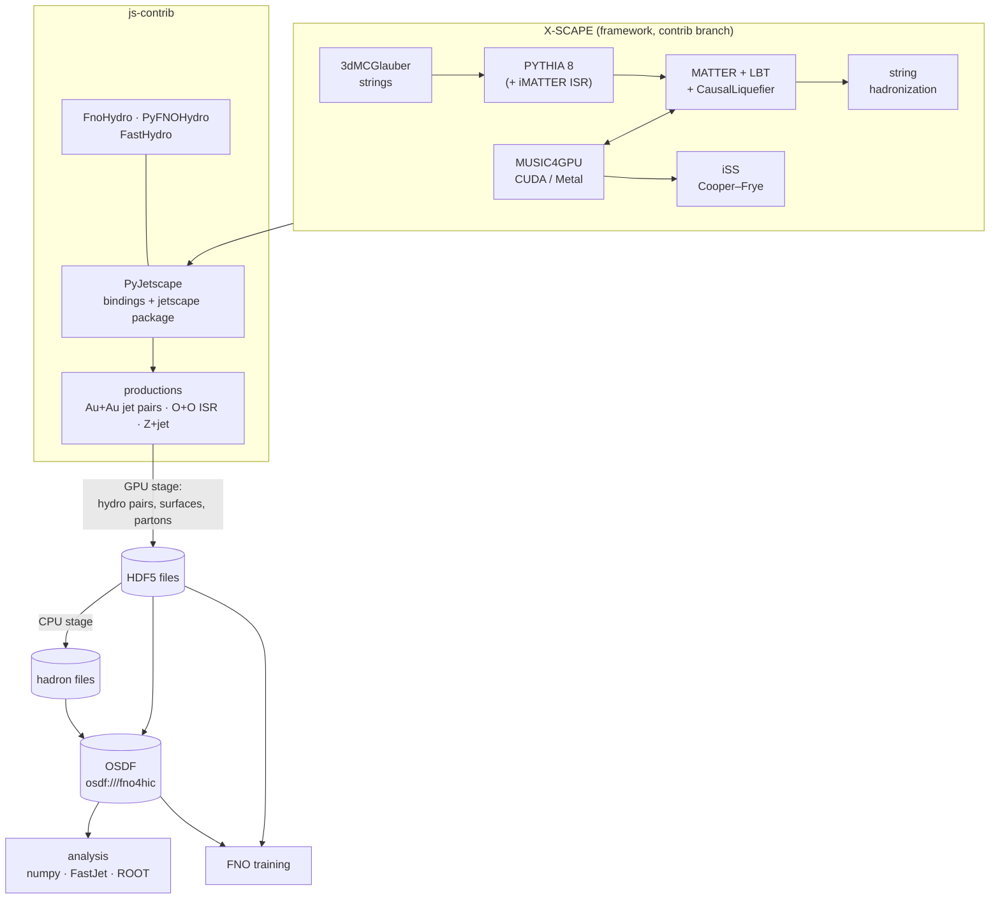

# Why js-contrib

X-SCAPE can simulate a heavy-ion collision from the initial state to the final hadrons, with
jets that lose energy in a 3+1D viscous fluid and feed that energy back into it. A few such
events are easy to make. Hundreds of thousands are not: MUSIC on a CPU takes minutes per event,
the event record is written in formats meant for small samples, and the framework is driven
from C++ and XML only. js-contrib closes that gap. It makes large, GPU-accelerated
productions of the full chain possible, writes them in a form that both physics analyses and
machine learning can use, gives access to all of it from Python, and shares the results openly.
Read this page to see what the package adds and how it relates to the framework; the physics
itself is on [The physics](physics.md).

## What it adds

### 1. Large-statistics productions with full 3+1D hydro

MUSIC, the 3+1D second-order viscous hydro of X-SCAPE, runs on the GPU through
**MUSIC4GPU**: CUDA on NVIDIA cards and Metal on Apple Silicon. It is a direct port of MUSIC's
CPU algorithms (no new physics) and is checked against the CPU build down to the final
hadrons. Several production jobs share one GPU, so a single workstation produces large
samples, and the same container runs on HPC clusters. Details and throughput per machine:
[GPU acceleration](gpu.md).

The productions are split into **two stages**:

1. **On the GPU:** initial state, hard process, jet energy loss and hydro. Each job writes the
   hydro evolution and/or the *input* to hadronization (the freeze-out surfaces and the final
   partons) straight to HDF5.
2. **On CPUs, later:** Cooper–Frye sampling and jet hadronization from those stored inputs,
   with as many oversamples as the analysis needs.

The split keeps the expensive GPU part from being repeated when the hadronization settings
change, and lets cheap CPU nodes do the sampling. A one-job mode (`--hadrons-only`) does both
stages at once when little oversampling is needed. How to run them: [Run](../run/index.md).

### 2. Jets and their wake: paired background/jet hydro

The medium's response to a jet (the wake) is a small perturbation on top of a fireball that
fluctuates strongly from event to event. Subtracting a separate, average background leaves
these fluctuations in. js-contrib's jet productions therefore evolve every event **twice, on
the same initial condition**: once without the jet (the background leg) and once with the
energy and momentum the jet deposits (the jet leg). Before the first deposit the two legs are
bit-identical. The difference, jet leg minus background leg, is the jet's effect on the medium
and nothing else, event by event.

The same idea carries over to the hadrons. Both legs' freeze-out surfaces are sampled with
correlated random numbers, so that jet and background give the same hadrons where their
surfaces agree. For Au+Au this makes jet − background about 8 times less noisy at
\(|\eta| < 1\) at the same number of oversamples. The physics of the pair is explained in
[The physics](physics.md#6-the-backgroundjet-hydro-pair).

### 3. Training data for machine-learned surrogates

Hydro is the most expensive part of the chain, and it is smooth enough to be learned. A
Fourier neural operator (FNO) trained on MUSIC evolutions predicts the hydrodynamic evolution
orders of magnitude faster
([Stewart and Putschke, Phys. Rev. C 113, 014904 (2026)](https://arxiv.org/abs/2507.23598)).
js-contrib provides both sides of this:

- **Training data.** The productions resample MUSIC's evolution (energy density and flow
  velocity, every 0.1 fm/c) onto a fixed output grid chosen in a YAML file, and store
  background/jet pairs, so a 3+1D surrogate can learn both the medium and the jet's wake.
  [FastHydro](../python/fasthydro.md), a fast 3+1D finite-volume solver running the same
  jet-deposition chain, produces such pairs cheaply.
- **Using a trained model in the chain.** `FnoHydro` replaces MUSIC with an FNO in C++
  (through LibTorch), and `PyFNOHydro` runs a PyTorch model live from Python. See
  [Python and machine learning](python-ml.md) and [Live PyTorch FNO hydro](../python/fno.md).

### 4. Python access to the whole framework

PyJetscape exposes the X-SCAPE framework to Python (`pyjetscape_core`, built with pybind11),
and the `jetscape` package adds a "Pythonic" layer on top. With it you can build and run the
task list from Python, read the hydro, surfaces, partons and hadrons as numpy arrays, and write
your own modules in Python (a hard process, energy loss, hadronization, an afterburner, a
writer) without recompiling anything. The production drivers themselves are Python scripts
built on it. See [Python](../python/index.md).

### 5. Portable ways to run

| setup | for | runs on |
|---|---|---|
| Production container `jhputschke/xscape-prod` | productions, your own scripts and Python modules, analysis | Linux with an NVIDIA GPU (Docker), HPC clusters (Apptainer) |
| xscape wheel ([jhputschke/xscape-macos](https://github.com/jhputschke/xscape-macos)) | the same, natively with the Mac's GPU | Apple Silicon Macs, macOS 26 or later |
| Analysis environment (a Python venv) | reading and analysing production files | any computer with Python 3.10 or later; no GPU, no X-SCAPE build |
| Source build (conda) | changing the C++ code, the bindings or the Python package | Mac (Metal), Linux |

The container and the wheel come precompiled. Which one to choose:
[Install](../install/index.md).

### 6. Open data on the OSDF

Productions are shared on the Open Science Data Federation (OSDF) in the Pelican namespace
`osdf:///fno4hic`. Reading it is public: no account, login or token is needed. Files can be
downloaded with a provided tool or read in place over `osdf://`. Sharing the outputs means a
campaign made once on GPUs serves many analyses and model trainings, and nobody needs a GPU
just to analyse it. See [Data on the OSDF](../run/osdf.md).

## How it relates to JETSCAPE, X-SCAPE and C-SCAPE

- **JETSCAPE** is the modular, task-based framework for simulating all stages of a heavy-ion
  collision ([The JETSCAPE framework](https://arxiv.org/abs/1903.07706)).
- **X-SCAPE** extends it, among other things, to small systems: the 3D MC-Glauber initial
  state with strings, initial-state radiation with iMATTER, and exact four-momentum
  conservation between the hard and soft sectors
  ([arXiv:2308.02650](https://arxiv.org/abs/2308.02650),
  [arXiv:2407.17443](https://arxiv.org/abs/2407.17443)). js-contrib follows X-SCAPE's
  `contrib` branch.
- **C-SCAPE** is in development; js-contrib is meant to serve it too.

js-contrib is to X-SCAPE what fastjet-contrib is to FastJet: contributions that live in their
own repository, outside the framework's core, and plug into it. X-SCAPE fetches js-contrib into
`external_packages/js-contrib` with `external_packages/get_js_contrib.sh` and builds it with
`-DUSE_JS_CONTRIB=ON` and a flag per contrib. The hydro (MUSIC4GPU), the Cooper–Frye sampler
(iSS) and the initial state (3dMCGlauber) are X-SCAPE external packages, fetched by X-SCAPE's
own `get_*.sh` scripts. The full list of components and repositories is in
[Contribs and repositories](../reference/contribs.md).

## Next steps

- [The physics](physics.md): what exactly the productions simulate.
- [GPU acceleration](gpu.md) and [Python and machine learning](python-ml.md).
- [Install](../install/index.md), then [Run](../run/index.md) and
  [Analyse](../analysis/index.md).
- [Publications and citing](references.md).
