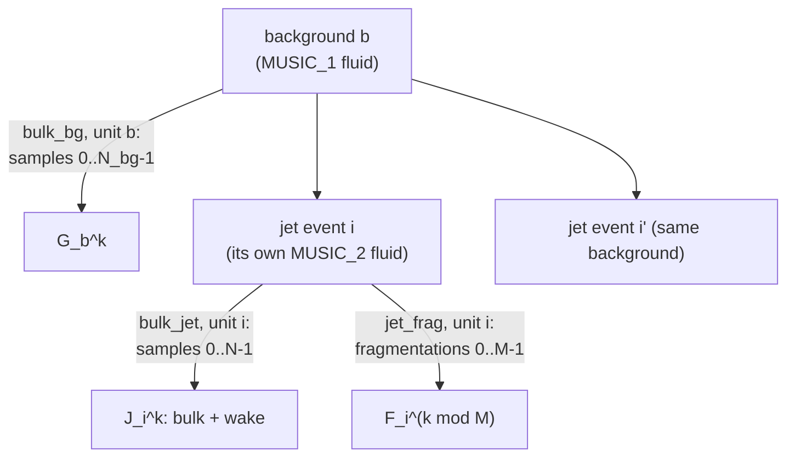

# What a production writes

Every production job writes a small set of files that share one name, the **stem**
(`AuAu_0_10_jet_seed0001`, `OO_isr_c1_0007`, ...). This page describes each kind: what it holds,
how it is laid out, and how big it is. It also says what one "event" means at hadron level,
which settings must match before files are combined, and how to look inside any file. Read it
once before your first analysis; the statistics of oversamples in particular affect every
result.

**Why HDF5, and why one file per job.** The hydro evolution is a large 4D array per event; HDF5
stores it chunked (one chunk per event and τ frame) and compressed, so a single frame reads
without the rest. Every file carries its provenance as attributes: the job's XML, the grid, the
seed and the software build. Jobs are never merged: a campaign is a directory of production
files, and the readers open them side by side as one data set.

## 1. The files at a glance

The Au+Au jet production (two hydro legs per event) writes, per job:

| file | made by | holds | size per event | read with |
|---|---|---|---|---|
| `<stem>.h5`, the **pair file** | the production job | both hydro legs on the output grid: `arr` (jet leg), `arr_bg` (background); the droplets, the showers, diagnostics | ~170 MB with 15 jets per background, 285 MB with one | h5py, FNO4d's loader, `wake_observables.py` |
| `<stem>_particlize.h5` | the job, with `--write-particlize` | both freeze-out surfaces (32 columns per cell), the final partons, the shower initiators, the event table | ~90 MB (15 jets per background) | `ParticlizeFile` |
| `<stem>_hadrons_bulk_jet.h5` | `hadronize.py` | iSS on the jet leg's surface: bulk + wake, N oversamples per event | ~0.2 MB per oversample at full precision | `HadronFileReader` |
| `<stem>_hadrons_bulk_bg.h5` | `hadronize.py` | iSS on the background's surface, once per background | as above | `HadronFileReader` |
| `<stem>_hadrons_jet_frag.h5` | `hadronize.py` | the fragmented surviving partons, M fragmentations per event | small | `HadronFileReader` |
| `<stem>_hadrons.root`, `<campaign>_campaign.root` | `run_h5toROOT.py` | the three hadron tags as RNTuple or TTree, one entry per oversample; event table, cross sections, provenance | 0.9 × the HDF5 hadron files | uproot, RDataFrame, `HadronFileReader.h` |
| `<stem>.json`, `.xml`, `.log` | every job | the job summary (seed, events, droplets, edge hits), the exact job XML, the log | | `json`, an editor |

The sizes are for the Au+Au campaign setting (three pT̂ windows, five jets per window and
background, partons at \(|y| < 0.6\)): pair + particlize file together 0.243 GB per event, 0.097 GB
with `--particlize-only` (no pair file).

Other productions write a subset or a variant:

| production | files |
|---|---|
| Au+Au hydro only (`prod_AuAu_0_10`) | `AuAu_0_10_*.h5` with `arr` only (~140 MB per event) |
| Au+Au **hadrons only** (`run_prod_jet.py --hadrons-only`) | the three hadron files and the undecayed `_primary` bulk files, written in the job; no pair and no particlize file; the event record sits in the jet files' `units/` |
| O+O with ISR (`prod_OO_isr`) | one hydro per event (`OO_isr_*.h5`, ~17 MB), a particlize file (~10 MB), the jet hadrons and optionally the bulk hadrons made in the job; see [O+O](oo.md) |
| Z+jet (Pb+Pb) | hadrons-only jobs, as above, with the Z and its leptons in the event record; see [Z+jet and other systems](../run/zjet-other.md) |

### Which files an analysis needs

| analysis | files |
|---|---|
| hadron spectra, the wake at hadron level, jets | the particlize file and the three hadron files of every production file (hadrons-only jobs: the hadron files); or the ROOT files alone |
| the wake in the fluid, the energy balance, the deposit | the pair files (and the particlize files) |
| FNO training | the pair files, or the hydro-only files |
| more oversamples, other iSS settings | the particlize files, and `hadronize.py` in the [container](../install/container.md) on a CPU node |

The particlize files are self-contained: a hadron analysis never needs the large pair files.
With the OSDF downloader, `--what h5` fetches exactly the particlize and hadron files
([Data on the OSDF](../run/osdf.md)).

## 2. Hydro pair files

**Why pairs.** The jet production runs MUSIC twice on the same initial condition: once without
the jet (the background, MUSIC_1), and once with the energy the jet deposits (the jet leg,
MUSIC_2). Both legs are bit-identical until the first droplet arrives, so `arr − arr_bg` is
the jet's effect on the medium and nothing else: no pairing of separate runs, no event-by-event
fluctuations to subtract. How to use them: [Hydro and hadrons together](hydro-hadrons.md).

| dataset | shape | content |
|---|---|---|
| `arr` | `(nevents, 4, nx, ny, neta, ntau)` float32 | the **jet leg** (MUSIC_2). Channels `energy_density` [GeV/fm³], `vx`, `vy`, `vz` (Cartesian lab velocities) |
| `arr_bg` | as `arr` | the **background** (MUSIC_1) |
| `ntau_freezeout`, `ntau_freezeout_bg` | `(nevents,)` | frames written per leg; every frame from there on is 0 |
| `tau_freezeout`, `tau_freezeout_bg` | `(nevents,)` | when each leg's hydro ended [fm/c] |
| `source/droplets`, `source/offsets` | `(M, 8)`, `(nevents + 1,)` | the droplets MUSIC_2 received: `tau, x, y, eta, E, px, py, pz`; event i is rows `offsets[i]:offsets[i+1]` |
| `shower/` | | the shower graphs (partons, vertices, initiators), read with `jetscape.showers` |
| `diag/` | `(nevents,)` each | `E_droplets`, `n_droplets`, `bg_id`, `frames_identical`, boundary and edge flags, `tau0_music`, `eloss_tstart`, `wall_s`; with pT̂ windows `pthat_bin`, `pthat`, `event_weight` |

- **The grid** is in the attributes: `x_min`, `dx`, `nx` (and `y_*`, `eta_*`), `tau_min`,
  `dtau`. The production default (`grid_fno.yaml`) is 64 × 64 × 32 cells: x, y from −12.2 to
  12.2 fm in steps of 0.3875 fm, η_s from −4.84 to 4.84 in steps of 0.3125, τ = 0.5 + k · 0.1 fm/c.
  MUSIC's own grid is recorded in the `*_MUSIC` attributes.
- **Read frame by frame.** Each chunk is one event and one τ frame (~2 MB): `f["arr"][i, ..., k]`
  is fast, a single cell's whole history reads every chunk.
- **The legs freeze out at different times.** The deposit reheats the jet leg, by 1–2 fm/c in
  0–10 % Au+Au. After the background has frozen out, `arr − arr_bg` is the jet leg's whole
  medium, not a wake: compare only frames below both `ntau_freezeout` values.
- **Shared backgrounds.** When several events share one background (`--reuse`, pT̂ windows),
  `arr_bg` is an HDF5 virtual dataset over `arr_bg_store`, so each background is stored once.
  Read `arr_bg`, never the store. Copy such files whole (`cp`, `rsync`, `h5repack`): copying
  only the `arr_bg` dataset into another file gives a view without its data, which reads as
  zeros.
- **No gridded source.** There is no `source/S`: MUSIC evaluates the liquefier's kernel per
  cell and step, so only the droplets are stored.

## 3. Particlize files

The input to hadronization, stored instead of hadrons so that hadronization can run later, on
CPUs, as often as needed (`jetscape.particlize_h5`):

| group | content |
|---|---|
| `surface/jet/cells` | MUSIC_2's freeze-out surface, `(N, 32)` float32, one unit per event: exactly the fields iSS reads |
| `surface/bg/cells` | MUSIC_1's, one unit per **new** background; `events/bg_unit` says which unit an event used |
| `partons/data` | the final partons the jet hadronization receives, `(K, 14)`: shower, pid, pstat, E, px, py, pz, t, x, y, z, mass, col, acol |
| `initiators/data` | each event's shower-initiating partons, `(J, 11)`: shower, pid, pstat, px, py, pz, E, x, y, z, t |
| `events/` | per event: `bg_id`, `bg_unit`, `bg_key`, `n_cells_jet`, `n_cells_bg`, `n_partons`, droplet energies, MUSIC's τ₀, boundary flags; with windows `pthat_bin`, `pthat` |
| attributes | `music_input` (iSS reads the EoS from it), `T_fo`, `pair_file`, `file_uuid`, the provenance |

- **Surface columns** (`SURFACE_COLUMNS`): `tau, x, y, eta, ds0..ds3, u0..u3, e, T, P, nB, nQ,
  nS, muB, muQ, muS`, the 10 components of π^{μν} and `Pi`. Lossless: the framework's surface
  cells are float.
- **Parton status:** 0 shower, 1 recoil, −1 hole, −11/−13/−17 went into the droplets (never
  hadronized), 22 photon. The jet hadronization takes 0, 1, 22 and −1.
- **A broken leg shows here:** a background with far more or fewer cells than its jet leg did
  not freeze out ([Hadrons, bad runs](hadrons.md#6-bad-runs)).

Reading one event:

```python
from jetscape.particlize_h5 import ParticlizeFile, SURFACE_COLUMNS

with ParticlizeFile("AuAu_0_10_jet_c1_0001_particlize.h5") as pf:
    cells    = pf.surface("jet", 0)          # (N, 32) float32: MUSIC_2's surface, event 0
    cells_bg = pf.surface("bg", 0)           # the background event 0 used (events/bg_unit)
    partons  = pf.partons(0)                 # (K, 14)
    ini      = pf.initiators(0)              # (J, 11)
    n_cells  = pf.events("n_cells_jet")      # a column of the per-event table
    T_fo     = cells[:, SURFACE_COLUMNS.index("T")]
```

Particlize files from before the initiators were added have no `initiators/` group;
`prod_AuAu_0_10_jet/add_initiators.py` copies them in once from the pair files.

## 4. Hadron files

`hadronize.py` (or the job itself, in hadrons-only mode) writes one file per **tag**
(`jetscape.hadrons_h5`, format `xscape/hadrons`):

| tag | from | one unit is |
|---|---|---|
| `bulk_jet` | iSS on the jet leg's surface: bulk + wake | an event |
| `bulk_bg` | iSS on the background's surface: bulk | a background (shared by the events that reused it) |
| `jet_frag` | Colorless hadronization of the surviving partons (O+O: iColored, in the job) | an event |

Each file keeps every sample apart:

| dataset | content |
|---|---|
| `hadrons/pid`, `hadrons/pstat` | int32, one row per hadron |
| `hadrons/p` | float32 `(n, 4)`: E, px, py, pz [GeV] |
| `hadrons/x` | float32 `(n, 4)`: t, x, y, z [fm]; absent with `--no-x` |
| `hadrons/sample_offsets` | where each sample (oversample or fragmentation) starts |
| `hadrons/unit_offsets` | where each unit's samples start |
| `units/` | per unit: `unit`, `event`, `n_samples`, `seed`, `n_cells`; hadrons-only and O+O jobs: the whole event record |
| `initiators/` | `bulk_jet`, `jet_frag`: each event's shower initiators |

**Choices made at hadronization, recorded in the files.** `--keep-bits-p 12 --keep-bits-x 8`
rounds the stored momenta and positions (58 % of the disk; the recommended campaign setting);
`--eta-max X`, `--charged` and `--no-x` store only part of the hadrons. All three tags get the
same selection, so jet − background stays complete inside it. They change only what is
stored: the same seeds give the same hadrons, and `hadronize.py --force` without them recreates
the full files from the particlize file. The attributes `eta_max`, `charged_only`,
`positions` and each dataset's `keep_mantissa_bits` record them;
`HadronFileReader.precision(i)`, `.eta_max()` and `.selection()` read them back. Full option
list: [`prod_AuAu_0_10_jet/README.md`](https://github.com/jhputschke/js-contrib/blob/main/contribs/PyJetscape/example/prod_AuAu_0_10_jet/README.md).

### What an event is



- **A jet event** at hadron level is oversample k of `bulk_jet` plus fragmentation k mod M of
  `jet_frag`. Its background is sample k of `bulk_bg`, unit `events/bg_unit` of that event.
- **Oversamples are not independent collisions.** The N oversamples of an event are
  independent Cooper–Frye samplings of **one** fluid. Average each event over its samples first,
  then over events, and take errors per event. `HadronFileReader` does both.
- **Events that share a background** (`--reuse`, pT̂ windows) are correlated through it.
  Per-window results and jet − background are fine; spectra stitched over windows have
  correlated errors.
- **Correlated sampling** (`hadronize.py --correlated`): sample k of the jet leg and sample k of
  its background share most hadrons, so jet − background is ~8 times less noisy at
  \(|\eta| < 1\). Only the paired error (the spread of the per-sample differences) is then right;
  `jet_minus_background` uses it automatically.
- **An empty surface** (MUSIC stopped at the grid boundary) gives a unit with no samples; the
  readers skip such events.

The ROOT files have the same structure, one entry per oversample: [ROOT and C++](root.md).

## 5. Provenance: the job record

Every job keeps its exact inputs, so a file can always be traced and reproduced:

| where | what |
|---|---|
| `<stem>.json` | the job summary: seed, events written, droplets, edge hits, skipped events, cross sections |
| `<stem>.xml`, attribute `prod_user_xml` | the job's XML, verbatim |
| `prod_grid_yaml` | the output grid |
| `prod_seed`, `prod_reuse`, `prod_hard`, `prod_build`, `prod_host` | seed, background reuse, hard process, software build, machine |
| `pthat_bins`, `pthat_bin_sigma_gen`, `pthat_bin_sigma_err`, `pthat_bin_n_accepted`, `pthat_bin_seeds` | the pT̂ windows and each window's Pythia cross section [mb], written when the job ends |
| `music_input`, `hadronize_xml` | MUSIC's input and the hadronization settings |
| `file_uuid` (particlize), `source_uuid` (hadron files) | the link between a hadron file and the run it came from: `HadronFileReader` refuses a mismatch |

The pair files and the particlize files carry the same `prod_*` attributes.

## 6. Settings to check before combining files

None of these shows in the data arrays. Files that differ in one of them belong in different
data sets:

| setting | why it matters | where it is recorded |
|---|---|---|
| **MUSIC's late time step** (Δτ 0.02 → 0.05 fm/c from τ = 3 fm/c, on by default in current images) | the stored frames stay at 0.1 fm/c, so the files look alike; but the medium differs at the 10⁻³ level, the cell-level wake by ~5 % below ~1 fm. Hadron observables agree within ±2 %. Don't mix late-step and constant-step files in one training set or comparison | `<late_delta_tau>` in the job XML (`prod_user_xml`); absent or 0: constant step |
| the image or build | MUSIC on the GPU and on the CPU differ at 2 × 10⁻³: one image per campaign | `prod_build`, `prod_host`; the campaign's notes |
| the output grid | 64 × 64 × 32 at ±12.2 fm, or the earlier 65 × 65 × 33 at ±10 fm: never in one training set | `prod_grid_yaml`; `nx`, `dx`, ... |
| hadron precision and selection | `--keep-bits-*`, `--eta-max`, `--charged`, `--no-x`: one setting per campaign | `HadronFileReader.precision(i)`, `.eta_max()`, `.selection()`; the reader warns on a mix |
| correlated sampling | the errors of jet − background must be paired | `HadronFileReader.correlated` |
| pT̂ windows, parton rapidity cut, reuse | each window has its own cross section; events sharing a background are correlated | `pthat_bins`, `pthat_bin_sigma_gen`, `parton_ymax`, `prod_reuse`; `events/bg_unit` |
| the liquefier normalisation and the LBT double counting | older pair files gave MUSIC_2 the wrong droplet energy (only a rerun fixes the jet leg) or counted absorbed LBT partons twice (`fix_lbt_double_counting.py` repairs the partons) | pair file: `liquefier_normalize_on_hydro_grid` = 1 for fixed files; `lbt_double_count_fix` on repaired ones |

The settings of every production file of a campaign:

```python
import glob, h5py, hdf5plugin, yaml              # hdf5plugin registers the Blosc filter
import xml.etree.ElementTree as ET

for path in sorted(glob.glob("/path/to/campaign/**/*_particlize.h5", recursive=True)):
    with h5py.File(path, "r") as f:
        A = f.attrs
        late = ET.fromstring(A["prod_user_xml"]).findtext(".//Hydro/MUSIC/late_delta_tau")
        grid = yaml.safe_load(A["prod_grid_yaml"])["grid"]
        print(path.rsplit("/", 1)[-1], "| seed", A["prod_seed"],
              "| late_delta_tau", late.strip() if late else "absent (constant step)",
              "| grid x", grid["x"], "| reuse", A.get("prod_reuse"))
```

The details behind the late time step:
[`docs/REPORT_FINAL_OPTIM.md`](https://github.com/jhputschke/js-contrib/blob/main/docs/REPORT_FINAL_OPTIM.md);
the liquefier normalisation:
[`docs/SOURCE_NORMALIZATION.md`](https://github.com/jhputschke/js-contrib/blob/main/docs/SOURCE_NORMALIZATION.md).

## 7. Looking inside any file: `h5_inspect.py`

[`utils/h5_inspect.py`](https://github.com/jhputschke/js-contrib/blob/main/utils/h5_inspect.py)
prints every group and dataset with its shape, dtype, storage and attributes. For the hydro
files it adds a summary that decodes the conventions: the output and MUSIC grids, the axes,
the per-event freeze-out, the ragged `*offsets` groups with their columns, the `diag/` vectors,
and it flags inconsistencies. It needs only h5py and numpy, and reads nothing from the large
datasets unless asked:

```bash
python utils/h5_inspect.py AuAu_0_10_jet_seed0001.h5                  # tree + summary
python utils/h5_inspect.py AuAu_0_10_jet_seed0001.h5 --no-tree        # summary only
python utils/h5_inspect.py AuAu_0_10_jet_seed0001.h5 --attr prod_user_xml   # one attribute in full
python utils/h5_inspect.py AuAu_0_10_jet_seed0001.h5 --stats --event 0      # min/max/mean, NaN/inf of event 0
python utils/h5_inspect.py AuAu_0_10_jet_seed0001_hadrons_bulk_jet.h5 --json > meta.json
```

For the HDF5 command-line tools (`h5dump`, `h5ls`) on Blosc data, point them at the plugin:
`export HDF5_PLUGIN_PATH=$(python -c "import hdf5plugin; print(hdf5plugin.PLUGIN_PATH)")`.

## Next steps

- Read the hadrons of a campaign: [Hadrons](hadrons.md).
- Read the hydro pair and connect it to the hadrons: [Hydro and hadrons together](hydro-hadrons.md).
- Work in ROOT: [ROOT and C++](root.md).
