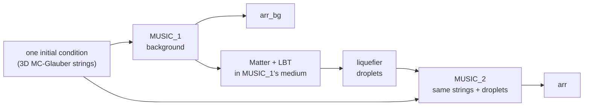

# Hydro and hadrons together

The Au+Au and Pb+Pb jet productions store each event twice in the fluid, with and without the
jet, and both legs again at hadron level. This page shows how to use that: read a hydro pair and
take the difference as the wake, follow the wake through a whole campaign, connect the hadron
files to the pair's events, measure the wake in hadrons, walk through one event from energy
density to hadrons with `jet_wake.ipynb`, and judge how well hadrons made from the stored hydro
history (what an FNO prediction would give) reproduce MUSIC's own. You need the pair files
(`<stem>.h5`) for the fluid side; the hadron side needs only the particlize and hadron files.

## 1. Why a pair, and what the difference is



The jet loses energy in the background's medium (MUSIC_1); the liquefier turns what it loses
into droplets, and a second MUSIC run (MUSIC_2) gets the same initial condition plus those
droplets. Both legs are bit-identical until the first droplet is deposited, so
\(\Delta e = e_\text{jet} - e_\text{bg}\) is the jet's effect on the medium (the wake, with its
excess and its depletion) and nothing else. There are no event-by-event fluctuations to
subtract, and no pairing of separate runs. The physics behind it:
[The physics](../about/physics.md).

Two things to keep in mind:

- **The legs freeze out at different times.** The deposit reheats the jet leg, by 1–2 fm/c in
  0–10 % Au+Au. After the background has frozen out, `arr − arr_bg` is the jet leg's whole
  medium: use only frames below both `ntau_freezeout` values.
- **The jet leg ignores late droplets.** Energy deposited after MUSIC_2 has stopped never
  enters the fluid (`diag/E_droplets_late`).

## 2. Reading a pair

```python
import os
import h5py, hdf5plugin, numpy as np            # hdf5plugin: without it Blosc data won't read

with h5py.File("AuAu_0_10_jet_c1_0001.h5", "r") as f:
    A = f.attrs
    x   = A["x_min"]   + A["dx"]   * np.arange(A["nx"])      # cell centres [fm]
    y   = A["y_min"]   + A["dy"]   * np.arange(A["ny"])
    eta = A["eta_min"] + A["deta"] * np.arange(A["neta"])
    tau = A["tau_min"] + A["dtau"] * np.arange(f["arr"].shape[-1])   # 0.5, 0.6, ... fm/c

    i, k = 0, 40                                   # event 0, frame tau = 4.5 fm/c
    jet = f["arr"][i, :, :, :, :, k]               # (4, nx, ny, neta): e, vx, vy, vz
    bg  = f["arr_bg"][i, :, :, :, :, k]            # the same collision without the jet
    de  = jet[0] - bg[0]                           # the wake in e [GeV/fm^3]
    live = min(f["ntau_freezeout"][i], f["ntau_freezeout_bg"][i])   # frames where both legs live

    o = f["source/offsets"]
    droplets = f["source/droplets"][o[i]:o[i + 1]]   # tau, x, y, eta, E, px, py, pz
    E_dep = droplets[:, 4].sum()                   # = diag/E_droplets[i]

    # e -> T with MUSIC's hotQCD table (columns e, P, s, T); the venv sets MUSIC_EOS_TABLE
    tab = np.fromfile(os.environ["MUSIC_EOS_TABLE"], dtype="<f8").reshape(-1, 4)
    tab = tab[np.argsort(tab[:, 0])]
    T = np.interp(jet[0], tab[:, 0], tab[:, 3])    # GeV; T_fo = 0.15 at e = 0.234
```

- **Read frame by frame.** Each chunk is one event and one τ frame; a frame is ~2 MB.
- **The grid** (cell centres, steps) is in the attributes; the production grid is 64 × 64 × 32,
  ±12.2 fm in x and y, ±4.84 in η_s, every 0.1 fm/c from τ = 0.5 fm/c.
- **The showers** that made the droplets are in `shower/`, read with `jetscape.showers`
  (`fates`, `segments`, `to_milne`).
- **A campaign to one τ length:** `python contribs/PyJetscape/python/jetscape/repad_h5.py FILES`
  grows `arr` and `arr_bg` in place (a metadata resize), for loaders that need equal shapes.
- **FNO training:** FNO4d's `read_3d_data_hdf5(files, h5_key="arr"/"arr_bg", unique_bg=...)`
  reads many pair files lazily; `unique_bg` drops the repeated backgrounds of a reuse campaign.

### FastHydro's `PairBrowser` (optional)

With FastHydro's readers installed (`setup_analysis_env.sh --with-fasthydro`), a pair file opens
in a browser that checks the premise and answers the common questions:

```python
from fasthydro.browse import PairBrowser

with PairBrowser("AuAu_0_10_jet_seed0001.h5") as p:
    print(p.summary(0))      # identical IC?, first differing frame, droplets, deposited E, freeze-out times
    de = p.diff(0, 20)       # arr - arr_bg, energy density, frame 20: (nx, ny, neta)
```

More about FastHydro and its notebooks: [FastHydro](../python/fasthydro.md). 3D views and movies
of a pair file (`wake_pyvista.py`, `hydro_jet_particles_pyvista.py`):
[3D visualization](../python/visualization.md).

## 3. The wake in the fluid, for a whole campaign

[`analysis/wake_observables.py`](https://github.com/jhputschke/js-contrib/blob/main/contribs/PyJetscape/example/analysis/wake_observables.py)
reads each pair file once and writes a small `wake_observables.h5`; the notebook makes the
figures from it alone, so a new figure never needs another pass over the data:

```bash
cd contribs/PyJetscape/example/analysis
python wake_observables.py /path/to/campaign -j 10 -o /path/to/campaign/wake_observables.h5
WAKE_OBS=/path/to/campaign/wake_observables.h5 jupyter lab wake_observables.ipynb
```

| table | content |
|---|---|
| `showers` | per initial parton: kinematics, vertex, heading in or out of the fireball, angle to the background's ψ₂, the energy bookkeeping from the shower graph, and the medium along its path (path length above T_c, ∫T², ∫T³, ...) |
| `droplets` | position, four-momentum, the shower it came from, background T and v at the deposit |
| `events` | pT̂ window and cross section, ψ₂ and ε₂, freeze-out times, energy totals |
| `evolution` | P^μ and S of both legs through every τ surface (ideal-fluid T^{μν} with MUSIC's EoS), and the cumulative droplet four-momentum |
| `jetframe` | the stacked wake about the leading-deposit leg's source, in (Δη, Δφ) |

It takes ~1 min for 300 events at `-j 10`, with ~0.5 GB extra per process for reading ahead. It
also flags legs that never froze out (the hottest cell of a leg's last frame above 1.5 e_fo) and
leaves those events out of the figures.

**How faithful is the stored wake?** The output grid is coarser than MUSIC's (0.3875 fm against
0.3 fm, 0.3125 against 0.2 in η_s). A comparison on 6 events (pT̂ 50–70 GeV) of the same Δe on
MUSIC's grid and on the output grids found: the wake's net energy within ~1 % of MUSIC's; its
shape at scales of 0.5 fm and up within ~10 %; peaks at 0.76 of MUSIC's height; and a ~30 %
point-by-point loss that every resampling has, even one at MUSIC's own spacing shifted by half a
cell. The background is unaffected (0.2 %). Details:
[`docs/Wake_grid_comparison.md`](https://github.com/jhputschke/js-contrib/blob/main/docs/Wake_grid_comparison.md).

## 4. The wake at hadron level

### Matching hadron files to the pair's events

All files of one job share its stem and its event order. Event i of the pair file is event i of
the particlize file, unit i of `bulk_jet` and of `jet_frag`; its background in `bulk_bg` is unit
`events/bg_unit[i]` of the particlize file (backgrounds are stored once, so their numbering is
not the events'). In the pair file `arr_bg[i]` already resolves a shared background.
`HadronFileReader` numbers events over the whole campaign, and its `event_info` leads back to the
job and the local event:

```python
import h5py, hdf5plugin, numpy as np
from jetscape.hadrons_h5 import HadronFileReader
from jetscape.particlize_h5 import ParticlizeFile

with HadronFileReader("/path/to/campaign") as r:
    for g in r.events():
        info = r.event_info(g)                         # the job (stem) and the event in it
        i = info.local_event
        with h5py.File(f"{info.stem}.h5", "r") as f:   # the pair file of the same job
            live = min(f["ntau_freezeout"][i], f["ntau_freezeout_bg"][i])
            E_dep = f["diag/E_droplets"][i]            # energy handed to MUSIC_2 [GeV]
            k = live - 1                               # the last frame where both legs live
            de = f["arr"][i, 0, ..., k] - f["arr_bg"][i, 0, ..., k]
        with ParticlizeFile(f"{info.stem}_particlize.h5") as pf:
            cells = pf.events("n_cells_bg")[i] / pf.events("n_cells_jet")[i]   # ~1, else a bad leg
        # the same event at hadron level: the wake's energy at |eta| < 1
        dE, dE_err = r.jet_minus_background(None, None, mask=lambda ev, inf: np.abs(ev.eta) < 1,
                                            weights="E", events=[g])
        print(f"event {g}: {E_dep:.1f} GeV deposited, wake in hadrons {dE[0]:.1f} +- {dE_err[0]:.1f} GeV")
```

### Jet minus background, in hadrons

At hadron level the wake is \(\langle\)`bulk_jet`\(\rangle - \langle\)`bulk_bg`\(\rangle\): each event's
oversample average of its jet leg minus that of its own background, then averaged over events.
`HadronFileReader.jet_minus_background` does exactly that, with the right error for correlated
sampling ([Hadrons](hadrons.md#2-histograms-totals-and-the-wake)). The jet event is that plus
the fragments (`fragments=True`). Jet-relative observables use the event's shower initiators
(`info.initiators()`) as the jet axis.

For a campaign, [`analysis/wake_hadrons.py`](https://github.com/jhputschke/js-contrib/blob/main/contribs/PyJetscape/example/analysis/wake_hadrons.py)
does the same in one pass and writes `wake_hadrons.h5`, which `wake_hadrons.ipynb` turns into
figures together with `wake_observables.h5`:

```bash
cd contribs/PyJetscape/example/analysis
python wake_hadrons.py /path/to/campaign -j 10 -o /path/to/campaign/wake_hadrons.h5
WAKE_HAD=/path/to/campaign/wake_hadrons.h5 WAKE_OBS=/path/to/campaign/wake_observables.h5 \
  jupyter lab wake_hadrons.ipynb
```

- Per event and relative to the leading initiator: the (Δη, Δφ, pT) map of charged hadrons, ΔR
  profiles, identified spectra at \(|y| < 1\) near and away side, and totals (N, E, pT, ...) per
  \(|\eta|\) band; ~3.5 min for 300 events at `-j 10`.
- **Correlated files** (`--correlated`, or `--common-seeds`): the events of one background are
  not independent, so it also stores the jet leg and the wake as means over `--batches` (default
  10) aligned blocks of samples, and the notebook takes the errors from their spread. On a
  1005-event campaign with 15 events per background this cut the wake's errors 4–8 times.
- **Bad runs** are checked first, from the pair file, the hadron multiplicities and the logs;
  flagged events are not histogrammed unless `--keep-flagged`.
- **Stored hadrons:** with files hadronized at `--eta-max`, every "all η" result is only within
  that cut; the script records and warns about it.

**What it found** on a 285-event 0–10 % Au+Au campaign at pT̂ 10–40 GeV: the wake's hadrons
carry 1.01 ± 0.13 ± 0.18 of the energy MUSIC_2 received; fragments (minus beam remnants) plus
wake give 1.006 of the initial partons' energy. The wake has thermal chemistry and a harder
spectrum than the background (⟨pT⟩ 0.85 against 0.54 GeV), peaks along both jets with no
significant depletion behind them, and brings back 20 % of the leading leg's deposit inside
R = 0.4 and 70 % inside 1.5. Details:
[`analysis/README.md`](https://github.com/jhputschke/js-contrib/blob/main/contribs/PyJetscape/example/analysis/README.md).

!!! note "Beam remnants in the fragments"
    Colorless hadronization closes colour-unpaired strings with remnant quarks of
    \(\sqrt{s}/6\) = 33 GeV along the beam. That energy is not the jet's, and the strings to a
    remnant spread hadrons across all Δη, so no rapidity cut removes them. `wake_hadrons.ipynb`
    takes them out of the energy balance.

## 5. One event, end to end: `jet_wake.ipynb`

[`prod_AuAu_0_10_jet/jet_wake.ipynb`](https://github.com/jhputschke/js-contrib/blob/main/contribs/PyJetscape/example/prod_AuAu_0_10_jet/jet_wake.ipynb)
follows one pair from the energy density to the hadrons. It needs only numpy, h5py, matplotlib
and scipy (and `jetscape` for the hadron section):

| section | shows |
|---|---|
| 1–3 | the data, a check that both legs start identical, the dijet: several showers, several sources, each droplet assigned to a leg |
| 4–5 | Δe in the transverse plane and in (η, φ), re-centred on the jet |
| 6–7 | how big, how much, how wide; whether the front sits where a Mach cone would |
| 8 | freeze-out: the jet extends the medium's lifetime |
| 10 | the same event at hadron level: bulk_jet − bulk_bg in (Δη, Δφ) about the leading leg, the energy at \(|\eta| < 1, 2, 5\) against the deposit |
| 11 | the energy balance: initial partons = surviving partons + deposited energy |

```bash
cd contribs/PyJetscape/example/prod_AuAu_0_10_jet
WAKE_H5=/path/to/AuAu_0_10_jet_seed0001.h5 jupyter lab jet_wake.ipynb
```

`WAKE_H5` names the pair file; the hadron section looks for `<stem>_particlize.h5` and the three
hadron files next to it and prints the commands that make them if they are missing.
`MUSIC_EOS_TABLE` gives the EoS for c_s². The shipped example (seed 1) shows a Mach-cone-like
pattern behind the source, a wake whose hadrons return the deposited energy within errors
(18.1 ± 2.7 GeV at \(|\eta| < 1\), 24.6 ± 5.6 GeV at \(|\eta| < 2\), for 25.0 GeV deposited), and a
medium lifetime extended by 1.1 fm/c. One event shows the shape and the mechanism, not an average.

## 6. Hadrons from the stored hydro history

The pair files keep only e, vx, vy, vz on the output grid, with no viscous fields. That is all a
neural operator (FNO) trained on them would predict. Such a history can only be hadronized
through a freeze-out surface **found in it**, sampled **without viscous corrections**. The study
in [`hydro_hist_vs_surface/`](https://github.com/jhputschke/js-contrib/tree/main/contribs/PyJetscape/example/hydro_hist_vs_surface)
measures how far those hadrons are from the correct ones: iSS on MUSIC's own surface, with
π^{μν} and Π. Same events, same `hadronize.py` settings, same seeds; only the surface changes:

| variant | surface | viscous corrections | isolates |
|---|---|---|---|
| `ref` | MUSIC's | shear + bulk δf | the correct answer |
| `ref_no_shear` | MUSIC's, π^{μν} = 0 | bulk only | shear δf |
| `ref_no_bulk` | MUSIC's, Π = 0 | shear only | bulk δf |
| `ref_ideal` | MUSIC's, π^{μν} = Π = 0 | none | all of δf |
| `hist` | Cornelius on the stored history, T from MUSIC's EoS | none | + the coarse history |

### Running it

It needs an X-SCAPE build with iSS and PyJetscape (as for `hadronize.py`; see
[Source build](../install/source.md)), and a production directory made with
`run_prod_jet.py --write-particlize both` plus its reference hadrons:

```bash
cd contribs/PyJetscape/example/hydro_hist_vs_surface
PYTHON=$(which python) ./run_study.sh /path/to/production       # all variants, resumable
HVS_SUMMARY=/path/to/production/hist_vs_surface/summary.npz jupyter lab hydro_hist_vs_surface.ipynb
```

`run_study.sh [DATA [OUT]]` builds each variant's particlize files (`make_surfaces.py`),
hadronizes them (`run_hadronize.py`) and summarizes everything into one small `summary.npz`
(`analyze.py`). The hadronization settings must be the reference's: pass them as
`HADRONIZE_OPTS` if they differ from the default `--oversample 100 --n-frag 50 --correlated
--keep-bits-p 12 --keep-bits-x 8`. Other knobs: `HADRONIZE_J`, `VARIANTS`. On the GB10 (20
cores) 4 files × 25 events took 2 h 12 min and 51 GB, most of it the surface search in the
history (~31 s per leg). Because the variants keep the reference's seeds and the sampling is
correlated, variant − reference is far less noisy than either.

### What it found

(0–10 % Au+Au, pT̂ 50–70 GeV, 100 events; shifts relative to `ref`, mid-rapidity.)

- **The surfaces agree to 2 %:** 0.981 of MUSIC's freeze-out volume, same position and timing,
  but less of the fastest fluid.
- **For the bulk, the missing viscous corrections dominate,** not the coarse history:

  | observable | all δf off (`ref_ideal`) | history on top | **total (`hist` − `ref`)** |
  |---|---|---|---|
  | dN_ch/dη, \(|\eta|<0.5\) | −0.4 % | +0.5 % | **+0.2 %** |
  | dN/dy p + p̄ | −29.3 % | +1.0 % | **−28.6 %** |
  | ⟨pT⟩ π | +13.5 % | −1.2 % | **+12.1 %** |
  | v₂{2} | +6.5 % | −3.0 % | **+3.3 %** |
  | v₃{2} | +21.4 % | −4.9 % | **+15.4 %** |

  Bulk δf sets the yields and spectral shapes, shear δf the flow harmonics.
- **The jet wake: δf cancels, the history loses about 10 %.** ΔE at \(|\eta| < 1\) is
  24.0 ± 1.2 GeV with `ref` and 21.5 ± 1.1 GeV with `hist`; the deficit is a scale, not a change
  of shape (per-event correlation 0.97, same Δφ shape), and is already in the surfaces.
- **So:** dN/dη and the wake's shape can be taken from a history as it is (the wake's size ~10 %
  low); spectra, identified yields, ⟨pT⟩ and v_n cannot (5–30 % off, almost all of it missing
  δf). A single weight table w(species, pT) corrects yields and ⟨pT⟩ to within 0.3 %, one scale
  fixes the wake and v₂, but v₃ per event needs δf restored at the surface.

The study also lists its limits (the output grid ends at \(|\eta_s|\) = 5, where the medium is
still above T_sw, so forward hadrons are missing) and next steps. Full write-up:
[`hydro_hist_vs_surface/README.md`](https://github.com/jhputschke/js-contrib/blob/main/contribs/PyJetscape/example/hydro_hist_vs_surface/README.md).

## Next steps

- Jets in the same events, and what the wake does to them: [Jets with FastJet](jets.md).
- The live FNO hydro these files train: [Live PyTorch FNO hydro](../python/fno.md).
- Making pair files: [Au+Au jets (two stages)](../run/auau-jet.md).
