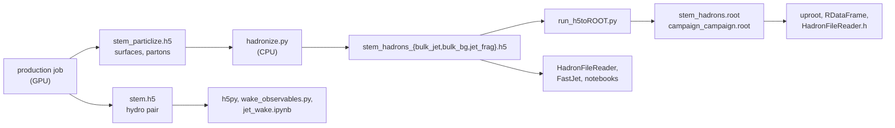

# Analyse

A production leaves behind HDF5 files: the hydro evolution of every event, the freeze-out
surfaces and partons that hadronization starts from, and the hadrons themselves, plus ROOT
copies of the hadrons if you made them. This section shows how to read each kind, how to
combine many production files into one data set with the right statistics, and how to go from
there to spectra, jets, the jet-induced wake and the O+O observables. Start here if you have
production files in hand, your own or downloaded, and want physics out of them.

None of the analysis needs X-SCAPE, a GPU or the production container. Everything on these
pages runs in a plain Python environment; ROOT is needed only for the C++ route.



## 1. Pick an environment

| environment | use it for | set up |
|---|---|---|
| **the analysis venv** (recommended) | every HDF5 file, the ROOT files through uproot, FastJet in Python, the notebooks, `run_h5toROOT.py` | [Analysis environment](../install/analysis-env.md) |
| **the analysis venv + ROOT** (conda) | the above plus PyROOT, RDataFrame, the C++ macros and FastJet in C++ | [Analysis environment](../install/analysis-env.md), and [ROOT and C++](root.md) |
| **the Mac wheel** (Apple Silicon) | the same environment that runs X-SCAPE also analyses; on any other computer `pyjetscape[analysis]` installs the readers alone | [Mac (xscape wheel)](../install/mac.md) |
| **the production container** | re-hadronizing stored surfaces (`hadronize.py`: more oversamples, other iSS settings), which needs X-SCAPE | [Production container](../install/container.md) |

The venv installs PyJetscape's pure-Python readers (`jetscape.hadrons_h5`,
`jetscape.particlize_h5`, ...), h5py with `hdf5plugin` (the files are Blosc-compressed),
uproot, awkward, scikit-hep `fastjet`, matplotlib and Jupyter, and it sets `MUSIC_EOS_TABLE`
for converting energy density to temperature.

!!! warning "Always `import hdf5plugin`"
    The production files are compressed with Blosc-zstd. h5py reads them only after
    `import hdf5plugin`; without it every dataset read fails with
    `OSError: Can't synchronously read data`. The PyJetscape readers import it for you.

## 2. Get the files

- **Your own run:** the job writes everything into its output directory, one set of files per
  job (`<stem>.h5`, `<stem>_particlize.h5`, ...); `hadronize.py` adds the hadron files next to
  them. See [Au+Au jets](../run/auau-jet.md), [O+O with ISR](../run/oo-isr.md) and
  [Z+jet and other systems](../run/zjet-other.md).
- **Shared productions:** campaigns are published on the OSDF under `osdf:///fno4hic`, public
  to read. `js_osdf.py` downloads a whole campaign or only the kind of file an analysis needs
  (`--what h5` for the hadron analyses, `--what root`, `--what pair`), and small files can be
  read in place without downloading. See [Data on the OSDF](../run/osdf.md).

## 3. A first analysis

The charged-hadron pT spectrum of the background events of a whole campaign, at
\(|\eta| < 0.5\), each event averaged over its oversamples:

```python
import numpy as np
import matplotlib.pyplot as plt
from jetscape.hadrons_h5 import HadronFileReader

edges = np.linspace(0, 4, 41)                                  # pT bins [GeV]
with HadronFileReader("/path/to/campaign") as r:               # the production files in there
    print(r.n_files, "files,", r.n_events, "events, tags", r.tags())
    mid = lambda ev, info: ev.charged & (np.abs(ev.eta) < 0.5)   # charged, |eta| < 0.5
    dn, err = r.hist("bulk_bg", "pt", edges, mask=mid, per_event=False)

pt, w = 0.5 * (edges[1:] + edges[:-1]), np.diff(edges)
plt.errorbar(pt, dn / w, err / w, fmt="o")                     # per event: d^2N/dpT deta
plt.yscale("log"); plt.xlabel(r"$p_T$ [GeV]"); plt.ylabel(r"$dN_{ch}/dp_T\,d\eta$")
plt.savefig("pt_spectrum.png")
```

`hist` returns, per bin, the count per event (each event first averaged over its own
oversamples, then over the events) and its error. Replace `"bulk_bg"` with `"bulk_jet"` for
the events with the jet's wake, or `"jet_frag"` for the jet's own hadrons.
[Hadrons](hadrons.md) explains all of it.

## 4. The pages of this section

| page | what you learn |
|---|---|
| [What a production writes](files.md) | every file, its layout, what an "event" is, the settings to check before combining files, `h5_inspect.py` |
| [Hadrons](hadrons.md) | `HadronFileReader` for a campaign, single events, cross sections of pT̂ windows, the lower-level readers, bad runs, `HadronArray` |
| [Jets with FastJet](jets.md) | the jet conventions, the classic and the awkward interface, areas and ρ subtraction, embedding, and the Z+jet, Z+hadron and dijet Δη analyses as worked examples |
| [Hydro and hadrons together](hydro-hadrons.md) | the background/jet hydro pair, the wake in the fluid and in hadrons, matching hadron files to pair events, `jet_wake.ipynb`, and hadrons from the stored hydro history |
| [O+O](oo.md) | the O+O event record, cross-section and Ncoll weights, multiplicity, centrality, flow from oversamples, jets |
| [ROOT and C++](root.md) | `run_h5toROOT.py`, uproot, RDataFrame, `HadronFileReader.h`, FastJet in C++, the ROOT Z+jet map steps |
| [Notebooks](notebooks.md) | every analysis notebook, its input, its environment |

## Next steps

- New to the files: read [What a production writes](files.md) first; the statistics of
  oversamples matter for every result.
- Want hadron observables right away: [Hadrons](hadrons.md).
- The physics behind the two legs, the liquefier and the wake: [The physics](../about/physics.md).
