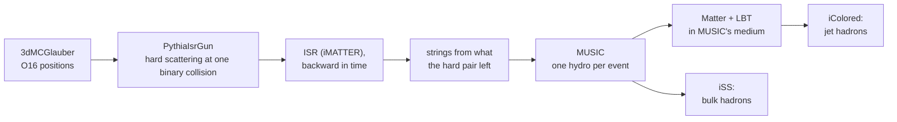

# O+O

This page is for the analysis of O+O collisions at 200 GeV with initial-state radiation, from
the `prod_OO_isr` production: what one event is, what its per-event record holds, how to load a
campaign, how to weight it (pT̂-window cross sections, N_coll), the checks to run, and recipes for
multiplicity, centrality, flow from the oversamples and jets. O+O differs from the Au+Au jet
production in ways that change the analysis: there is no background twin, every event is
hard-triggered, and the hadrons are usually made in the job. Running the production:
[O+O with ISR](../run/oo-isr.md).

## 1. What an O+O event is



What matters for an analysis:

- **One MUSIC run per event, no background leg.** The medium response to the jet is part of the
  bulk and cannot be separated from it: there is no jet − background.
- **Every event is hard-triggered:** exactly one hard scattering, at a binary collision drawn
  uniformly. The geometry is sampled as in minimum-bias collisions within the b range, but in
  nature the hard-process rate grows with N_coll: weight with N_coll for the geometry of hard
  events (§6).
- **The hard partons' momentum is taken from the strings** (the default): the bulk loses what the
  hard pair and its remnants carry. That biases a multiplicity-based centrality towards
  peripheral, more so at small N_part.
- **The jet hadrons are the whole hard nucleon pair:** the dijet showered by Matter + LBT, the
  ISR emissions, Pythia's MPI partons and the pair's beam remnants, hadronized together by
  iColored. Their pstat is mostly 1000 (the gun's mark, which the shower's daughters keep); that
  does not mean "unshowered".
- **Events without a medium:** when the hard collision is the only one, no string is made: no
  evolution, Matter showers in vacuum, the bulk unit is empty (`has_medium` 0). In 0–80 %
  (b < 5.6 fm) that is ~5 % of the events, mostly with N_coll = 1.
- **Centrality comes from b.** For O+O at 200 GeV with this Glauber setup, the b percentiles are
  10 % 1.91, 20 % 2.71, 40 % 3.84, 60 % 4.71, 80 % 5.59 fm; the production's default b < 3 fm is
  about 0–24 %.

## 2. The files

Each job writes, next to each other (stem `OO_isr_<campaign>_NNNN` or `OO_isr_seedNNNN`):

| file | holds | when | size per event |
|---|---|---|---|
| `<stem>_hadrons_jet_frag.h5` | the jet hadrons, one sample per event; `units/` with the whole event record (§3); `initiators/` | always (unless `--no-jet-hadrons`) | small |
| `<stem>_hadrons_bulk_bg.h5` | the bulk (iSS), N oversamples per event | `--bulk-hadrons N` in the job, or later `hadronize.py --tags bulk_bg` | ~13 kB per oversample |
| `<stem>_particlize.h5` | MUSIC's freeze-out surface (one unit per event), the final partons, the initiators | default; not with `--no-particlize` | ~10 MB |
| `<stem>.h5` | MUSIC's evolution (e, vx, vy, vz) on `grid_oo.yaml`, `diag/` | default; not with `--no-hydro-file` | ~17 MB |
| `<stem>.json`, `.xml`, `.log` | the job summary (cross sections, skipped events), the job XML, the log | always | |

The usual production setting is **hadron files only** (`--bulk-hadrons 10 --no-particlize
--no-hydro-file`), 0.13 MB per event; the bulk can then not be resampled later. Download a
campaign with `js_osdf.py download <campaign> --what h5` ([Data on the OSDF](../run/osdf.md)).

!!! warning "Unit i is event i, and `HadronFileReader` does not apply"
    Unit i of the jet file and unit i of the bulk file are the same event. Hadron files made in
    the job have no `source_uuid`, so `HadronFileReader` and `run_h5toROOT.py`, made for the
    Au+Au pairs, refuse them. Read them as in §5 (or with `Hadrons` / `HadronFile` /
    `HadronArray`), and convert them to ROOT as in §13.

## 3. The per-event record

`units/` of the jet file (and of an in-job bulk file), `diag/` of the hydro file and `events/` of
the particlize file carry the same columns:

| column | meaning |
|---|---|
| `unit`, `event` | the unit (row), the event's number in the job (skipped events leave gaps in `event`) |
| `pthat`, `pthat_bin` | the hard scattering's pT̂ and its window |
| `sigma_gen`, `sigma_err` | Pythia's running cross-section estimate at that event [mb]; use the per-window file attributes instead (§6) |
| `glauber_b`, `glauber_npart`, `glauber_ncoll`, `glauber_nstrings` | the geometry |
| `has_medium`, `hydro_row` | 1 if the event has a medium; its row in `<stem>.h5` (−1: none) |
| `isr_sub_{E,px,py,pz}_{proj,targ}`, `isr_sub_E_total` | what the ISR handed over for subtraction from the projectile (+z) and target (−z) nucleon |
| `remnant_E_{proj,targ}`, `remnant_pz_{proj,targ}` | the hard pair's remnants, which go to the jet hadronization |
| `strings_E_total`, `strings_pz_net` | what MUSIC's strings carry (NaN without a medium) |
| `parton_y_lead`, `parton_pt_lead`, `parton_y_sub`, `parton_pt_sub` | the two hardest partons of the hard process after the ISR |
| `tau0_music` | MUSIC's start time |
| `n_samples`, `seed`, `n_cells` | per file: the unit's samples, its seed, the surface cells (bulk file) |

Per event, exactly: `strings_E_total + isr_sub_E_total + remnant_E_proj + remnant_E_targ =
Npart √s_NN / 2`.

## 4. Settings to check before combining files

| setting | why | where |
|---|---|---|
| `subtract_hard_momentum` | 1 (default) or 0 (`--no-subtraction`, a reference that counts the hard pair's energy twice) | attribute of every file; `.json` |
| the b range, √s | e.g. `O+O 200 GeV, b in [0.0, 3.0] fm` | the `system` attribute |
| MUSIC's late time step | the freeze-out surface is 0.20 % larger and the bulk +0.05 % against a constant step: one setting per campaign | `<late_delta_tau>` in the job XML (`<stem>.xml`, or `prod_user_xml` of the hydro/particlize file) |
| energy loss | Matter + LBT (current default) or Matter alone (`--matter-only`, and older campaigns) | the `eloss` attribute (absent: Matter alone) |
| jet colour handling | the jet hadrons differ between campaigns with and without colour tags in the energy loss; `<colour_closure>` must be the same across a campaign | `units/colour_partons` present or not; the `jet_hadronization_xml` attribute |
| pT̂ windows, parton rapidity cut | the cross section per window | `pthat_bins`, `pthat_bin_sigma_gen`, `pthat_bin_acceptance`, `parton_ymax` |
| bulk oversamples, hadron selection | `--eta-max`, `--charged`, `--no-x`, `--keep-bits-*` | `n_samples`, `eta_max`, `charged_only`, `positions` |
| skipped events | a few per campaign in older builds | `events_skipped` in the attributes and the `.json` |

```python
# the settings of every job of a campaign
import glob, h5py, hdf5plugin
for p in sorted(glob.glob("/path/to/OO_c1/**/*_hadrons_jet_frag.h5", recursive=True)):
    with h5py.File(p, "r") as f:
        A = f.attrs
        windows = A["pthat_bins"].tolist() if "pthat_bins" in A else "none"
        print(p.rsplit("/", 1)[-1], "|", A["system"], "| subtraction", A["subtract_hard_momentum"],
              "| skipped", A.get("events_skipped"), "| windows", windows)
```

The late step is recorded only in the job XML, which hadron-only jobs keep next to the files:
`grep late_delta_tau OO_c1/*.xml`.

## 5. Reading a campaign

The hadron files are small, so a whole campaign fits in memory as flat arrays: one event table,
and one array per hadron quantity with the global event index and the sample of each hadron:

```python
import glob
import h5py, hdf5plugin, numpy as np
from jetscape.hadrons_h5 import CHARGED, pseudorapidity

def read(path):
    """units/ and the hadrons of one file; 'event' = the unit's position, 'sample' within it."""
    with h5py.File(path, "r") as f:
        units = {k: f["units"][k][:] for k in f["units"]}
        attrs = dict(f.attrs)
        so, uo = f["hadrons/sample_offsets"][:], f["hadrons/unit_offsets"][:]
        p, pid = f["hadrons/p"][:].astype(np.float64), f["hadrons/pid"][:]
    n_had = np.diff(so)
    unit_of_sample = np.repeat(np.arange(len(uo) - 1), np.diff(uo))
    h = {"event": np.repeat(unit_of_sample, n_had),
         "sample": np.repeat(np.arange(len(n_had)) - uo[:-1][unit_of_sample], n_had),
         "pid": pid, "E": p[:, 0], "px": p[:, 1], "py": p[:, 2], "pz": p[:, 3]}
    return units, attrs, h

def load(campaign):
    """Every finished job (its .json) of a campaign: one event table, bulk and jet hadrons."""
    stems = sorted(p[:-5] for p in glob.glob(f"{campaign}/**/*.json", recursive=True))
    ev, bulk, jet, n0 = [], [], [], 0
    for i, stem in enumerate(stems):
        u, attrs, hj = read(f"{stem}_hadrons_jet_frag.h5")      # the event record: always here
        ub, _, hb = read(f"{stem}_hadrons_bulk_bg.h5")          # in the job or hadronize.py
        assert len(ub["unit"]) == len(u["unit"])                # unit i = event i in both
        u["n_samples_jet"] = u.pop("n_samples")
        u["n_samples_bg"] = ub["n_samples"]                     # 0: no medium
        u["file"] = np.full(len(u["unit"]), i)
        for k in ("pthat_bin_sigma_gen", "pthat_bin_n_accepted"):   # per window, this file
            u[k] = np.tile(np.atleast_1d(attrs.get(k, np.nan)), (len(u["unit"]), 1))
        hj["event"] += n0
        hb["event"] += n0
        ev.append(u), jet.append(hj), bulk.append(hb)
        n0 += len(u["unit"])
    cat = lambda parts: {k: np.concatenate([x[k] for x in parts]) for k in parts[0]}
    ev, bulk, jet = cat(ev), cat(bulk), cat(jet)
    for h in (bulk, jet):
        h["pt"] = np.hypot(h["px"], h["py"])
        h["eta"] = pseudorapidity(np.stack([h["E"], h["px"], h["py"], h["pz"]], axis=1))
        h["phi"] = np.arctan2(h["py"], h["px"])
        h["charged"] = np.isin(np.abs(h["pid"]), CHARGED)
    return ev, bulk, jet

ev, bulk, jet = load("/path/to/OO_c1")
n_ev = len(ev["unit"])
```

On a test campaign (2,991 events, 10 bulk oversamples) this loads 5.5 M bulk and 0.35 M jet
hadrons in ~1 s. Only finished jobs (with a `.json`) are read, so it also works while a campaign
runs.

**The Pythonic alternative:** `jetscape.HadronArray.from_h5(path).to_awkward(by_unit=True)` gives
events × oversamples × hadrons as awkward arrays; the notebook `pythonic/oo_analysis.ipynb` does
an O+O analysis that way, streaming the files of a public test run from the OSDF
([The Pythonic interface](../python/pythonic.md)).

## 6. Weights and statistics

**Cross sections.** Each pT̂ window is its own Pythia; each file records per window
`pthat_bin_sigma_gen` [mb] (after the parton-rapidity cut) and `pthat_bin_n_accepted`. Combine
the files weighted by their accepted events:

```python
first = np.unique(ev["file"], return_index=True)[1]          # one row per file
sig, n_acc = ev["pthat_bin_sigma_gen"][first], ev["pthat_bin_n_accepted"][first]
sigma_k = (n_acc * sig).sum(0) / n_acc.sum(0)                 # mb per window
k = ev["pthat_bin"]
N_k = np.bincount(k, minlength=len(sigma_k))                  # events per window

w_hard = sigma_k[k] / N_k[k]             # sum over events = sigma of the hard process [mb]
SIGMA_NN = 42.0                          # mb, inelastic NN at 200 GeV
w_coll = ev["glauber_ncoll"] * sigma_k[k] / SIGMA_NN / N_k[k]   # per O+O collision in the b range
```

| weight | normalises to | use |
|---|---|---|
| none (per event, per window) | per hard event of that window | shapes and ratios within a window |
| `w_hard` | dσ/dX of the hard process [mb], summed over windows | spectra stitched over windows |
| `w_coll` | the yield per O+O collision in the b range, assuming the hard rate ∝ N_coll σ_k/σ_NN | comparisons with measured per-event yields; ratios to a p+p reference |
| `ev["glauber_ncoll"]` alone | the geometry of hard events | ⟨N_part⟩, multiplicities "for events with a jet" |

The N_coll weight matters because the events are hard-triggered with one hard scattering whatever
the geometry: unweighted, peripheral events are over-represented. In the 0–80 % test campaign it
moves the bulk's dN_ch/dη at \(|\eta| < 0.5\) from 28.3 (unweighted) to 36.7 (N_coll-weighted).

**Statistics.**

- **Events are independent:** there is no shared background. Different windows are independent
  samples.
- **The bulk oversamples of one event sample one fluid:** average each event over its samples
  (`n_samples_bg`), then over events, and take errors from the spread of the per-event values.
- **The jet hadrons are one sample per event.** Combining them with each bulk oversample makes N
  correlated copies of the event: weight each by 1/N.
- **`n_samples_bg` is 0 for events without a medium:** their bulk is empty, not missing. Keep them
  unless the analysis needs a medium.

## 7. Checks

```python
E_beam = ev["glauber_npart"] * 200.0 / 2                     # Npart sqrt(s_NN) / 2
E_sum = (ev["strings_E_total"] + ev["isr_sub_E_total"]
         + ev["remnant_E_proj"] + ev["remnant_E_targ"])
med = ev["has_medium"] == 1                                  # no medium: strings_E_total is NaN
print(np.max(np.abs(E_sum[med] - E_beam[med]) / E_beam[med]))   # test campaign: 3e-9
print("without a medium:", 1 - med.mean())                   # 4.9 % in 0-80 %
```

- **Skipped events:** `events_skipped` in every file's attributes and the `.json` (with the error).
- **The b range:** `glauber_b` must stay inside the `system` attribute's range.
- **Windows:** `np.bincount(ev["pthat_bin"])` should be about equal (event i uses window i mod K).

## 8. Multiplicity and spectra

Per event: the bulk's sample mean plus the event's jet hadrons:

```python
n_samp = ev["n_samples_bg"]
mid_b = bulk["charged"] & (np.abs(bulk["eta"]) < 0.5)
mid_j = jet["charged"] & (np.abs(jet["eta"]) < 0.5)
dn_bulk = np.bincount(bulk["event"][mid_b], minlength=n_ev) / np.maximum(n_samp, 1)
dn_jet = np.bincount(jet["event"][mid_j], minlength=n_ev)
dndeta = dn_bulk + dn_jet                                    # |eta| < 0.5: width 1
w = ev["glauber_ncoll"]
mean = np.average(dndeta, weights=w)                         # test campaign: 36.7
err = np.sqrt(np.sum(w**2 * (dndeta - mean)**2)) / w.sum()
```

A pT spectrum is the same with `np.histogram(..., weights=1/n_samp[event])` per hadron and the
event weights on top; `hard_sub_compare.ipynb` has a complete, weighted version with errors from
the per-event spread.

## 9. Centrality

An experiment classifies events by a multiplicity, not by b. `hard_sub_compare.ipynb` §2 shows
how: an estimator from charged hadrons at \(3.1 < |\eta| < 3.9\) (like RHIC's beam-beam counters),
from **one** bulk sample (one collision's fluctuations) plus the jet hadrons; class boundaries
from a reference without a hard scattering's effect; then each event classified by what an
experiment would count. The hard-momentum subtraction makes events with a hard scattering look
more peripheral, the more so at small N_part: compare classes defined this way, not by b, with
data.

## 10. Flow from the oversamples

Pairs of hadrons from **different** oversamples of one event correlate only through the fluid
(its flow and geometry): no resonance-decay or momentum-conservation pairs within one sample.
That gives v_n{2} of the events' own fluids, without that non-flow:

```python
def vn2(h, n, n_samples, mask):
    """v_n{2} from pairs of hadrons in different oversamples of the same event."""
    m = mask & (n_samples[h["event"]] >= 2)
    e, s, q = h["event"][m], h["sample"][m], np.exp(1j * n * h["phi"][m])
    key = e * 100000 + s                                     # (event, sample)
    uk, inv = np.unique(key, return_inverse=True)
    Qs = np.bincount(inv, weights=q.real) + 1j * np.bincount(inv, weights=q.imag)
    Ms = np.bincount(inv).astype(float)
    ev_of = uk // 100000
    Q = np.bincount(ev_of, weights=Qs.real) + 1j * np.bincount(ev_of, weights=Qs.imag)
    M = np.bincount(ev_of, weights=Ms)
    num = np.abs(Q)**2 - np.bincount(ev_of, weights=np.abs(Qs)**2)   # sum over a != b of Q_a Q_b*
    den = M**2 - np.bincount(ev_of, weights=Ms**2)                    # number of such pairs
    ok = den > 0
    return np.sqrt(num[ok].sum() / den[ok].sum())

sel = bulk["charged"] & (np.abs(bulk["eta"]) < 1) & (bulk["pt"] > 0.2) & (bulk["pt"] < 3)
v2 = vn2(bulk, 2, ev["n_samples_bg"], sel)       # test campaign (0-80 %, unweighted): 0.031
```

- The pairs are weighted by their number; for an N_coll-weighted average, weight `num` and `den`
  per event.
- Ten oversamples give ~45 sample pairs per event, enough for v₂; v₃ needs more oversamples.
- A pseudorapidity gap between the two hadrons (as in data) is a mask on each sample's Q.

## 11. Jets

The full event at hadron level is one bulk oversample plus the jet hadrons. Clustering bulk
sample 0 with them:

```python
import fastjet as fj
JET_DEF = fj.JetDefinition(fj.antikt_algorithm, 0.4)

def pseudojets(h, idx):        # massless, as on the FastJet page
    return [fj.PseudoJet(px, py, pz, np.hypot(pt, pz))
            for px, py, pz, pt in zip(h["px"][idx], h["py"][idx], h["pz"][idx], h["pt"][idx])]

acc_b = bulk["charged"] & (np.abs(bulk["eta"]) < 1.5) & (bulk["pt"] > 0.15) & (bulk["sample"] == 0)
acc_j = jet["charged"] & (np.abs(jet["eta"]) < 1.5) & (jet["pt"] > 0.15)
by_b = np.split(np.flatnonzero(acc_b), np.searchsorted(bulk["event"][acc_b], np.arange(1, n_ev)))
by_j = np.split(np.flatnonzero(acc_j), np.searchsorted(jet["event"][acc_j], np.arange(1, n_ev)))
lead_pt = np.zeros(n_ev)
for e in range(n_ev):
    parts = pseudojets(bulk, by_b[e]) + pseudojets(jet, by_j[e])
    jets = fj.sorted_by_pt(fj.SelectorAbsRapMax(1.1)(
        fj.ClusterSequence(parts, JET_DEF).inclusive_jets(5.0)))
    lead_pt[e] = jets[0].pt() if jets else 0.0
```

- **Background:** the O+O bulk is small; ρA subtraction works as in
  [Jets with FastJet](jets.md#3-the-classic-interface-with-a-subtraction) (areas with explicit
  ghosts, ρ from kT jets).
- **All oversamples:** cluster bulk sample k plus the jet hadrons for every k and weight each by
  1/N: the jet hadrons are the same in all of them.
- **Relative to the hard partons:** the initiators of event (file i, unit u) are in the jet file,
  `HadronFile(path).initiators(u)` → `(K, 11)`, columns `shower, pid, pstat, px, py, pz, E, x, y,
  z, t`; the two hardest partons after the ISR are also in `parton_{y,pt}_{lead,sub}`.
- **A p+p reference** with the same chain (ISR, Matter in vacuum, iColored) is not part of the
  production.

## 12. The hydro and particlize files

With the default outputs:

- **`<stem>.h5`:** `arr` `(nevents, 4, 64, 64, 32, ntau)` on `grid_oo.yaml` (x, y ±9.84 fm and
  η_s ±4.84 in steps of 0.3125), τ = 0.5 + k · 0.1 fm/c, `diag/` with the record of §3. Only
  events with a medium have a row: an event's row is its `hydro_row`. Read it as the Au+Au pair
  files ([Hydro and hadrons together](hydro-hadrons.md#2-reading-a-pair)), without `arr_bg`.
- **`<stem>_particlize.h5`:** `surface/bg` (one unit per event), the final partons and the
  initiators; `ParticlizeFile` reads it. It is the input for more bulk hadrons later, in the
  container or an X-SCAPE build:

```bash
contribs/PyJetscape/example/prod_AuAu_0_10_jet/run_hadronize.py /work/OO_c1 -j 8 --tags bulk_bg --oversample 100
```

`hadronize.py` refuses `jet_frag` on these files: the O+O jet hadrons are made in the job.

## 13. ROOT

`run_h5toROOT.py` and `HadronFileReader.h` expect the Au+Au layout (they stop on O+O with
`KeyError: 'seed'`). For O+O, convert each tag with the single-file converter and write the event
record next to it:

```python
import glob, subprocess, sys
import h5py, hdf5plugin, numpy as np, uproot

CONV = "contribs/PyJetscape/example/prod_AuAu_0_10_jet/root_export/hadrons_to_root.py"
for jf in sorted(glob.glob("/path/to/OO_c1/**/*_hadrons_jet_frag.h5", recursive=True)):
    stem = jf[: -len("_hadrons_jet_frag.h5")]
    for tag in ("bulk_bg", "jet_frag"):                     # one ntuple per tag, one entry per sample
        subprocess.run([sys.executable, CONV, f"{stem}_hadrons_{tag}.h5",
                        "-o", f"{stem}_{tag}.root", "--no-x"], check=True)
    with h5py.File(jf, "r") as f:                           # the event record (jet file)
        ev = {k: f["units"][k][:] for k in f["units"]}
        win = {k: np.atleast_1d(f.attrs[k]) for k in ("pthat_bin_sigma_gen", "pthat_bin_n_accepted")
               if k in f.attrs}
    with h5py.File(f"{stem}_hadrons_bulk_bg.h5", "r") as f:  # unit i = event i in both files
        ev["n_samples_bg"] = f["units/n_samples"][:]
    ev["n_samples_jet"] = ev.pop("n_samples")
    with uproot.recreate(f"{stem}_events.root") as out:
        out["events"] = {k: v.astype(np.float64 if v.dtype.kind == "f" else np.int64)
                         for k, v in ev.items()}
        if win:
            out["windows"] = {k: v.astype(np.float64) for k, v in win.items()}
```

It writes, per job, `<stem>_bulk_bg.root` and `<stem>_jet_frag.root` (one entry per sample:
`event`, `unit`, `sample`, `pid[n]`, `pstat[n]`, `E/px/py/pz[n]`) next to the inputs, and
`<stem>_events.root` (`events`, one entry per unit; `windows`). An RDataFrame macro for the
N_coll-weighted bulk dN_ch/dη on these files is
[`docs/analysis_snippets/oo_dndeta.C`](https://github.com/jhputschke/js-contrib/blob/main/docs/analysis_snippets/oo_dndeta.C):
`root -l -b -q 'oo_dndeta.C+("/path/OO_c1/OO_isr_c1_0001")'`. More on ROOT:
[ROOT and C++](root.md).

## 14. Notebooks

| notebook | what |
|---|---|
| [`prod_OO_isr/oo_isr_overview.ipynb`](https://github.com/jhputschke/js-contrib/blob/main/contribs/PyJetscape/example/prod_OO_isr/oo_isr_overview.ipynb) | one job: the medium at three τ with the freeze-out contour and the dijet; η, φ, pT and Δφ to the leading parton of bulk and jet hadrons (`OO_STEM`, `XSCAPE_BUILD` for the EoS) |
| [`prod_OO_isr/hard_sub_compare/hard_sub_compare.ipynb`](https://github.com/jhputschke/js-contrib/blob/main/contribs/PyJetscape/example/prod_OO_isr/hard_sub_compare/hard_sub_compare.ipynb) | two campaigns with and without the hard-momentum subtraction: the centrality bias, dN/dη, dE/dη and spectra of bulk and jet hadrons, energy against the parton pT; N_coll-weighted (`HSC_DIR`) |
| [`pythonic/oo_analysis.ipynb`](https://github.com/jhputschke/js-contrib/blob/main/contribs/PyJetscape/example/pythonic/oo_analysis.ipynb) | the O+O hadron files of a public test run, streamed from the OSDF: event record, awkward views, spectra, jets with FastJet (`OO_DIR` for local copies) |

The production itself, its options and physics notes:
[`prod_OO_isr/README.md`](https://github.com/jhputschke/js-contrib/blob/main/contribs/PyJetscape/example/prod_OO_isr/README.md);
the full analysis guide:
[`docs/README_OO.md`](https://github.com/jhputschke/js-contrib/blob/main/docs/README_OO.md).

## Next steps

- Run your own O+O events: [O+O with ISR](../run/oo-isr.md).
- Work with awkward arrays and `HadronArray`: [The Pythonic interface](../python/pythonic.md).
- All notebooks: [Notebooks](notebooks.md).
