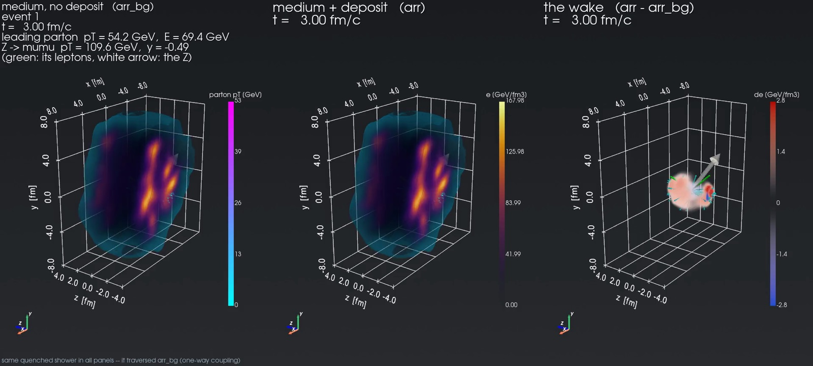
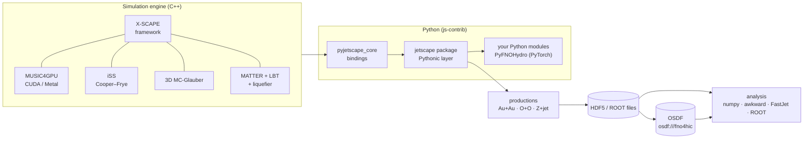

---
hide:
  - navigation
---

# js-contrib

**GPU-accelerated X-SCAPE heavy-ion simulations, driven from Python, with the data out in the open.**

js-contrib is the contrib package of the [JETSCAPE](https://github.com/JETSCAPE/JETSCAPE) /
[X-SCAPE](https://github.com/JETSCAPE/X-SCAPE) event generator, much like
[fastjet-contrib](https://fastjet.hepforge.org/contrib/) is for FastJet. It takes the full
multistage simulation (3+1D viscous hydrodynamics, MATTER + LBT jets with the medium
response, Cooper–Frye particlization and hadronization) and makes it fast enough, scriptable
enough and portable enough to produce large event samples. Those samples are used for physics
analyses and as training data for machine-learned surrogates.



*A Pb+Pb Z+jet event at 5.02 TeV, 3 fm/c after the collision: the medium without the jet's
deposit, with it, and the difference, the jet's wake. The Z (white arrow, its muons in green)
recoils against the parton shower. Drawn by `wake_pyvista.py` from the
[example on the OSDF](python/visualization.md#example-data-a-pbpb-zjet-event-on-the-osdf).*

<div class="grid cards" markdown>

-   :material-expansion-card-variant:{ .lg .middle } **GPU acceleration**

    ---

    MUSIC hydro runs on the GPU: CUDA on NVIDIA cards, Metal on Apple Silicon. Several jobs
    share one GPU, so a single workstation produces thousands of Au+Au events with jets per hour.

    [:octicons-arrow-right-24: GPU acceleration](about/gpu.md)

-   :material-language-python:{ .lg .middle } **Python and PyTorch**

    ---

    The whole framework is available in Python. You can run events, read results as numpy
    or awkward arrays, write your own modules in Python, and put a live PyTorch FNO in place
    of the hydro.

    [:octicons-arrow-right-24: Python and ML](about/python-ml.md)

-   :material-package-variant-closed:{ .lg .middle } **Runs anywhere**

    ---

    Choose a production container (Docker or Apptainer, NVIDIA GPUs), a native Mac wheel
    (Metal), a lightweight analysis environment, or a full source build in conda.

    [:octicons-arrow-right-24: Choose your setup](install/index.md)

-   :material-database-arrow-down:{ .lg .middle } **Open data on the OSDF**

    ---

    Productions are shared on the Open Science Data Federation and can be read without an
    account, either by downloading them or by opening them in place over `osdf://`.

    [:octicons-arrow-right-24: Data on the OSDF](run/osdf.md)

</div>

## From zero to an analysed event

=== "Linux + NVIDIA GPU (container)"

    ```bash
    docker pull jhputschke/xscape-prod:cu126
    mkdir -p work
    docker run --rm --gpus all --user "$(id -u):$(id -g)" -v "$PWD/work:/work" -w /work \
      jhputschke/xscape-prod:cu126 bash -c \
      'xscape-examples /work/examples && cd /work/examples/pythonic &&
       python oo_workflow.py --events 1 --outdir /work/out_oo'
    ```

    One O+O event goes through the whole chain, and its hadron files are written to
    `./work/out_oo/`. Other CUDA versions, Apptainer and Jupyter are covered in
    [Production container](install/container.md).

=== "Mac, Apple Silicon (wheel)"

    ```bash
    curl -LsSf https://astral.sh/uv/install.sh | sh        # once; then open a new Terminal
    VER=0.1.0                                              # latest: github.com/jhputschke/xscape-macos/releases
    mkdir -p ~/xscape && cd ~/xscape
    curl -LO https://github.com/jhputschke/xscape-macos/releases/download/v$VER/xscape-$VER-cp313.lock.txt
    uv venv --managed-python ~/.venvs/xscape-$VER --python 3.13
    source ~/.venvs/xscape-$VER/bin/activate
    uv pip sync xscape-$VER-cp313.lock.txt
    xscape-fetch-data lbt                                  # the LBT tables (240 MB download)
    xscape-examples ~/xscape/examples
    cd ~/xscape/examples/pythonic && python oo_workflow.py --events 1 --outdir ~/xscape/out_oo
    ```

    The same event runs on the Mac's GPU in under a minute. See
    [Mac (xscape wheel)](install/mac.md).

=== "Any computer (analysis only)"

    ```bash
    git clone https://github.com/jhputschke/js-contrib.git && cd js-contrib
    ./utils/analysis_env/setup_analysis_env.sh             # venv in ~/.venvs/js_analysis
    source ~/.venvs/js_analysis/bin/activate
    python utils/analysis_env/check_env.py /path/to/out    # opens every file of a production
    ```

    This gives you no GPU and no X-SCAPE build, only what you need to read and analyse the
    files, including files on the OSDF. See [Analysis environment](install/analysis-env.md).

From there, the site follows the order you work in:

1. **[Install](install/index.md):** choose one of the four setups.
2. **[Run](run/index.md):** start with [your first event](run/first-event.md), then run the
   productions: [Au+Au with jets](run/auau-jet.md), [O+O with initial-state radiation](run/oo-isr.md),
   [Z+jet in Pb+Pb](run/zjet-other.md), and [at scale on clusters](run/clusters.md).
3. **[Analyse](analysis/index.md):** [hadrons](analysis/hadrons.md),
   [jets with FastJet](analysis/jets.md), [hydro and hadrons together](analysis/hydro-hadrons.md)
   (the jet wake), [O+O](analysis/oo.md), and [ROOT](analysis/root.md).
4. **[Extend in Python](python/index.md):** the [Pythonic interface](python/pythonic.md),
   [your own modules](python/modules.md), and the [live PyTorch FNO hydro](python/fno.md).

## What is in the box



The physics behind each box is explained in [The physics](about/physics.md). If you use these
simulations in a publication, cite the papers listed in
[Publications and citing](about/references.md).

!!! info "Status"
    js-contrib follows the X-SCAPE `contrib` branch and MUSIC4GPU `XSCAPE`. The Mac wheel's
    first regular release is **v0.1.0**. The production container images are tagged by CUDA
    version (`cu126`, `cu130`, `cu124`). See [Contribs and repositories](reference/contribs.md)
    for the full list of components.
