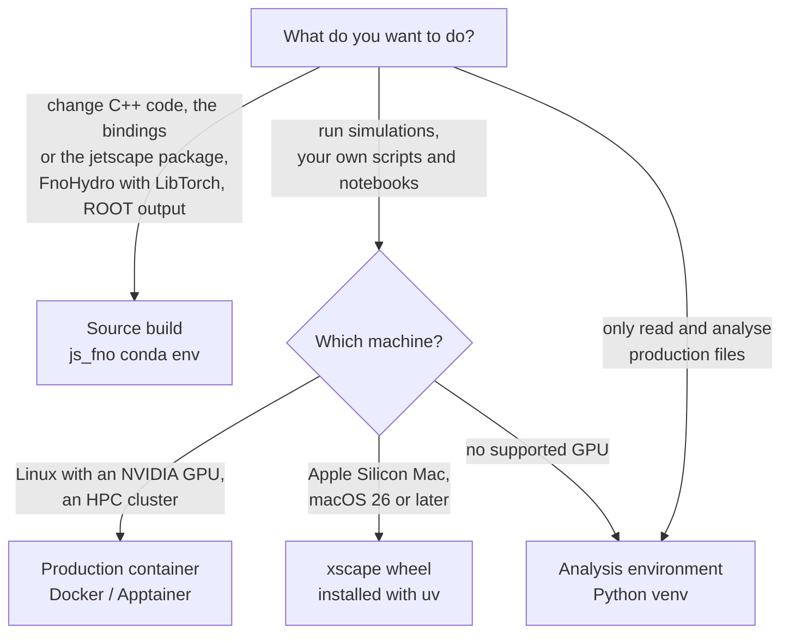

# Choose your setup

There are four ways to get js-contrib running. Two of them come ready-made, with X-SCAPE,
MUSIC4GPU, iSS, 3dMCGlauber and the Python bindings already compiled: the **production
container** for Linux machines with an NVIDIA GPU, and the **xscape wheel** for Apple Silicon
Macs. The third, the **analysis environment**, only reads and analyses the files a production
writes, on any computer. The fourth, the **source build**, is for changing the code itself.
Pick by your hardware and by what you want to do; you can have more than one side by side.

## Which one?

| | Production container | xscape wheel | Analysis environment | Source build |
|---|---|---|---|---|
| **runs on** | Linux with an NVIDIA GPU (Docker); HPC clusters (Apptainer); without a GPU for analysis and hadronization | Apple Silicon Mac (M1 or later), macOS 26 or later | any computer with Python 3.10 or later | Linux (x86_64, aarch64), Apple Silicon Mac |
| **hydro on** | the NVIDIA GPU (CUDA) | the Mac's GPU (Metal) | no simulation | CUDA, Metal, or MUSIC on the CPU |
| **you need** | Docker with the NVIDIA Container Toolkit, or Apptainer | uv (one command) | a js-contrib checkout, or one `pip install` | conda, compilers (the env brings them), CUDA toolkit or Xcode with its Metal toolchain |
| **productions** | yes | yes | no | yes |
| **your own scripts, notebooks, Python modules** | yes | yes | reading files only | yes |
| **analysis** (HDF5, uproot, FastJet, Jupyter) | yes | yes | yes | yes |
| **ROOT / PyROOT** | no (uproot reads ROOT files) | no (uproot reads ROOT files) | optional, next to it | yes |
| **change C++, bindings, `jetscape`** | no | no | no | yes |
| **FNO hydro with PyTorch** | no PyTorch in the image | no PyTorch in the environment | no | yes |
| **page** | [Production container](container.md) | [Mac (xscape wheel)](mac.md) | [Analysis environment](analysis-env.md) | [Source build](source.md) |

!!! tip "Precompiled still means extensible"
    The container and the wheel come compiled, so they need no compiler. You can still write
    your own physics modules in Python (a hard process, energy loss, hadronization, an
    afterburner, a writer) and run them inside X-SCAPE's event loop next to the C++ modules:
    see [Writing modules in Python](../python/modules.md). Only changes to the C++ code, the
    bindings or the `jetscape` package itself need the source build.

## The four setups in one paragraph each

**[Production container](container.md)** (`jhputschke/xscape-prod`). One image holds X-SCAPE
with MUSIC on the GPU, iSS, 3dMCGlauber, Matter, LBT, iColored and Pythia, PyJetscape and its
Pythonic layer, and the analysis packages with JupyterLab. It runs the productions, your own
scripts and notebooks, and the analysis. The same image runs on CPU-only nodes for the second
(hadronization) stage and for analysis. It can't use a Mac's GPU: Docker on macOS runs
containers in a Linux VM without Metal.

**[xscape wheel](mac.md)** (Apple Silicon). The same software as the container, installed
natively from a lock file with uv, with MUSIC on the Mac's GPU through Metal. There is no
compiler, Xcode, Homebrew, conda or Docker to install. It does not include ROOT or PyTorch,
and it can't rebuild X-SCAPE. Intel Macs are not supported.

**[Analysis environment](analysis-env.md)**. A plain Python venv with the HDF5 readers,
uproot, awkward, FastJet, the notebooks and pelicanfs for files on the OSDF. It needs no GPU,
no X-SCAPE build and no conda. It can't run X-SCAPE, so no productions and no
re-hadronization. ROOT can be added next to it from conda.

**[Source build](source.md)** (the `js_fno` conda environment). X-SCAPE (branch `contrib`) and
its external packages built from source, with js-contrib in the tree. This is the setup for
changing C++ (X-SCAPE modules, MUSIC4GPU, iSS, 3dMCGlauber), the PyJetscape bindings or the
`jetscape` package, for the C++ FNO hydro (FnoHydro, through LibTorch), the live PyTorch FNO
hydro, and ROOT output. On Linux with an NVIDIA GPU, the dev container
`jhputschke/xscape-fno4d-dev` provides the same build environment.

!!! note "Keep them apart"
    The wheel and a source build can share a Mac, and the container and a source build can
    share a Linux machine. Use them in separate terminals: a source build sets `PYTHONPATH`,
    `XSCAPE` or `JETSCAPE_BUILD`, and those variables point the ready-made setups at the wrong
    tree.

## Next steps

- Install one of the four setups: [container](container.md), [Mac](mac.md),
  [analysis environment](analysis-env.md), [source build](source.md).
- Then [run your first event](../run/first-event.md).
