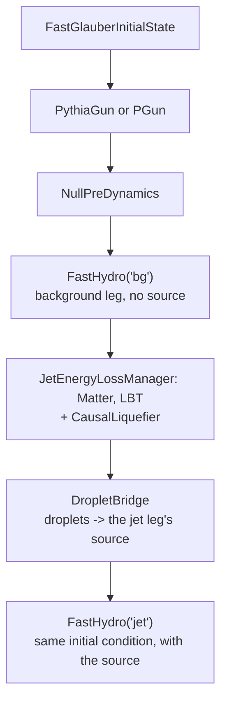

# FastHydro

FastHydro runs X-SCAPE's real jet energy-loss chain, **Matter + LBT → CausalLiquefier →
droplets**, on top of a fast 3+1D finite-volume hydro solver in Milne coordinates written in
PyTorch, with an MC-Glauber initial state. For each event it gives back a **pair**: the medium
without the jet and the medium with the jet's lost energy deposited, both from the identical
initial condition. That pair is what jet-deposition FNO studies and wake analyses need, and the
cost per event makes large samples practical on a CPU, a CUDA GPU or Apple's MPS. On the same
initial condition the solver agrees with MUSIC to about 0.3 % (relative L2 of the energy density
at freeze-out). For production-grade pairs with MUSIC itself, use the
[two-stage Au+Au production](../run/auau-jet.md); FastHydro writes the same file layout.

The solver and the initial state are FNO4d's `fast_data`, vendored unchanged under
`python/fast_data/`. FastHydro itself is the glue that makes them X-SCAPE modules.

## Requirements

- An X-SCAPE build (branch `contrib`) with PyJetscape: `-DUSE_JS_CONTRIB=ON -DUSE_JS_PYJETSCAPE=ON`
  ([source build](../install/source.md)). FastHydro is pure Python: it compiles nothing and needs
  no CMake option of its own.
- **The Python that `pyjetscape_core` was built with**, with numpy, scipy, h5py, hdf5plugin,
  pyyaml, and PyTorch ≥ 2.0 for the solver. The `js_fno` conda environment has all of them and
  installs FastHydro as an editable package. PyTorch is not in the production container.

```bash
pip install -e external_packages/js-contrib/contribs/FastHydro          # from the X-SCAPE root
# or without installing:
export PYTHONPATH=$PWD/external_packages/js-contrib/contribs/FastHydro/python:$PYTHONPATH
```

The example scripts find their own paths, so they also run from a checkout without the install.

## The pipeline



This is X-SCAPE's two-stage hydro (`config/jetscape_user_twostagehydro.xml`,
`examples/custom_examples/TwoStagesHydro.cc`) with FastHydro in place of MUSIC. Four things in
it are fixed:

- **NullPreDynamics is mandatory.** X-SCAPE requires a pre-equilibrium stage for every hydro
  except MUSIC and Brick. (The log then shows a harmless `Unrecognized hydro module id` warning.)
- **Matter before LBT.** Matter hands over to LBT at `Q0`; `<Eloss><mutex>ON</mutex>` arbitrates.
- **The background leg comes first.** X-SCAPE registers only the first `FluidDynamics` as *the*
  hydro, so Matter, LBT and the liquefier see the background and the jet leg is invisible to
  them. That is the two-stage semantics: the shower is quenched by the undisturbed medium, and
  its deposit goes into the second leg. The coupling is one-way.
- **The deposit is computed in Python.** FastHydro deposits the droplets with `fast_data`'s
  `CausalLiquefierSource`; the C++ `CausalLiquefier` is used only as the droplet container.
  There is no double counting.

## Configuration: an XML and a YAML

Two files, for two readers:

| file | read by | holds |
|---|---|---|
| `config/jetscape_user_fasthydro.xml` | X-SCAPE (C++) | `<IS>`, `<Preequilibrium>`, `<Hard>`, `<Eloss>`, `<Liquefier>` |
| `config/fasthydro_twostage.yaml`, top level | the solver (`fast_data`) | grid, EoS, transport, τ axis, deposit scheme, device, dtype |
| the same YAML, section `fasthydro:` | FastHydro's adapters | hard-scattering vertices, shower storage, `bulk_info` storage |

The solver settings cannot go into the XML: X-SCAPE stops on any user-XML tag that
`jetscape_main.xml` lacks. Three quantities appear in both files, and `build_two_stage()`
**refuses to run** if they disagree:

| quantity | XML | YAML | rule |
|---|---|---|---|
| grid | `<IS><grid_max_*>`, `<grid_step_*>` | `grid:` | must agree (`grid_max = n·d/2`) |
| hydro start | `<Preequilibrium><taus>` | `time.tau0` | must agree |
| energy-loss start | `<Eloss><tStart>` | | must not precede `time.tau0` |

The liquefier's deposit parameters (`tau_delay`, `time_relax`, `d_diff`, `width_delta`) live only
in `<Liquefier><CausalLiquefier>`; FastHydro reads them from the C++ object and records them in
the output. Any YAML key can be overridden on the command line with `--set`, routed by its
prefix: `--set time.choose_ntau=41` (solver), `--set fasthydro.hard_vertex.mode=centre`
(adapters), `--set transport.mode=israel_stewart`.

**Where the hard scatterings happen** is `fasthydro.hard_vertex.mode`: `ncoll` (default, the
smeared binary-collision density, what a hard process follows), `ncoll_mc`, `npart` or `centre`
(every vertex at the origin).

!!! warning "PGun ignores the vertex"
    X-SCAPE's `PGun` overwrites the sampled vertex with the origin, so with PGun every shower
    starts at (0, 0, 0) whatever `hard_vertex.mode` says. `PythiaGun` uses the vertex and is the
    default here.

## Running

Run from the X-SCAPE build directory; the framework resolves several paths relative to it.

```bash
cd $XSCAPE_BUILD
C=../external_packages/js-contrib/contribs/FastHydro
export OMP_WAIT_POLICY=passive OMP_NUM_THREADS=8    # idle OpenMP threads otherwise spin

# 0. smoke test: hydro only, then check the medium queries against the stored grid
python $C/example/run_hydro_only.py --config $C/config/fasthydro_twostage.yaml

# 1. the real thing: background leg, Matter + LBT, jet leg -> one HDF5 file
python $C/example/run_two_stage.py \
    --config   $C/config/fasthydro_twostage.yaml \
    --user-xml $C/config/jetscape_user_fasthydro.xml \
    --main-xml ../config/jetscape_main.xml \
    --events 1 --out out/pair.h5 --dump-droplets out/run.droplets.npz

# 2. replay the same shower through other solver settings: no X-SCAPE, no Matter/LBT
python $C/example/run_replay.py --droplets out/run.droplets.npz \
    --config $C/config/fasthydro_twostage.yaml \
    --set transport.mode=israel_stewart --out out/pair_visc.h5
```

- **Give `--out` an `.h5` name.** It writes the FNO4d HDF5 layout, one event at a time, so the
  memory is one pair however many events you ask for. An `.npz` name writes plain arrays of one
  pair, for a quick look only.
- **The replay** reads the droplet dump (small, numpy only) and runs both legs again, so it works
  on a machine without h5py or an X-SCAPE build. It answers "what does the same jet do in a
  different medium": the shower responds to the medium it crosses, so a live run on a viscous
  background gives a different jet, while a replay keeps the deposit fixed.
- `run.device` in the YAML (or `--set run.device=cuda`) picks `cpu`, `cuda` or `mps`; MPS runs in
  float32. CPU runs are slower and bitwise reproducible.

For the wake notebook, one command makes both legs (ideal and viscous, the second replayed from
the first's droplets), about a minute per leg on Apple MPS:

```bash
python $C/example/make_wake_data.py                      # -> out_wake/wake_{ideal,visc}.h5
python $C/example/make_wake_data.py --medium realistic   # dN_ch/deta about 650
```

It finds or downloads the EoS table it needs (`--no-download` refuses the network,
`--dry-run` prints what it would do).

## Soft particlization: hadrons from one leg

FastHydro has no surface code of its own: when iSS finds no surface, X-SCAPE builds one from the
stored evolution (Cornelius, in C++). **One run particlizes one leg**, chosen with
`<SoftParticlization><hydro_id>`; `run_particlize.py` sets it:

```bash
cd $XSCAPE_BUILD
C=../external_packages/js-contrib/contribs/FastHydro
python $C/example/run_particlize.py --leg jet --events 10 --out-dir out_particlize
python $C/example/run_particlize.py --leg bg  --events 10 --out-dir out_particlize --oversample 200
python $C/example/delta_spectra.py --out-dir out_particlize --npz out_particlize/delta.npz
```

An event's initial condition depends only on the seed and the event index, so event *k* of the
background run is the background of event *k* of the jet run; both record the initial condition's
hash, and `delta_spectra.py` refuses to pair events whose hashes differ. It prints every
(jet − background) difference with its compound-Poisson error: the wake's tens of GeV sit on
about 10⁴ GeV of bulk, so the background's sampling noise decides how many oversamples a signal
needs.

The driver refuses settings that cannot give a meaningful surface: frames zeroed after freeze-out
(`output.zero_after_freezeout` / `stop_at_freezeout` must be off), and an EoS whose hadron list
iSS does not decay. Use `eos.kind: hotqcd` (MUSIC EOS 9, the UrQMD list, decayed by iSS);
`hotqcd_smash` (EOS 91) needs SMASH as an afterburner.

Checked with Israel–Stewart (η/s = 0.08), 2 central events × 200 oversamples, mid-rapidity:

| | FastHydro + iSS | PHENIX 0–5 % |
|---|---|---|
| dN_ch/dη | 637 | ~650–690 |
| dN/dy π⁺, K⁺, p | 292, 56, 17.4 | ~286, ~49, ~18 |
| ⟨p_T⟩ π⁺, K⁺, p [GeV] | 0.51, 0.74, 1.03 | ~0.45, ~0.67, ~0.95 |

⟨p_T⟩ is about 10 % harder than data: there is no δf and no hadronic cascade. The surface
conserves entropy (98 % of the hydro's total at τ₀ on an ideal run).

## Comparison with MUSIC, and the 0–10 % tune

`notebooks/bulk_vs_music.ipynb` compares FastHydro's hadrons with 3D MC-Glauber + MUSIC + iSS,
0–10 % Au+Au (`example/make_bulk_comparison_data.py` makes its inputs). On 25 events per model:

- **The initial state alone is close.** Against MUSIC with FastHydro's transport and no δf,
  FastHydro's multiplicity is 9 % lower, ⟨p_T⟩ 3–4 % softer for every species, and the dN/dη shape
  agrees to 1 % in width.
- **Transport matters more.** MUSIC's calibrated bulk viscosity and δf add 23 % multiplicity and
  lower ⟨p_T⟩ by 7–13 %.
- **The tune.** τ₀ = 0.5 fm/c, `target_T` = 0.418, η/s = 0.08, ζ/s = 0.12, b ∈ [0, 4.7] fm
  matches calibrated MUSIC in dN_ch/dη at mid-rapidity (−1 %) and in π and K ⟨p_T⟩ (+1.5 %,
  −0.6 %). Protons stay about 7 % soft and dN/dη 7–9 % wide at |η| ≈ 3.

The tune comes as two configuration pairs on the same medium:

| pair | for |
|---|---|
| `config/AuAu_FastHydro_tune_0_10_particles.{yaml,xml}` | spectra: iSS on one leg, every frame kept |
| `config/AuAu_FastHydro_tune_0_10_wake.{yaml,xml}` | jet-wake pairs (`arr`, `arr_bg`, `source/`), parton level |

```bash
python $C/example/run_particlize.py --leg bg --events 25 --oversample 100 --set run.device=cuda \
    --config $C/config/AuAu_FastHydro_tune_0_10_particles.yaml \
    --user-xml $C/config/AuAu_FastHydro_tune_0_10_particles.xml
python $C/example/make_wake_data.py --medium tune_0_10 --legs visc --device cuda
python $C/example/make_hadron_wake_data.py --medium tune_0_10 --device cuda
```

On this medium use only the viscous leg for wake runs: the "ideal" leg drops the tuned shear and
bulk viscosity.

## Output format

The file is FNO4d's HDF5 layout, written with `fast_data`'s own writer, so every FNO4d reader
loads it:

```text
arr               (N, 4, nx, ny, neta, ntau) f4   the JET leg   [e, vx, vy, vz]
arr_bg            (N, 4, nx, ny, neta, ntau) f4   the background leg
source/S          (N, 4, nx, ny, neta, ntau) f4   what was injected (contravariant Milne)
source/droplets   (M, 8) f8                       tau, x, y, eta, E, px, py, pz
source/offsets    (N+1,) i8                       per-event slices into droplets
shower/partons, shower/vertices, shower/initiators, and their offsets
ntau_freezeout[_bg], tau_freezeout[_bg]           per leg
diag/                                             per-event scalars: n_droplets, ic_sha256, ...
```

- `e` is in GeV/fm³, `vx, vy, vz` are Cartesian lab velocities; attributes record the full
  resolved configuration as JSON.
- **`arr` is the jet leg**, following `fast_data`'s convention: `arr` together with `source/S` is
  what a deposition FNO consumes. `arr_bg` is the same initial condition without the jet.
- **`arr` is not `arr_bg + S`.** The fluid keeps responding after the last droplet has fired, and
  the response spreads far beyond the cells the source touched. That propagating difference, the
  wake, is the physics.
- **The shower** costs about 9 kB per event against 5.5 MB for the hydro pair, and is stored by
  default (`fasthydro.store_showers: false` turns it off). Shower positions are Cartesian
  `(x, y, z, t)` and live on the partons; X-SCAPE's vertices carry only a time.

Read a pair with `PairBrowser`:

```python
from fasthydro.browse import PairBrowser

p = PairBrowser("out_wake/wake_ideal.h5")
p.summary()                          # IC identical, first differing frame, deposit, freeze-out
p.diff(0, k)                         # e(jet) - e(background), event 0, frame k
p.source_at(0, tau)                  # where the jet was, from the droplet table
par, ver, ini = p.showers(0)         # the shower graph of event 0
start, tip, alive = p.shower_at(0, 3.0)   # the shower as it stands at t = 3 fm/c
```

`PairBrowser` also opens the MUSIC pair files of the [Au+Au jet production](../run/auau-jet.md),
which use this layout. Two diagnostics are worth reading after every run: the energy of droplets
that would deposit after the end of the τ window (often 20 % or more with a short window; fix with
a longer `time.choose_ntau` or a smaller `tau_delay`), and the count of medium queries outside the
grid (a grid too small silently removes quenching).

## Notebooks

| notebook | |
|---|---|
| `notebooks/jet_wake.ipynb` | the wake in the medium: Mach cone, damping, broadening, Mach angle (inputs: `make_wake_data.py`) |
| `notebooks/hadron_wake.ipynb` | the wake in the hadrons: Δφ and (Δη, Δφ) maps with significance, the near-side excess, the momentum balance (inputs: `make_hadron_wake_data.py`) |
| `notebooks/bulk_vs_music.ipynb` | bulk observables against 3D MC-Glauber + MUSIC, 0–10 % (inputs: `make_bulk_comparison_data.py`) |

## Limitations

- **Soft hadrons only, ideal Cooper–Frye.** The viscous stresses are stored as zero, so iSS
  applies no δf (exact for ideal runs, an approximation for viscous ones). The jet's surviving
  partons are not hadronized.
- **No hadronic afterburner** in the default build; iSS decays the resonances itself.
- **The η edges are open**: analyse at mid-rapidity.
- **The surface lattice is coarser than the hydro grid** (twice the spacing in the shipped XML)
  to keep the surface finder affordable.
- **Bulk viscosity is untested upstream**, and the non-conformal viscous sector has no analytic
  benchmark.

## Tests

```bash
pytest tests -q
FAST_DATA_FULL_SELFTEST=1 pytest tests/test_fast_data_selftests.py   # the solver's physics gates
```

Tests that need `pyjetscape_core` skip cleanly without a build. Among them: zero droplets give a
jet leg equal to the background bit for bit, four-momentum is conserved to 1e-10, and the Python
deposit kernel matches the real C++ one.

The full documentation, with every measurement and design decision:
[`contribs/FastHydro/README.md`](https://github.com/jhputschke/js-contrib/blob/main/contribs/FastHydro/README.md).

## Next steps

- [Live PyTorch FNO hydro](fno.md): run a trained model as the hydro.
- [3D visualization](visualization.md): `wake_pyvista.py` draws a FastHydro pair (background,
  jet leg, difference) with the shower.
- [Au+Au jets (two stages)](../run/auau-jet.md): the same pairs from MUSIC on GPUs.
