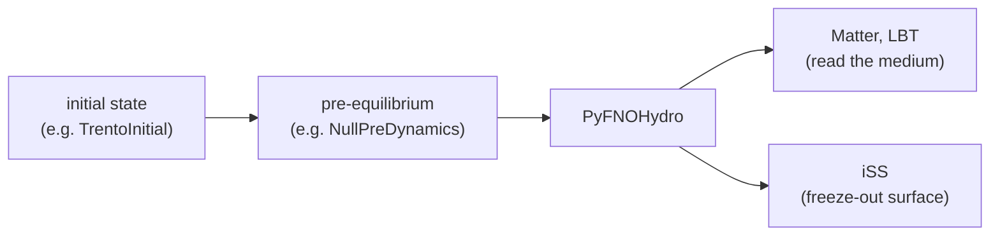

# Live PyTorch FNO hydro

`PyFNOHydro` is a hydro module written in Python and backed by a PyTorch Fourier neural operator
(FNO). It takes the initial condition from the pre-equilibrium stage, predicts the whole
space-time evolution of the medium in one forward pass, stores it in X-SCAPE's evolution history
and builds the freeze-out surface, so Matter, LBT and iSS run on the prediction exactly as they
would on MUSIC. Use it to test a surrogate model against the full event: jet quenching and
hadron observables on the predicted medium, side by side with MUSIC. Because the model can be a
live `torch.nn.Module`, you can do this in the same Python session in which you train it, with no
export step. The method and the 2+1D models are described in
[Phys. Rev. C 113 (2026) 014904](https://doi.org/10.48550/arXiv.2507.23598)
(arXiv:2507.23598).

## How it works



Inside `EvolveHydro()`, `PyFNOHydro`:

1. takes the pre-equilibrium energy density and flow (`e`, `ux`, `uy`) and rebins them
   (nearest neighbour) onto the FNO grid: 3 features `(e, vx, vy)` or 4 `(e, T, vx, vy)`;
2. repeats that frame `ntau` times along the time axis and, for a 3-feature model, multiplies
   the energy density by τ₀ (the models are trained on e·τ);
3. calls the model on a tensor of shape `(1, n_features, nx, ny, ntau)`, under
   `torch.no_grad()`; the model must return the same shape;
4. prepends the τ₀ frame, divides by τ again, and stores the `ntau + 1` frames as a
   boost-invariant evolution starting at τ₀ (the pre-equilibrium module's end time);
5. finds the freeze-out surface at the configured temperature.

## Three ways to give it a model

```python
import torch                                   # always before jetscape
from jetscape.fno_hydro import PyFNOHydro

# 1. a JIT-traced TorchScript file (the format the C++ FnoHydro reads)
hydro = PyFNOHydro("models/traced.pt", config)

# 2. your model class plus a checkpoint (state_dict, or a dict with "model_state_dict")
from my_model import FNOModel
net = FNOModel(modes=12, width=20)
hydro = PyFNOHydro((net, "checkpoints/epoch50.pt"), config)

# 3. a live model object, used as it is: no serialisation
hydro = PyFNOHydro(net, config)
```

### The live model (approach 3)

Approach 3 is what makes the module useful while you develop a model. `PyFNOHydro` keeps a
reference to *your* `nn.Module`, not a copy, so a model you have just trained, or are still
training, runs inside a full X-SCAPE event:

```python
import torch                                   # (1) before jetscape
import torch.nn as nn
from jetscape import create_module
from jetscape.fno_hydro import PyFNOHydro, fno_config_from_xml
from jetscape.run_jetscape import run_manual
from jetscape.utils import bulk_info_to_numpy

net = ...                                      # your nn.Module, e.g. the FNO you are training:
                                               # (1, F, nx, ny, ntau) -> (1, F, nx, ny, ntau)

user_xml = "jetscape_user_fno.xml"             # a user XML with a <Hydro><FNO> block
config = fno_config_from_xml(user_xml, device="mps")      # "cpu", "cuda" or "mps"
hydro = PyFNOHydro(net, config)                # (2) sets net.eval()

modules = [create_module("TrentoInitial"), create_module("NullPreDynamics"), hydro]
run_manual("jetscape_main.xml", user_xml, modules, n_events=1)

evo = bulk_info_to_numpy(hydro.get_bulk_info(), n_features=4)  # (ntau+1, nx, ny, [e, T, vx, vy])
surface = hydro.get_surface_cells()                             # what iSS samples
```

Run it from the X-SCAPE build directory (or inside a [`js.JobDir`](pythonic.md#running-events)):
TrentoInitial and the other C++ modules read their tables from there. `run_manual` takes a
pipeline built in Python; the user XML must set
`<enableAutomaticTaskListDetermination>false</enableAutomaticTaskListDetermination>`. FnoHydro's
[`config/jetscape_user_root_bulk_test.xml`](https://github.com/jhputschke/js-contrib/blob/main/contribs/FnoHydro/config/jetscape_user_root_bulk_test.xml)
is such a file, with a Trento initial state and a `<Hydro><FNO>` block. For jet
energy loss and hadronization on the predicted medium, add the managers by hand as on
[Writing modules in Python](modules.md#a-worked-example-an-energy-loss-module), with
`create_module("Matter")` and `create_module("ColorlessHadronization")` inside them, or use
`js.per_event(..., tasks=[...])` to read each event's results.

!!! warning "Pitfalls of the live model"
    - **Import `torch` before `jetscape`.** PyTorch and the compiled extension each load an
      OpenMP runtime, and the one initialised second can crash the process. On macOS
      `import jetscape` imports torch first if it is installed; on Linux torch is otherwise only
      loaded when `PyFNOHydro` is constructed, after the extension. Put `import torch` at the top.
    - **`PyFNOHydro` calls `net.eval()`** when it is constructed. If you continue training the
      same object, call `net.train()` for the training steps and `net.eval()` again before the
      next event.
    - **The grid must be the model's.** `nx`, `ny`, `ntau`, `x_min`, `y_min`, `dtau` and
      `n_features` must match what the model was trained on; nothing checks this for you.
      `dx = -2 x_min / nx`.
    - **The model runs on `config["device"]`**, and `PyFNOHydro` moves your model there
      (`net.to(device)` moves the object itself, not a copy).
    - **A pre-equilibrium module is required** before `PyFNOHydro` (`NullPreDynamics` will do); τ₀
      is its end time, not a config key.
    - **The evolution is 2+1D, boost-invariant.** Higher-dimensional models need their own
      module (see [FastHydro](fasthydro.md) for a 3+1D Python hydro).
    - The log line `Unrecognized hydro module id:PyFNOHydro` is a harmless warning.
    - One forward pass per event runs with the GIL held; the heavy work is inside torch.

## The grid configuration

The `config` dict gives the FNO grid:

```python
config = dict(
    nx=60, ny=60, ntau=59,          # required
    n_features=3,                   # required: 3 or 4
    x_min=-15.0, y_min=-15.0,       # required [fm]
    dtau=0.1,                       # required [fm/c]
    T_freeze=0.136,                 # required: freeze-out temperature [GeV]
    neta=1, deta=0.0,               # optional
    tau_normalise=True,             # optional: the model predicts e*tau (default for 3 features)
    device="cpu",                   # optional: "cpu", "cuda", "mps"
)
```

Instead of a dict, keep the grid in the user XML, next to the run: `fno_config_from_xml(user_xml,
device=...)` parses the `<Hydro><FNO>` block before the run, and `config=None` lets
`PyFNOHydro` read the same block from the loaded XML in `InitializeHydro()`, as the C++ module
does:

```xml
<Hydro>
  <FNO>
    <model_file>models/traced_JS3.7_10k_3feat_fno_model_cpu_40_60_59bins.pt</model_file>
    <n_features>3</n_features>
    <freezeout_temperature>0.136</freezeout_temperature>
    <nx>60</nx>
    <ny>60</ny>
    <neta>1</neta>
    <ntau>59</ntau>
    <x_min>-15.0</x_min>
    <y_min>-15.0</y_min>
    <dtau>0.1</dtau>
    <deta>0</deta>
  </FNO>
</Hydro>
```

X-SCAPE's `config/jetscape_main.xml` (branch `contrib`) has the defaults of this block, so a user
XML may carry it. `PyFNOHydro` takes the model from its constructor, not from `<model_file>`.

## Try it: `python_fno_test.py`

[`example/python_fno_test.py`](https://github.com/jhputschke/js-contrib/blob/main/contribs/PyJetscape/example/python_fno_test.py)
runs TrentoInitial → NullPreDynamics → `PyFNOHydro` with a traced model, prints the stored grid,
the evolution as numpy and torch tensors and the number of surface cells, and saves
`python_fno_test_bulk.png` (energy-density slices). Put the model file into
`contribs/FnoHydro/models/` or pass `--model`:

```bash
cd X-SCAPE/build_gpu
python ../external_packages/js-contrib/contribs/PyJetscape/example/python_fno_test.py \
  --model ../external_packages/js-contrib/contribs/FnoHydro/models/traced_JS3.7_10k_3feat_fno_model_cpu_40_60_59bins.pt \
  --events 1 --device cpu
```

`--config-source dict|python-xml|jetscape-xml` picks one of the three configuration routes above,
`--user` another user XML (default: FnoHydro's `config/jetscape_user_root_bulk_test.xml`),
`--no-plots` skips matplotlib.

PyTorch is not part of the [container](../install/container.md) or the
[Mac wheel](../install/mac.md) environment; install it there, or use the `js_fno` conda
environment of a [source build](../install/source.md), which has it.

## Utilities: the evolution as arrays and tensors

`jetscape.utils` converts between X-SCAPE's evolution history and numpy / torch:

```python
from jetscape.utils import (bulk_info_to_numpy, bulk_info_to_tensor,
                            numpy_to_bulk_info, tensor_to_bulk_info, rebin_preeq_to_fno_grid)

info = hydro.get_bulk_info()                               # EvolutionHistory, any hydro module
arr = bulk_info_to_numpy(info, n_features=4)               # (ntau, nx, ny, 4): e, T, vx, vy; float32
t = bulk_info_to_tensor(info, n_features=4, device="cpu")  # (1, 4, nx, ny, ntau), the FNO layout

tensor_to_bulk_info(t, hydro)                              # back into a FluidDynamics module
fno_input = rebin_preeq_to_fno_grid(preeq, ini, nx_fno, ny_fno, x_min_fno, y_min_fno,
                                    dx_fno, dy_fno, n_features=3)   # (3, nx, ny, 1)
```

`bulk_info_to_numpy` reads the transverse slice (2+1D). For a 3+1D evolution, e.g. from MUSIC,
`info.to_numpy_full(n_features)` returns `(ntau, nx, ny, neta, n_features)` with the columns
`e, T, vx, vy, vz, s`. The production writers store MUSIC's evolution directly in the HDF5 layout
the FNO training reads ([below](#training-data-from-the-productions)).

## The C++ FnoHydro (LibTorch)

For runs without Python in the loop, the
[FnoHydro contrib](https://github.com/jhputschke/js-contrib/tree/main/contribs/FnoHydro) is the
same idea in C++: a `FluidDynamics` module registered as `FnoHydro` that loads a traced
TorchScript model with LibTorch and runs it on the pre-equilibrium output. It reads the model file
and the grid from the same `<Hydro><FNO>` block (`<model_file>`, `nx`, `ny`, `ntau`, ...), so a
traced model and its XML work in both; the freeze-out temperature it takes from
`<Hydro><MUSIC><freezeout_temperature>`.
It needs LibTorch (about 2 GB) and ROOT at build time:

```bash
cmake .. -DUSE_MUSIC=ON -DUSE_ISS=ON -DUSE_JS_CONTRIB=ON -DUSE_JS_FNO_HYDRO=ON \
  -DCMAKE_PREFIX_PATH="$(python -c 'import torch; print(torch.utils.cmake_prefix_path)')"
make -j FnoModule
```

It is not built in the container or the Mac wheel. The contrib also holds `FnoRooIn` (replays a
stored evolution from ROOT) and the ROOT bulk writers of the original training pipeline; see its
[README](https://github.com/jhputschke/js-contrib/blob/main/contribs/FnoHydro/README.md).

## Where the models come from

The trained models are not in js-contrib (too large for git):

- **The JETSCAPE-FNO repository**,
  [github.com/JETSCAPE/JETSCAPE-FNO](https://github.com/JETSCAPE/JETSCAPE-FNO), branch
  `PythonTest`, folder `fno_hydro/models`: traced TorchScript models such as
  `traced_JS3.7_10k_3feat_fno_model_cpu_40_60_59bins.pt` (3 features, 60 × 60, 59 time steps), the
  default of `python_fno_test.py`. The repository also has the training notebooks.
- **Zenodo**, [record 16647726](https://zenodo.org/records/16647726): the training data (ROOT
  format) and several pre-trained models of the paper.
- **The OSDF** (in the future): trained models and training data will be shared on the OSDF next
  to the production outputs; see [Data on the OSDF](../run/osdf.md).

## Training data from the productions

A model is only as good as its training set, and js-contrib's productions write it directly in the
HDF5 layout of the FNO4d training code (`/arr` of shape
`(nevents, 4, nx, ny, neta, ntau)` with `e, vx, vy, vz`, plus the grid as attributes), with no
ROOT step in between:

- **Hydro only:** `prod_AuAu_0_10` writes one MUSIC evolution per event (`H5BulkWriter`).
- **Jet + medium pairs:** `prod_AuAu_0_10_jet` runs the two-stage hydro: MUSIC_1 evolves the
  background, Matter + LBT lose energy in it, and MUSIC_2 evolves the **same** initial condition
  with the lost energy deposited. Each event is written as a pair: `arr` (with the jet),
  `arr_bg` (without), the droplets that were deposited (`source/droplets`) and the parton shower
  (`shower/`). `arr - arr_bg` is the jet's effect alone, the target of a deposition model. How to
  run it, also on clusters: [Au+Au jets (two stages)](../run/auau-jet.md).
- **FastHydro** writes the same pair layout with a fast PyTorch solver, for large samples:
  [FastHydro](fasthydro.md).

## Next steps

- [Writing modules in Python](modules.md): the module interface `PyFNOHydro` is built on.
- [FastHydro](fasthydro.md): a 3+1D hydro solver in PyTorch with the jet-deposition workflow.
- [Au+Au jets (two stages)](../run/auau-jet.md): the GPU production of training pairs.
