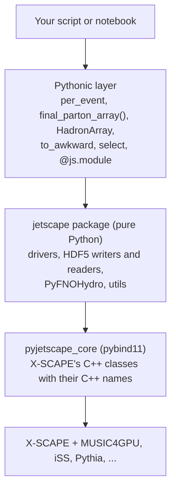

# Python

js-contrib's Python interface, PyJetscape, lets you run X-SCAPE events from Python, read what
every module produced as numpy arrays while the event is still in memory, and put modules of your
own, written in Python, into the chain. Use it when the productions' command-line scripts are not
enough: for a study of your own, for a notebook, for machine learning, or to try a new physics
module without touching C++. Why this matters for ML is on
[Python and machine learning](../about/python-ml.md).

## The three layers



- **`pyjetscape_core`** is the compiled extension: pybind11 bindings of X-SCAPE's classes
  (`JetScape`, `JetScapePerEvent`, `Parton`, `FourVector`, `PartonShower`, the module base
  classes, MUSIC, iSS access, ...) with their C++ names and argument order, so C++ code ports
  line by line. Every module base class has a *trampoline*: a Python subclass runs as a real
  JETSCAPE module.
- **The `jetscape` package** is pure Python around it: event-loop drivers
  (`jetscape.run_jetscape`), the HDF5 writers and readers of the productions, `PyFNOHydro`,
  conversion helpers (`jetscape.utils`), and `jetscape.paths` / `JobDir`, which find the X-SCAPE
  tree and give each run a working directory. The HDF5 readers work without the compiled
  extension; `jetscape.HAS_CORE` says whether it is there.
- **The Pythonic layer** is installed onto the bound classes by `import jetscape`: numpy record
  arrays instead of column indices, hadrons as one array per field, awkward views with `vector`
  kinematics, an event loop that is a context manager, and modules that declare their XML
  parameters. It only adds names, so code written against the bare bindings keeps working.

In code, `import jetscape as js` gives the package and the Pythonic layer; the bound classes
themselves are in `jetscape.pyjetscape_core`:

```python
import jetscape as js                         # package + Pythonic layer
from jetscape import pyjetscape_core as core  # the bound C++ classes: core.JetEnergyLoss, core.FourVector, ...
```

!!! warning "PyTorch: import it first"
    `torch` and the compiled extension each bring an OpenMP runtime; the one loaded second can
    crash the process. When you use PyTorch, `import torch` **before** `import jetscape`. On
    macOS `import jetscape` does this for you if PyTorch is installed.

## Where you get it

=== "Container"

    The production image `jhputschke/xscape-prod` has `pyjetscape_core` and the `jetscape`
    package on `PYTHONPATH`, plus the analysis packages (awkward, vector, FastJet, Jupyter).
    PyTorch is not included. Copy the examples out of the read-only image once:

    ```bash
    mkdir -p work
    docker run --rm --user "$(id -u):$(id -g)" -v "$PWD/work:/work" jhputschke/xscape-prod:cu126 \
      xscape-examples /work/examples
    ```

    Details: [Production container](../install/container.md).

=== "Mac (xscape wheel)"

    The `xscape` wheel (X-SCAPE with MUSIC4GPU for Metal, and the compiled `pyjetscape_core`)
    and the `pyjetscape` wheel (the `jetscape` package) install into one Python environment;
    `import jetscape` finds the compiled core there. PyTorch is not included. Copy the examples
    with

    ```bash
    xscape-examples ~/xscape/examples
    ```

    Details: [Mac (xscape wheel)](../install/mac.md).

=== "Source build"

    Build X-SCAPE (branch `contrib`) with js-contrib and the bindings. `-DUSE_MUSIC=ON` and
    `-DUSE_3DGlauber=ON` are required (the bindings use MUSIC's wrapper, iColoredHadronization
    and iMATTER):

    ```bash
    cmake .. -DUSE_MUSIC=ON -DUSE_ISS=ON -DUSE_3DGlauber=ON \
             -DUSE_JS_CONTRIB=ON -DUSE_JS_PYJETSCAPE=ON
    make -j pyjetscape_core
    pip install -e ../external_packages/js-contrib/contribs/PyJetscape   # or "...PyJetscape[fno,root]"
    python -c "import jetscape; print(jetscape.HAS_CORE)"               # True
    ```

    The extension must be built for the Python you run it with. Details:
    [Source build (conda)](../install/source.md).

With only the [analysis environment](../install/analysis-env.md) (no X-SCAPE build) you can read
and analyse every production file, but not run events.

## A first event from Python

This runs one O+O event through the whole chain (3D MC-Glauber, Pythia with initial-state
radiation, MUSIC, Matter + LBT, hadronization) with the user XML of the Pythonic example,
`pythonic/oo_workflow.xml` in the copied examples, and prints what the jet left behind:

```python
import numpy as np
import jetscape as js

with js.JobDir("out_first", "oo_workflow.xml") as job:          # a private working directory
    with js.per_event(job.main_xml, job.user_xml, n_events=1) as driver:
        for i in driver.events():                                # results are in memory here
            partons = driver.energy_loss_manager.final_parton_array()   # numpy records
            jet = driver.hadronization_manager.hadron_array()          # HadronArray
            print(f"event {i}: {len(partons)} final partons,",
                  f"leading parton pT {np.hypot(partons['px'], partons['py']).max():.1f} GeV,",
                  f"{len(jet)} jet hadrons")
```

On an M3 Max (Metal) this takes about 16 s and prints a line like
`event 0: 17 final partons, leading parton pT 9.2 GeV, 116 jet hadrons`.

- `js.JobDir(out_dir, user_xml)` copies the XML to `out_dir/`, points its relative paths at the
  X-SCAPE build, and runs inside `out_dir/work/<name>`, because MUSIC, 3dMCGlauber and iSS read
  and write files in the current directory. Write your own outputs to absolute paths.
- `js.per_event(...)` as a context manager runs `Init()` on entry and `Finish()` on exit;
  `driver.events()` yields once per event, after the event ran and before its memory is freed.

A longer version that writes the hadrons to files is `pythonic/oo_workflow.py`
(`python oo_workflow.py --events 3 --seed 7 --outdir out_oo`).

## Three ways to drive a run

| | how | modules come from | event loop |
|---|---|---|---|
| A, from the XML | `jetscape.run_jetscape.run_automatic(main_xml, user_xml)` | the XML (C++ factory, plus registered Python modules) | C++ |
| B, by hand | `run_manual(main_xml, user_xml, modules=[...])` | a Python list; the user XML sets `<enableAutomaticTaskListDetermination>false` | C++ |
| C, per event | `js.per_event(main_xml, user_xml, tasks=None)` | the XML, or `tasks=[...]` as in B | Python |

Mode C is the one to use for analysis and for anything that reads results: only there is each
event's data still in memory when your code runs.

## Pages in this section

- [The Pythonic interface](pythonic.md): running events, the result arrays, hadrons, awkward,
  FastJet, showers.
- [Writing modules in Python](modules.md): your own hard process, energy loss, hadronization,
  afterburner or writer, with a worked example.
- [Live PyTorch FNO hydro](fno.md): a PyTorch Fourier neural operator as the hydro module.
- [FastHydro](fasthydro.md): MC-Glauber and a 3+1D hydro solver in PyTorch, with jet-deposition
  pairs.
- [3D visualization](visualization.md): the medium and the parton shower in PyVista.

The full reference of the bindings and the package is
[`contribs/PyJetscape/README.md`](https://github.com/jhputschke/js-contrib/blob/main/contribs/PyJetscape/README.md);
all examples are listed in
[`contribs/PyJetscape/example/README.md`](https://github.com/jhputschke/js-contrib/blob/main/contribs/PyJetscape/example/README.md).
