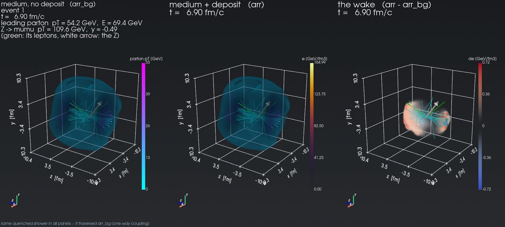

# 3D visualization

The `contribs/Visualization` scripts render an event's medium in 3D with
[PyVista](https://pyvista.org): the hydro evolution resampled from Milne coordinates
\((\tau, x, y, \eta_s)\) into the Cartesian lab frame \((t, x, y, z)\), so the fireball expands
along the beam as it does in the lab, with the jet's parton shower, the jet wake, and the hadrons
after freeze-out drawn in the same frame. Use them for talks and movies, and to check by eye that
a run does what you think (where the jet went, where it deposited, what the surface looks like).
The output is a GIF or MP4 movie, a ParaView time series, or an interactive window.

| script | draws | needs |
|---|---|---|
| `hydro_pyvista.py` | the medium of a live MUSIC event, or of a saved dump | a build (live), or a dump |
| `hydro_jet_pyvista.py` | the medium plus the jet's parton shower as growing arrows | a build (live), or a dump + an ASCII output file |
| `wake_pyvista.py` | three panels: medium without the deposit, with it, and the difference | a pair file (FastHydro or the Au+Au jet production) |
| `hydro_jet_particles_pyvista.py` | one production event from the hard scattering to the free-streaming hadrons | a pair file and its hadron files |

## Requirements

!!! important "On a Mac: use the analysis environment, not the xscape wheel"
    The [Mac wheel](../install/mac.md) has neither PyVista nor these scripts. To render stored
    files (a pair file, the [example on the OSDF](#example-data-a-pbpb-zjet-event-on-the-osdf))
    on a Mac, clone js-contrib and create the [analysis environment](../install/analysis-env.md).
    Its 3D visualization stack (PyVista, VTK, imageio-ffmpeg) is installed by default; only
    `--no-viz` leaves it out:

    ```bash
    git clone https://github.com/jhputschke/js-contrib.git
    cd js-contrib
    utils/analysis_env/setup_analysis_env.sh --python /opt/homebrew/bin/python3   # -> ~/.venvs/js_analysis
    source ~/.venvs/js_analysis/bin/activate
    cd contribs/Visualization          # the scripts run from here
    ```

    macOS's own `python3` is 3.9, and the script needs 3.10 or later: pass a newer one with
    `--python`, as above with Homebrew's (with uv instead:
    `--uv --python "$(uv python find 3.13)"`, not tested). Tested on an M3 Max on 2026-10-29:
    the setup took 2.5 minutes, `check_env.py` reported off-screen rendering working, and both
    scripts rendered the OSDF example to `.mp4`. Live runs (`hydro_pyvista.py`,
    `hydro_jet_pyvista.py` without `--load`) need a [source build](../install/source.md); they
    have not been tried with the wheel.

- **For stored files** (`wake_pyvista.py`, `hydro_jet_particles_pyvista.py`) no X-SCAPE build is
  needed: the [analysis environment](../install/analysis-env.md) has PyVista, VTK, imageio and
  MUSIC's EoS table (`requirements_viz.txt`, skipped with `--no-viz`). The container image has a
  `-viz` variant with PyVista ([Production container](../install/container.md)).
- **For live runs** (`hydro_pyvista.py`, `hydro_jet_pyvista.py` without `--load`) you need a
  build with `pyjetscape_core` for the same Python; the `js_fno` conda environment of a
  [source build](../install/source.md) has the PyVista stack. Live runs execute in the X-SCAPE
  build directory (default `<X-SCAPE>/build_gpu`, `--workdir` to change it); the script changes
  there itself.
- **3+1D events** need the `EvolutionHistory.to_numpy_full(n_features)` binding, which returns
  the whole rapidity grid, `(ntau, nx, ny, neta, nf)` with the columns `e, T, vx, vy, vz, s`. It is
  in current `pyjetscape_core`; after pulling an older tree, rebuild it
  (`cmake --build build_gpu --target pyjetscape_core`).
- `.mp4` needs `imageio-ffmpeg`; without it the scripts fall back to `.gif`. Rendering is
  off-screen, so headless machines work (else run under `xvfb-run`).

## Example data: a Pb+Pb Z+jet event on the OSDF

To try the scripts without running a production first, the OSDF holds a ready-made example in
**`osdf:///fno4hic/LHC/zjet_viz/`** ([Data on the OSDF](../run/osdf.md)): the full hydro
evolution of two Pb+Pb Z+jet events, with and without the jet's deposit, their hadrons, and the
movies made from them. The pair file is also input for the
[wake observables](../analysis/hydro-hadrons.md) and for anything else you want to do with a
3+1D MUSIC evolution.



*Event 1 at t = 6.9 fm/c, drawn by `wake_pyvista.py`: the Z (white arrow, its muons in green)
recoils against the parton shower; the right panel is the wake, Δe = e(with deposit) − e(without).*

| file | size | content | needed by |
|---|---|---|---|
| `AuAu_0_10_jet_seed0201.h5` | 0.93 GB | the pair file: both MUSIC legs (the medium without and with the jet's deposit) frame by frame on the 3+1D grid, with the showers and the Z | `wake_pyvista.py`, `hydro_jet_particles_pyvista.py` |
| `AuAu_0_10_jet_seed0201.json`, `.xml` | 10 kB | the run's settings and its X-SCAPE XML | |
| `…_hadrons_bulk_bg.h5`, `…_hadrons_bulk_jet.h5`, `…_hadrons_jet_frag.h5` | 13 MB | the hadrons: iSS on each leg's freeze-out surface, and the jet's fragmentation | `hydro_jet_particles_pyvista.py` |
| `…_particlize.h5` | 0.77 GB | the freeze-out surfaces, to run iSS again with `hadronize.py` | not needed for the movies |
| `zjet_wake_event1.mp4`, `zjet_particles_event1.mp4`, and a `_frame.png` of each | 3.6 MB | the two movies of event 1 | |

**The events:** Pb+Pb at √s<sub>NN</sub> = 5.02 TeV, 0–30 %, made like the
[Z+jet production](../run/zjet-other.md) (`PbPb_0_30_ZJet.xml`, the Pb+Pb grid) but with the
pair and particlize files written: a Z → μμ trigger (|y<sub>Z</sub>| < 1, muon
p<sub>T</sub> > 20 GeV, |η| < 2.5), PythiaGun p̂<sub>T</sub> 80–120 GeV, Matter + LBT, the
CausalLiquefier into MUSIC_2, EOS 91. In event 1 (the second; events count from 0) a Z of
p<sub>T</sub> 109.6 GeV at y = −0.49 recoils against a leading parton of 54.2 GeV. The file name
keeps the jet production's stem, `AuAu_0_10_jet_seed…`, although the system is Pb+Pb.

**Download and render.** `js_osdf.py` needs no environment of its own; the scripts run in the
[analysis environment](../install/analysis-env.md) (on a Mac too: [see above](#requirements)):

```bash
cd js-contrib/utils/remote_transfer
./js_osdf.py download 'LHC/zjet_viz/*.mp4' --to ~/zjet_viz        # only the movies (2.3 MB)
./js_osdf.py download LHC/zjet_viz --what pair --to ~             # the pair file -> ~/zjet_viz/ (0.93 GB)
./js_osdf.py download 'LHC/zjet_viz/*_hadrons_*' --to ~/zjet_viz  # its hadron files (13 MB)

cd ../../contribs/Visualization
# the jet wake: medium without the deposit, with it, and the difference
python wake_pyvista.py --file ~/zjet_viz/AuAu_0_10_jet_seed0201.h5 --event 1 \
    --nt 48 --z-oversample 3 --movie zjet_wake.mp4
# the whole event, from the hard scattering to the free-streaming hadrons
python hydro_jet_particles_pyvista.py --file ~/zjet_viz/AuAu_0_10_jet_seed0201.h5 --event 1 \
    --nt 60 --z-oversample 3 --movie zjet_particles.mp4
```

- **`--event 0`** draws the other event. Keep `--nt` small (4–8) while you try camera angles and
  colour scales: a 4-frame test of either script takes about 10 s on an M3 Max.
- **The EoS table.** This event, like the current productions, uses EOS 91, whose table is
  `hrg_hotqcd_eos_SMASH_binary.dat`. The analysis environment has it (a venv made before
  2026-10-29 has only EOS 9's: re-run `setup_analysis_env.sh`). Elsewhere pass `--eos-table`
  with the file or its directory: `EOS/hotQCD/` of a source build, or of the Mac wheel
  (`site-packages/xscape/share/xscape/EOS/hotQCD/`, which holds only EOS 91's). Without it the
  scripts warn and take the temperature from a conformal EoS, so the freeze-out isosurface is
  only indicative.
- The two scripts are described below: [the jet wake](#the-jet-wake-wake_pyvistapy) and
  [hadrons after freeze-out](#hadrons-after-freeze-out-hydro_jet_particles_pyvistapy).

## From Milne to the lab frame

For each lab time \(t\) the script sweeps \(z\) and maps back to Milne, as X-SCAPE's
`EvolutionHistory::get_tz()` does:

\[
\tau = \sqrt{t^2 - z^2}, \qquad \eta_s = \tfrac12 \ln\frac{t+z}{t-z}, \qquad
\text{fields} = \text{bulk}(\tau, x, y, \eta_s).
\]

Cells outside the light cone or outside the stored \(\tau\) range are empty. A frame at
\(t = \tau_\text{min}\) is therefore a thin sheet at \(z = 0\), and a frame after the last stored
\(\tau\) a hollow, receding shell. The data kind is detected from the evolution:

- **3+1D** (`neta > 1`, e.g. the bundled `config/OO_one_event.xml`): interpolation in 4D
  \((\tau, x, y, \eta_s)\) on the full grid from `to_numpy_full`, with the stored lab-frame
  velocity.
- **2+1D, boost-invariant**: interpolation in 3D \((\tau, x, y)\), and the longitudinal flow is
  synthesised (\(v_z = z/t\)).

The render grid is independent of the hydro grid (`--nxy`, `--nz`, default 96³): higher is
smoother and slower; the physics does not change. The resampling is the dominant cost and runs
in parallel over frames (`--jobs`).

!!! tip "Flicker at early times"
    The medium starts at \(\tau_\text{min}\), a thin, very hot surface that sweeps through the
    \(z\) grid. If \(z\) is under-resolved its peak flickers from frame to frame. Use a high
    `--nz` (≳ 256) or `--z-oversample 3` (extra samples uniform in \(\tau\), about 3–5× the
    resampling cost); the script warns when neither is set.

## The medium: `hydro_pyvista.py`

```bash
cd external_packages/js-contrib/contribs/Visualization

# live: one event with the bundled O+O config, a movie and a ParaView time series
python hydro_pyvista.py --events 1 --movie evt.gif --vtk-dir vti

# iterate on the picture without re-running MUSIC: dump the Milne array once, re-render from it
python hydro_pyvista.py --events 1 --save-milne /tmp/milne.npz
python hydro_pyvista.py --load /tmp/milne.npz --movie /tmp/hydro.gif --field both

# an interactive window with a lab-time slider
python hydro_pyvista.py --load /tmp/milne.npz --interactive
```

Main options: `--field {e,T,both}`, `--freeze-temp 0.155` (an isosurface, repeatable),
`--velocity` (flow arrows), `--nxy`/`--nz`/`--nt` (render resolution and frame count),
`--t-min`/`--t-max`/`--z-max`/`--xy-max` (the box), `--azimuth`/`--elevation` (camera; the beam
runs left to right), `--main`/`--user`/`--workdir` (the run), `--manual` (a pipeline built in
Python). The speed of a movie is `--framerate` (frames per second, default 6) or
`--frame-duration` (seconds per frame); `--vtk-dir DIR` writes `.vti` + `.pvd` for ParaView. The
3+1D array can be large; `--save-milne` compresses it well (a 643 MB grid to about 37 MB).

## The parton shower: `hydro_jet_pyvista.py`

```bash
# live: MUSIC + jets with the bundled config/OO_one_event_jet.xml
python hydro_jet_pyvista.py --events 1 --movie evt_jet.gif

# from a dump, with the shower from the ASCII writer's output
python hydro_jet_pyvista.py --load hydro.npz --jet-ascii test_out.dat --movie evt_jet.gif
```

The medium is drawn exactly as by `hydro_pyvista.py`; the partons are arrows in the same
\((t, x, y, z)\) frame, colour-coded by pT and accumulating over lab time, so the shower tree
builds up. The animation starts at \(t = 0\): the jets evolve in vacuum first, and the medium
appears at \(\tau_0\). Live, the shower is read from the event at the per-event yield point
(`JetEnergyLossManager.get_showers()`, then `PartonShower.to_numpy()` per shower), not parsed from
a file. Options: `--jet-radius` (arrow width in fm), `--jet-cmap`, `--jet-color`,
`--jet-min-energy`, `--jet-ascii`, plus everything `hydro_pyvista.py` accepts.

## The jet wake: `wake_pyvista.py`

```text
┌────────────────────┬────────────────────┬────────────────────┐
│ medium, no deposit │  medium + deposit  │      the wake      │
│ arr_bg             │  arr               │   arr - arr_bg     │
│ + shower           │  + the SAME shower │  + the SAME shower │
└────────────────────┴────────────────────┴────────────────────┘
```

```bash
# a FastHydro pair (FastHydro's make_wake_data.py writes one)
python wake_pyvista.py --file out_wake/wake_ideal.h5 --nt 48 --nz 160 --z-oversample 3 \
    --movie wake_ideal.mp4

# a MUSIC pair from the Au+Au jet production
python wake_pyvista.py --file <out>/AuAu_0_10_jet_seed0001.h5 --nt 48 --movie wake_music.mp4
```

Nothing is run: the pair file holds both legs on one initial condition and the shower.

- **The left panel is not "no jet".** There is one shower, drawn in all three panels; the left
  panel leaves out only the medium's response to the energy the shower lost. The shower was
  quenched by that undisturbed medium (the background leg is the one Matter and LBT see).
- **The difference is absolute**, \(\Delta e\) in GeV/fm³, on a colour scale set at the 99.9th
  percentile (`--diff-clim` overrides it), because a single early spike where the first droplets
  land would otherwise hide the wake. The first two panels share one colour scale on purpose: the
  deposit is small against the fireball's peak.
- **A relative panel** \(\Delta e / e\) is opt-in: `--panels bg,jet,diff,reldiff`, with cells
  below `--rel-floor` (default 0.1) times each frame's peak drawn as zero.
- **Only frames where both legs are live are shown**: the jet leg freezes out later, and past the
  background's freeze-out the difference would be the whole jet leg.
- **The temperature** comes from the EoS: FastHydro files carry their table; for MUSIC files it is
  read from MUSIC's `EOS/hotQCD` under the production's build, or `--eos-table` /
  `$MUSIC_EOS_TABLE`. Without a table a conformal EoS is used, with a warning.
- **Z+jet pairs**: the Z's decay leptons are drawn as straight green tracks with an arrow along
  the Z (`--no-z`, `--z-color`, `--z-arrow`).

Options: `--panels`, `--event`, `--diff-cmap`, `--diff-clim`, `--diff-pct`, `--no-jet`, plus
everything `hydro_jet_pyvista.py` accepts. Each panel is resampled separately, so keep `--nt`
small while iterating.

## Hadrons after freeze-out: `hydro_jet_particles_pyvista.py`

One event of an [Au+Au jet production](../run/auau-jet.md), from the hard scattering to the
free-streaming hadrons: the jet leg's medium (with the deposit), the shower, then the hadrons.

```bash
python hydro_jet_particles_pyvista.py --file <out>/AuAu_0_10_jet_seed0001.h5 \
    --nt 60 --z-oversample 3 --movie jet_particles.mp4
```

It reads the pair file and, next to it, the hadron files that `hadronize.py` writes:
`<stem>_hadrons_bulk_jet.h5` (iSS on the jet leg's surface, small pale points) and
`<stem>_hadrons_jet_frag.h5` (the jet's fragmentation, large points coloured by pT).

- **One oversample is drawn**, picked at random; the run prints which
  (`--sample K --frag-sample J` reproduces it, `--rng-seed` fixes the choice).
- **Bulk hadrons** appear where iSS put them (the freeze-out cell, or a resonance's decay point)
  and then fly in straight lines. Many appear after the last frame, at large \(|z|\);
  `--hadron-eta-max` restricts the picture to mid-rapidity.
- **Jet hadrons have no position** (Pythia's string fragmentation writes none). They start from
  the hard vertex at `--frag-time` (default: the shower's last vertex). `--formation-tau0 TAU0`
  gives each its own formation time instead, \(t = \max(\text{frag-time},
  t_\text{vertex} + \tau_0 E/m)\), so soft fragments appear first.
- The beam view can foreshorten a dijet pointing at the camera: turn it with `--azimuth -55`.

More options: `--stream-time`, `--hadron-pt-min`, `--parton-off`, `--no-bulk`, `--no-frag`,
`--no-jet`, `--hadron-stem`, `--bulk-color`, `--bulk-size`, `--bulk-opacity`, `--frag-size`,
`--eos-table`.

The full documentation, with the reasoning behind every visual choice:
[`contribs/Visualization/README.md`](https://github.com/jhputschke/js-contrib/blob/main/contribs/Visualization/README.md).

## Next steps

- [FastHydro](fasthydro.md): make a pair file for `wake_pyvista.py` in minutes.
- [Au+Au jets (two stages)](../run/auau-jet.md): MUSIC pairs and their hadron files.
- [Hydro and hadrons together](../analysis/hydro-hadrons.md): the same files, analysed.
