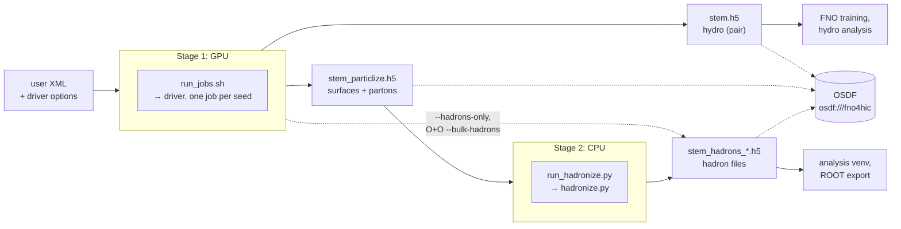

# Running the productions

A *production* is a set of ready-made scripts that run one physics setup of X-SCAPE many
times and write the results as HDF5 files for analysis and for training the ML hydro
surrogates. This section shows how to run them: a first event, the two-stage Au+Au jet
production, O+O with initial-state radiation, Z+jet and other collision systems, and how to
scale up to clusters with many GPUs and share the outputs on the OSDF. You need one of the
two ready-made setups, the [production container](../install/container.md) (Linux with an
NVIDIA GPU, or an HPC cluster) or the [xscape wheel](../install/mac.md) (Apple Silicon Mac),
or a [source build](../install/source.md).

## The productions

All productions live in
[`contribs/PyJetscape/example/`](https://github.com/jhputschke/js-contrib/tree/main/contribs/PyJetscape/example),
each in a folder with a driver script, a user XML in `example/config/`, and a `run_jobs.sh`
for campaigns. In the container they are under
`/opt/X-SCAPE/external_packages/js-contrib/contribs/PyJetscape/example`; on a Mac
`xscape-examples` copies them into a directory of yours.

| production | physics | writes | page |
|---|---|---|---|
| `prod_AuAu_0_10` | 0–10 % Au+Au at 200 GeV: 3D MC-Glauber strings, MUSIC on the GPU, no jet | hydro evolutions on a chosen output grid, in the FNO4d training format (`run_prod.py`) | [below](#hydro-only-prod_auau_0_10) |
| `prod_AuAu_0_10_jet` | the same medium with a jet: PythiaGun, Matter + LBT, the causal liquefier feeding the energy lost back into a second MUSIC run | a background/jet **pair** of hydro evolutions per event, the freeze-out surfaces and final partons, and (in stage 2) the hadron files | [Au+Au jets](auau-jet.md) |
| `prod_OO_isr` | O+O at 200 GeV with initial-state radiation (PythiaIsrGun + iMATTER), one MUSIC run per event, Matter + LBT, iColored jet hadronization | the hydro evolution, the jet hadrons, the bulk hadrons (in the job or later) | [O+O with ISR](oo-isr.md) |
| Z+jet (`utils/zjet/`) | Pb+Pb at 5.02 TeV, 0–30 %, with a Z → ee/μμ trigger, through the jet production's driver | hadron files with the Z and its leptons recorded per event | [Z+jet and other systems](zjet-other.md) |
| your own system | e.g. Pb+Pb at the LHC: a copy of the jet XML with the collision changed | as `prod_AuAu_0_10_jet` | [Z+jet and other systems](zjet-other.md#another-collision-system-pbpb-at-the-lhc) |

The Pythonic example
[`pythonic/oo_workflow.py`](https://github.com/jhputschke/js-contrib/blob/main/contribs/PyJetscape/example/pythonic/oo_workflow.py)
runs the O+O chain in about 140 lines of Python and is the quickest way to see the whole
chain work: [Your first event](first-event.md).

## The general shape

Every production works the same way.

- **A driver and a user XML.** The driver (`run_prod_jet.py`, `run_prod_oo_isr.py`,
  `run_prod.py`) runs *one job*: one seed, N events, one set of output files. The physics is
  in the user XML; the driver takes it (or yours, with `--user-xml`), fills in the job (events,
  seed, the hard process and its pT̂ windows, what to store), checks it, and writes the XML it
  ran next to the output (`<stem>.xml`) and into the files.
- **`run_jobs.sh` for campaigns.** It runs many jobs, `-j P` at a time on one GPU, each in its
  own working directory, and is resumable: run the same command again and finished jobs are
  skipped.

  ```text
  ./run_jobs.sh [-j P] [--mps] [--stagger S] [--campaign NAME] NJOBS EVENTS_PER_JOB FIRST_SEED [OUTDIR] [driver options]
  ```

- **Seeds.** `FIRST_SEED 0` gives every job a new seed drawn from OS entropy and checked
  against the seed registry `seeds_used.tsv` next to OUTDIR, so two campaigns never share a
  collision. `FIRST_SEED > 0` gives exactly those seeds, for reproducing a file or comparing
  settings on the same events. The seed that ran is stored in every file, and `--seed <it>`
  reproduces the file bit for bit.
- **Stages.** The expensive part, hydro and jets, runs on a GPU. Hadronization, which needs
  only the stored freeze-out surfaces and final partons, runs later on CPUs, as often as
  wanted. Productions with little oversampling can make the hadrons in the GPU job instead
  and skip the second stage.



**Why two stages.** Hydro needs a GPU; sampling hadrons from a freeze-out surface (iSS) and
fragmenting partons (Pythia) does not, and it is cheap per sample. Storing the surfaces, with
their full viscous information, lets you choose the number of oversamples, the hadron
selection and the precision after the expensive part is done, on any CPU nodes, without
rerunning the hydro. The result is the same as hadronizing in the job, checked bit for bit.

## Hydro only (`prod_AuAu_0_10`)

The simplest production writes 0–10 % Au+Au hydro evolutions (no jet) straight to FNO4d
training HDF5 on an output grid chosen in a YAML file (default
`example/config/grid_fno.yaml`). It is the training-data production for the FNO surrogates
and uses the same `run_jobs.sh` as the others:

```bash
cd prod_AuAu_0_10                                # in your copy of the examples
python run_prod.py --events 10 --seed 1          # -> out/AuAu_0_10_seed0001.h5
python run_prod.py --events 1 --seed 1 --grid my_grid.yaml --dry-run   # check a grid
./run_jobs.sh --campaign mb_a 20 25 0            # 20 jobs x 25 events, unique seeds
```

Each job writes `<stem>.h5` (the evolutions), `.xml`, `.json` and, through `run_jobs.sh`,
`.log`. Full options: the folder's
[README](https://github.com/jhputschke/js-contrib/blob/main/contribs/PyJetscape/example/prod_AuAu_0_10/README.md).
What the files hold: [What a production writes](../analysis/files.md).

## What a job writes

| file | written by | content |
|---|---|---|
| `<stem>.h5` | stage 1 | the hydro evolution (Au+Au jet: the background and jet-leg pair) on the output grid |
| `<stem>_particlize.h5` | stage 1 (`--write-particlize`; O+O by default) | the freeze-out surfaces, the final partons and the shower initiators: the input to hadronization |
| `<stem>_hadrons_{bulk_jet,bulk_bg,jet_frag}.h5` | stage 2, or the job itself | the hadrons: iSS on the jet-leg surface (bulk + wake), on the background, and the fragmented jet partons |
| `<stem>.xml`, `.json`, `.log` | stage 1 | the job XML as run, a summary (seed, events, cross sections, checks), the log |

The stem is `AuAu_0_10_jet_seedNNNN` for an explicit seed and
`AuAu_0_10_jet_<campaign>_NNNN` (job number) in a `FIRST_SEED 0` campaign; O+O files start
with `OO_isr_`. The formats are described in [What a production writes](../analysis/files.md).

## Next steps

- [Your first event](first-event.md): one O+O event through the whole chain, then two Au+Au
  jet events.
- [Au+Au jets (two stages)](auau-jet.md): the main production, from the first job to a
  campaign.
- [Clusters, GPUs and monitoring](clusters.md): SLURM, several GPUs, `jobmon.py`.
- [Data on the OSDF](osdf.md): download existing productions or share yours.
